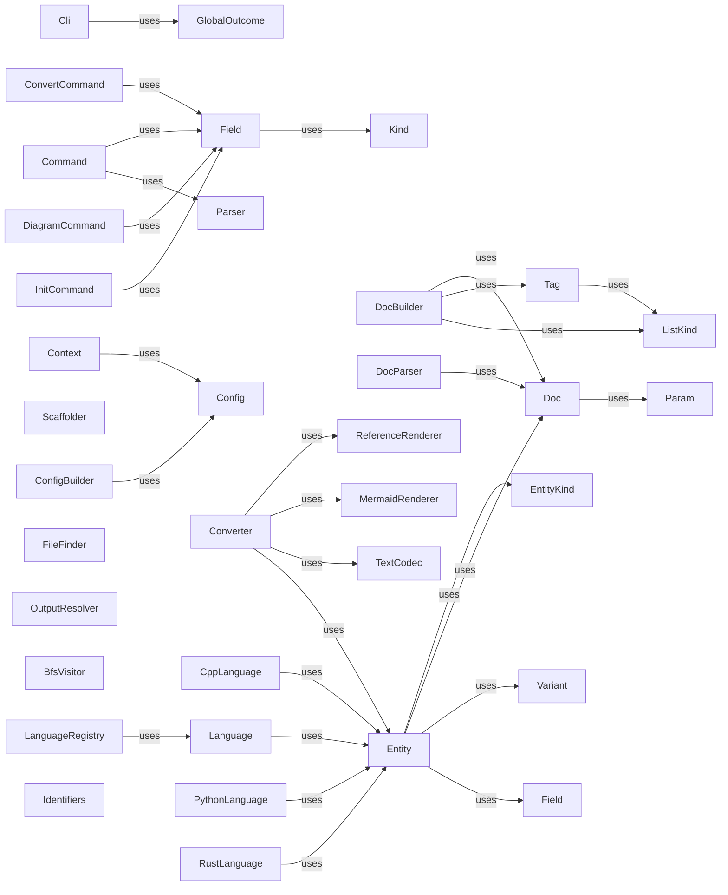
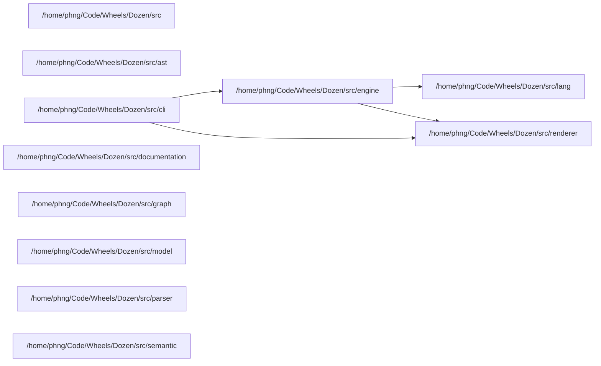

# Contract Graph

## Class Diagram

```mermaid
classDiagram
  class Context {
    -Option~PathBuf~ global_config
    +new()
    +load_config()
    +input_spec()
    +output_path()
    +prepare_output()
  }
  class Command {
    <<interface>>
    +name()
    +usage()
    +help()
    +fields()
    +run()
    +parse()
    +error_program()
    +print_help()
  }
  class ConvertCommand {
    +name()
    +usage()
    +help()
    +fields()
    +run()
  }
  class DiagramCommand {
    +name()
    +usage()
    +help()
    +fields()
    +run()
  }
  class InitCommand {
    +name()
    +usage()
    +help()
    +fields()
    +run()
  }
  class Cli {
    -Vec~String~ args
    +from_env()
    +execute()
    +command_index()
    +execute_default()
    +parse_global()
  }
  class GlobalOutcome {
    <<enumeration>>
    Continue
    Stop
  }
  class Kind {
    <<enumeration>>
    Flag
    Opt
    Pos
  }
  class Field {
    +static str long
    +Option~char~ short
    +Kind kind
    +option()
    +flag()
    +short_flag()
    +positional()
    +accepts_long()
    +accepts_short()
  }
  class Parser {
    +Vec~String~ flags
    +HashMap~String, String~ opts
    +Vec~String~ positional
    +flag()
    +opt()
    +str()
    +parse()
    +push_flag()
  }
  class Scaffolder {
    -PathBuf target
    -bool force
    +new()
    +run()
    +target()
    +config_path()
  }
  class Tag {
    <<enumeration>>
    +from_name()
    +list_kind()
    Brief
    Details
    Param
    Returns
    Throws
    See
    Note
    Warning
    Example
    Unknown
  }
  class ListKind {
    <<enumeration>>
    See
    Note
    Warning
    Example
  }
  class DocBuilder {
    -Doc doc
    -Option~Tag~ active
    -Option~usize~ param
    -Option~usize~ throw
    -Option~(ListKind, usize)~ list
    +new()
    +consume()
    +blank_line()
    +begin_tag()
    +continuation()
    +append_unstructured()
    +push_param()
    +push_throw()
    +push_list()
    +list_mut()
    +finish()
    +paragraphs()
  }
  class DocParser {
    +parse()
  }
  class Config {
    +String glob
    +PathBuf output
    +PathBuf diagram
    +String encoding
    +PathBuf base_dir
    +default()
    +defaults()
    +load()
    +parse()
  }
  class ConfigBuilder {
    -Config config
    -Option~String~ section
    +new()
    +apply()
    +set()
    +finish()
  }
  class TextCodec {
    -String encoding
    +new()
    +read()
    +decode()
    +encode()
    +write()
  }
  class Converter {
    -ReferenceRenderer reference
    -MermaidRenderer mermaid
    -TextCodec codec
    +new()
    +entities()
    +file()
    +project()
    +diagram()
    +files()
    +document()
  }
  class FileFinder {
    -Option~a Path~ base_dir
    +new()
    +collect()
    +select()
    +candidate_bases()
    +search_bases()
    +expand()
    +candidate_files()
    +directory_files()
  }
  class OutputResolver {
    -a Path base_dir
    +new()
    +resolve()
  }
  class CppLanguage {
    +extensions()
    +parse()
  }
  class Language {
    <<interface>>
    +extensions()
    +parse()
  }
  class PythonLanguage {
    +extensions()
    +parse()
  }
  class BfsVisitor {
    -usize depth
    -Vec~Vec~AnyNodeRef~a~~~ levels
    -bool skip_defs
  }
  class LanguageRegistry {
    +new()
    +suffix()
    +is_supported()
    +language_for()
  }
  class RustLanguage {
    +extensions()
    +parse()
  }
  class EntityKind {
    <<enumeration>>
    +value()
    +title()
    +is_aggregate()
    +is_enum()
    +is_callable()
    +is_container()
    Module
    Function
    Method
    Class
    Struct
    Enum
    Trait
    Interface
  }
  class Param {
    +String name
    +String direction
    +String description
    +new()
    +extend_description()
  }
  class Variant {
    +String name
    +String description
  }
  class Field_2 {
    +String name
    +String visibility
    +String description
    +new()
  }
  class Doc {
    +String brief
    +String details
    +Vec~Param~ params
    +String returns
    +Vec~(String, String)~ throws
    +Vec~String~ see
    +Vec~String~ notes
    +Vec~String~ warnings
    +Vec~String~ examples
    +has_contract()
  }
  class Entity {
    +EntityKind kind
    +String name
    +String signature
    +String return_type
    +Doc doc
    +Vec~Entity~ members
    +Vec~Variant~ variants
    +Vec~Field~ fields
    +Vec~String~ bases
    +Vec~String~ implements
    +String module
    +String path
    +usize line
    +Vec~String~ calls
    +Vec~String~ includes
    +new()
    +stamp()
  }
  class MermaidRenderer {
    +title()
    +render()
    +render_all()
    +class_diagram()
    +inheritance_diagram()
    +collaboration_diagram()
    +call_graph()
    +caller_graph()
    +call_diagram()
    +include_graph()
    +directory_graph()
  }
  class Identifiers {
    -HashMap~usize, String~ ids
    -HashMap~String, String~ by_name
    -HashMap~(String, String), String~ by_file
  }
  class ReferenceRenderer {
    +render()
    +entity()
    +module_reference()
    +function()
    +class_reference()
    +enum_reference()
    +relations()
    +member_contracts()
    +member_contract()
    +example_section()
    +members_table()
    +fields_table()
    +params_table()
    +throws_table()
    +quote_blocks()
  }
  Command <|.. ConvertCommand
  Command <|.. DiagramCommand
  Command <|.. InitCommand
  Field ..> Kind
  DocBuilder ..> Doc
  DocBuilder ..> Tag
  DocBuilder ..> ListKind
  ConfigBuilder ..> Config
  Converter ..> ReferenceRenderer
  Converter ..> MermaidRenderer
  Converter ..> TextCodec
  Language <|.. CppLanguage
  Language <|.. PythonLanguage
  Language <|.. RustLanguage
  Doc ..> Param
  Entity ..> EntityKind
  Entity ..> Doc
  Entity ..> Variant
  Entity ..> Field_2
```



## Inheritance Diagram

```mermaid
classDiagram
  class Context {
  }
  class Command {
    <<interface>>
  }
  class ConvertCommand {
  }
  class DiagramCommand {
  }
  class InitCommand {
  }
  class Cli {
  }
  class Field {
  }
  class Parser {
  }
  class Scaffolder {
  }
  class DocBuilder {
  }
  class DocParser {
  }
  class Config {
  }
  class ConfigBuilder {
  }
  class TextCodec {
  }
  class Converter {
  }
  class FileFinder {
  }
  class OutputResolver {
  }
  class CppLanguage {
  }
  class Language {
    <<interface>>
  }
  class PythonLanguage {
  }
  class BfsVisitor {
  }
  class LanguageRegistry {
  }
  class RustLanguage {
  }
  class Param {
  }
  class Variant {
  }
  class Field_2 {
  }
  class Doc {
  }
  class Entity {
  }
  class MermaidRenderer {
  }
  class Identifiers {
  }
  class ReferenceRenderer {
  }
  Command <|.. ConvertCommand
  Command <|.. DiagramCommand
  Command <|.. InitCommand
  Language <|.. CppLanguage
  Language <|.. PythonLanguage
  Language <|.. RustLanguage
```



## Collaboration Diagram



## Call Graph

```mermaid
flowchart LR
  fn_command_Context_new["command.Context.new"]
  fn_command_Context_load_config["command.Context.load_config"]
  fn_command_Context_input_spec["command.Context.input_spec"]
  fn_command_Context_output_path["command.Context.output_path"]
  fn_command_Context_prepare_output["command.Context.prepare_output"]
  fn_command_Command_name["command.Command.name"]
  fn_command_Command_usage["command.Command.usage"]
  fn_command_Command_help["command.Command.help"]
  fn_command_Command_fields["command.Command.fields"]
  fn_command_Command_run["command.Command.run"]
  fn_command_Command_parse["command.Command.parse"]
  fn_command_Command_error_program["command.Command.error_program"]
  fn_command_Command_print_help["command.Command.print_help"]
  fn_command_ConvertCommand_name["command.ConvertCommand.name"]
  fn_command_ConvertCommand_usage["command.ConvertCommand.usage"]
  fn_command_ConvertCommand_help["command.ConvertCommand.help"]
  fn_command_ConvertCommand_fields["command.ConvertCommand.fields"]
  fn_command_ConvertCommand_run["command.ConvertCommand.run"]
  fn_command_DiagramCommand_name["command.DiagramCommand.name"]
  fn_command_DiagramCommand_usage["command.DiagramCommand.usage"]
  fn_command_DiagramCommand_help["command.DiagramCommand.help"]
  fn_command_DiagramCommand_fields["command.DiagramCommand.fields"]
  fn_command_DiagramCommand_run["command.DiagramCommand.run"]
  fn_command_InitCommand_name["command.InitCommand.name"]
  fn_command_InitCommand_usage["command.InitCommand.usage"]
  fn_command_InitCommand_help["command.InitCommand.help"]
  fn_command_InitCommand_fields["command.InitCommand.fields"]
  fn_command_InitCommand_run["command.InitCommand.run"]
  fn_command_all["command.all"]
  fn_command_find["command.find"]
  fn_command_kind_choices["command.kind_choices"]
  fn_command_parse_or_exit["command.parse_or_exit"]
  fn_mod_run["mod.run"]
  fn_mod_Cli_from_env["mod.Cli.from_env"]
  fn_mod_Cli_execute["mod.Cli.execute"]
  fn_mod_Cli_command_index["mod.Cli.command_index"]
  fn_mod_Cli_execute_default["mod.Cli.execute_default"]
  fn_mod_Cli_parse_global["mod.Cli.parse_global"]
  fn_mod_dispatch["mod.dispatch"]
  fn_mod_is_help["mod.is_help"]
  fn_mod_print_help["mod.print_help"]
  fn_mod_print_version["mod.print_version"]
  fn_mod_usage_error["mod.usage_error"]
  fn_parser_Field_option["parser.Field.option"]
  fn_parser_Field_flag["parser.Field.flag"]
  fn_parser_Field_short_flag["parser.Field.short_flag"]
  fn_parser_Field_positional["parser.Field.positional"]
  fn_parser_Field_accepts_long["parser.Field.accepts_long"]
  fn_parser_Field_accepts_short["parser.Field.accepts_short"]
  fn_parser_Parser_flag["parser.Parser.flag"]
  fn_parser_Parser_opt["parser.Parser.opt"]
  fn_parser_Parser_str["parser.Parser.str"]
  fn_parser_Parser_parse["parser.Parser.parse"]
  fn_parser_Parser_push_flag["parser.Parser.push_flag"]
  fn_parser_parse["parser.parse"]
  fn_parser_parses_long_options_and_flags["parser.parses_long_options_and_flags"]
  fn_parser_parses_short_flags_and_attached_option_values["parser.parses_short_flags_and_attached_option_values"]
  fn_parser_collects_positionals_and_stops_at_double_dash["parser.collects_positionals_and_stops_at_double_dash"]
  fn_parser_last_option_wins_and_flags_are_unique["parser.last_option_wins_and_flags_are_unique"]
  fn_parser_rejects_unknown_and_incomplete_options["parser.rejects_unknown_and_incomplete_options"]
  fn_scaffold_Scaffolder_new["scaffold.Scaffolder.new"]
  fn_scaffold_Scaffolder_run["scaffold.Scaffolder.run"]
  fn_scaffold_Scaffolder_target["scaffold.Scaffolder.target"]
  fn_scaffold_Scaffolder_config_path["scaffold.Scaffolder.config_path"]
  fn_scaffold_normalize["scaffold.normalize"]
  fn_mod_Tag_from_name["mod.Tag.from_name"]
  fn_mod_Tag_list_kind["mod.Tag.list_kind"]
  fn_mod_DocBuilder_new["mod.DocBuilder.new"]
  fn_mod_DocBuilder_consume["mod.DocBuilder.consume"]
  fn_mod_DocBuilder_blank_line["mod.DocBuilder.blank_line"]
  fn_mod_DocBuilder_begin_tag["mod.DocBuilder.begin_tag"]
  fn_mod_DocBuilder_continuation["mod.DocBuilder.continuation"]
  fn_mod_DocBuilder_append_unstructured["mod.DocBuilder.append_unstructured"]
  fn_mod_DocBuilder_push_param["mod.DocBuilder.push_param"]
  fn_mod_DocBuilder_push_throw["mod.DocBuilder.push_throw"]
  fn_mod_DocBuilder_push_list["mod.DocBuilder.push_list"]
  fn_mod_DocBuilder_list_mut["mod.DocBuilder.list_mut"]
  fn_mod_DocBuilder_finish["mod.DocBuilder.finish"]
  fn_mod_DocBuilder_paragraphs["mod.DocBuilder.paragraphs"]
  fn_mod_split_lines["mod.split_lines"]
  fn_mod_expand_tabs["mod.expand_tabs"]
  fn_mod_cleandoc["mod.cleandoc"]
  fn_mod_DocParser_parse["mod.DocParser.parse"]
  fn_mod_partition_space["mod.partition_space"]
  fn_mod_parses_brief_and_paragraphs["mod.parses_brief_and_paragraphs"]
  fn_mod_parses_tags_and_aliases["mod.parses_tags_and_aliases"]
  fn_mod_preserves_blank_lines_in_details_and_examples["mod.preserves_blank_lines_in_details_and_examples"]
  fn_mod_cleandoc_matches_python_semantics["mod.cleandoc_matches_python_semantics"]
  fn_mod_split_lines_handles_python_separators["mod.split_lines_handles_python_separators"]
  fn_config_Config_default["config.Config.default"]
  fn_config_Config_defaults["config.Config.defaults"]
  fn_config_Config_load["config.Config.load"]
  fn_config_Config_parse["config.Config.parse"]
  fn_config_ConfigBuilder_new["config.ConfigBuilder.new"]
  fn_config_ConfigBuilder_apply["config.ConfigBuilder.apply"]
  fn_config_ConfigBuilder_set["config.ConfigBuilder.set"]
  fn_config_ConfigBuilder_finish["config.ConfigBuilder.finish"]
  fn_config_python_path["config.python_path"]
  fn_config_parses_defaults["config.parses_defaults"]
  fn_config_ignores_other_sections_and_comments["config.ignores_other_sections_and_comments"]
  fn_converter_TextCodec_new["converter.TextCodec.new"]
  fn_converter_TextCodec_read["converter.TextCodec.read"]
  fn_converter_TextCodec_decode["converter.TextCodec.decode"]
  fn_converter_TextCodec_encode["converter.TextCodec.encode"]
  fn_converter_TextCodec_write["converter.TextCodec.write"]
  fn_converter_encoding_for["converter.encoding_for"]
  fn_converter_Converter_new["converter.Converter.new"]
  fn_converter_Converter_entities["converter.Converter.entities"]
  fn_converter_Converter_file["converter.Converter.file"]
  fn_converter_Converter_project["converter.Converter.project"]
  fn_converter_Converter_diagram["converter.Converter.diagram"]
  fn_converter_Converter_files["converter.Converter.files"]
  fn_converter_Converter_document["converter.Converter.document"]
  fn_converter_display_name["converter.display_name"]
  fn_files_match_options["files.match_options"]
  fn_files_FileFinder_new["files.FileFinder.new"]
  fn_files_FileFinder_collect["files.FileFinder.collect"]
  fn_files_FileFinder_select["files.FileFinder.select"]
  fn_files_FileFinder_candidate_bases["files.FileFinder.candidate_bases"]
  fn_files_FileFinder_search_bases["files.FileFinder.search_bases"]
  fn_files_FileFinder_expand["files.FileFinder.expand"]
  fn_files_FileFinder_candidate_files["files.FileFinder.candidate_files"]
  fn_files_FileFinder_directory_files["files.FileFinder.directory_files"]
  fn_files_OutputResolver_new["files.OutputResolver.new"]
  fn_files_OutputResolver_resolve["files.OutputResolver.resolve"]
  fn_files_resolves_relative_output_against_base_dir["files.resolves_relative_output_against_base_dir"]
  fn_files_keeps_absolute_outputs["files.keeps_absolute_outputs"]
  fn_files_collects_directory_recursively_and_skips_unsupported_files["files.collects_directory_recursively_and_skips_unsupported_files"]
  fn_files_falls_back_to_parent_base_directories["files.falls_back_to_parent_base_directories"]
  fn_files_expands_globs_in_sorted_order["files.expands_globs_in_sorted_order"]
  fn_files_crate_root["files.crate_root"]
  fn_cpp_CppLanguage_extensions["cpp.CppLanguage.extensions"]
  fn_cpp_CppLanguage_parse["cpp.CppLanguage.parse"]
  fn_cpp_parse_class_body["cpp.parse_class_body"]
  fn_cpp_base_names["cpp.base_names"]
  fn_cpp_includes["cpp.includes"]
  fn_cpp_calls_from_lines["cpp.calls_from_lines"]
  fn_cpp_parse_cpp_params["cpp.parse_cpp_params"]
  fn_cpp_merge_types["cpp.merge_types"]
  fn_cpp_parses_parameters["cpp.parses_parameters"]
  fn_cpp_cleans_base_names["cpp.cleans_base_names"]
  fn_mod_Language_extensions["mod.Language.extensions"]
  fn_mod_Language_parse["mod.Language.parse"]
  fn_mod_consume_block["mod.consume_block"]
  fn_mod_read_block_comment["mod.read_block_comment"]
  fn_mod_body_slice["mod.body_slice"]
  fn_mod_is_identifier["mod.is_identifier"]
  fn_mod_consumes_braced_and_semicolon_blocks["mod.consumes_braced_and_semicolon_blocks"]
  fn_mod_reads_block_comments["mod.reads_block_comments"]
  fn_python_PythonLanguage_extensions["python.PythonLanguage.extensions"]
  fn_python_PythonLanguage_parse["python.PythonLanguage.parse"]
  fn_python_line_of["python.line_of"]
  fn_python_docstring["python.docstring"]
  fn_python_unparse["python.unparse"]
  fn_python_unparse_slice["python.unparse_slice"]
  fn_python_unparse_slice_element["python.unparse_slice_element"]
  fn_python_function["python.function"]
  fn_python_class_entity["python.class_entity"]
  fn_python_function_instance["python.function_instance"]
  fn_python_enum_variants["python.enum_variants"]
  fn_python_base_names["python.base_names"]
  fn_python_fields["python.fields"]
  fn_python_self_attribute["python.self_attribute"]
  fn_python_visibility["python.visibility"]
  fn_python_node_name["python.node_name"]
  fn_python_imports["python.imports"]
  fn_python_calls["python.calls"]
  fn_python_call_name["python.call_name"]
  fn_python_is_enum["python.is_enum"]
  fn_python_is_abstract["python.is_abstract"]
  fn_python_is_abstract_method["python.is_abstract_method"]
  fn_python_collect_bfs["python.collect_bfs"]
  fn_python_parses_animal_fixture["python.parses_animal_fixture"]
  fn_python_unparses_annotations_like_ast_unparse["python.unparses_annotations_like_ast_unparse"]
  fn_registry_LanguageRegistry_new["registry.LanguageRegistry.new"]
  fn_registry_LanguageRegistry_suffix["registry.LanguageRegistry.suffix"]
  fn_registry_LanguageRegistry_is_supported["registry.LanguageRegistry.is_supported"]
  fn_registry_LanguageRegistry_language_for["registry.LanguageRegistry.language_for"]
  fn_rust_RustLanguage_extensions["rust.RustLanguage.extensions"]
  fn_rust_RustLanguage_parse["rust.RustLanguage.parse"]
  fn_rust_parse_rust_fields["rust.parse_rust_fields"]
  fn_rust_parse_variants["rust.parse_variants"]
  fn_rust_parse_impl_body["rust.parse_impl_body"]
  fn_main_main["main.main"]
  fn_mod_EntityKind_value["mod.EntityKind.value"]
  fn_mod_EntityKind_title["mod.EntityKind.title"]
  fn_mod_EntityKind_is_aggregate["mod.EntityKind.is_aggregate"]
  fn_mod_EntityKind_is_enum["mod.EntityKind.is_enum"]
  fn_mod_EntityKind_is_callable["mod.EntityKind.is_callable"]
  fn_mod_EntityKind_is_container["mod.EntityKind.is_container"]
  fn_mod_Param_new["mod.Param.new"]
  fn_mod_Param_extend_description["mod.Param.extend_description"]
  fn_mod_Field_new["mod.Field.new"]
  fn_mod_Doc_has_contract["mod.Doc.has_contract"]
  fn_mod_Entity_new["mod.Entity.new"]
  fn_mod_Entity_stamp["mod.Entity.stamp"]
  fn_mod_dedup_push["mod.dedup_push"]
  fn_mermaid_MermaidRenderer_title["mermaid.MermaidRenderer.title"]
  fn_mermaid_MermaidRenderer_render["mermaid.MermaidRenderer.render"]
  fn_mermaid_MermaidRenderer_render_all["mermaid.MermaidRenderer.render_all"]
  fn_mermaid_MermaidRenderer_class_diagram["mermaid.MermaidRenderer.class_diagram"]
  fn_mermaid_MermaidRenderer_inheritance_diagram["mermaid.MermaidRenderer.inheritance_diagram"]
  fn_mermaid_MermaidRenderer_collaboration_diagram["mermaid.MermaidRenderer.collaboration_diagram"]
  fn_mermaid_MermaidRenderer_call_graph["mermaid.MermaidRenderer.call_graph"]
  fn_mermaid_MermaidRenderer_caller_graph["mermaid.MermaidRenderer.caller_graph"]
  fn_mermaid_MermaidRenderer_call_diagram["mermaid.MermaidRenderer.call_diagram"]
  fn_mermaid_MermaidRenderer_include_graph["mermaid.MermaidRenderer.include_graph"]
  fn_mermaid_MermaidRenderer_directory_graph["mermaid.MermaidRenderer.directory_graph"]
  fn_mermaid_collect["mermaid.collect"]
  fn_mermaid_identifiers["mermaid.identifiers"]
  fn_mermaid_block["mermaid.block"]
  fn_reference_ReferenceRenderer_render["reference.ReferenceRenderer.render"]
  fn_reference_ReferenceRenderer_entity["reference.ReferenceRenderer.entity"]
  fn_reference_ReferenceRenderer_module_reference["reference.ReferenceRenderer.module_reference"]
  fn_reference_ReferenceRenderer_function["reference.ReferenceRenderer.function"]
  fn_reference_ReferenceRenderer_class_reference["reference.ReferenceRenderer.class_reference"]
  fn_reference_ReferenceRenderer_enum_reference["reference.ReferenceRenderer.enum_reference"]
  fn_reference_ReferenceRenderer_relations["reference.ReferenceRenderer.relations"]
  fn_reference_ReferenceRenderer_member_contracts["reference.ReferenceRenderer.member_contracts"]
  fn_reference_ReferenceRenderer_member_contract["reference.ReferenceRenderer.member_contract"]
  fn_reference_ReferenceRenderer_example_section["reference.ReferenceRenderer.example_section"]
  fn_reference_ReferenceRenderer_members_table["reference.ReferenceRenderer.members_table"]
  fn_reference_ReferenceRenderer_fields_table["reference.ReferenceRenderer.fields_table"]
  fn_reference_ReferenceRenderer_params_table["reference.ReferenceRenderer.params_table"]
  fn_reference_ReferenceRenderer_throws_table["reference.ReferenceRenderer.throws_table"]
  fn_reference_ReferenceRenderer_quote_blocks["reference.ReferenceRenderer.quote_blocks"]
  fn_reference_table["reference.table"]
  fn_reference_code_list["reference.code_list"]
  fn_reference_bullets["reference.bullets"]
  fn_reference_cell["reference.cell"]
  fn_command_Context_load_config -->|calls| fn_parser_Parser_opt
  fn_command_Context_load_config -->|calls| fn_config_Config_load
  fn_command_Context_output_path -->|calls| fn_command_Context_new
  fn_command_Context_output_path -->|calls| fn_files_OutputResolver_resolve
  fn_command_Context_output_path -->|calls| fn_parser_Parser_opt
  fn_command_Context_prepare_output -->|calls| fn_command_Context_new
  fn_command_Command_parse -->|calls| fn_command_parse_or_exit
  fn_command_ConvertCommand_run -->|calls| fn_command_Command_parse
  fn_command_ConvertCommand_run -->|calls| fn_command_Context_load_config
  fn_command_ConvertCommand_run -->|calls| fn_command_Context_input_spec
  fn_command_ConvertCommand_run -->|calls| fn_command_Context_new
  fn_command_ConvertCommand_run -->|calls| fn_files_FileFinder_select
  fn_command_ConvertCommand_run -->|calls| fn_command_Context_output_path
  fn_command_ConvertCommand_run -->|calls| fn_command_Context_prepare_output
  fn_command_ConvertCommand_run -->|calls| fn_converter_Converter_files
  fn_command_DiagramCommand_run -->|calls| fn_command_Command_parse
  fn_command_DiagramCommand_run -->|calls| fn_command_Context_load_config
  fn_command_DiagramCommand_run -->|calls| fn_parser_Parser_opt
  fn_command_DiagramCommand_run -->|calls| fn_mod_usage_error
  fn_command_DiagramCommand_run -->|calls| fn_command_Command_error_program
  fn_command_DiagramCommand_run -->|calls| fn_command_kind_choices
  fn_command_DiagramCommand_run -->|calls| fn_command_Context_input_spec
  fn_command_DiagramCommand_run -->|calls| fn_command_Context_new
  fn_command_DiagramCommand_run -->|calls| fn_files_FileFinder_select
  fn_command_DiagramCommand_run -->|calls| fn_command_Context_output_path
  fn_command_DiagramCommand_run -->|calls| fn_command_Context_prepare_output
  fn_command_DiagramCommand_run -->|calls| fn_converter_Converter_diagram
  fn_command_InitCommand_run -->|calls| fn_command_Command_parse
  fn_command_InitCommand_run -->|calls| fn_command_Context_new
  fn_command_parse_or_exit -->|calls| fn_command_Command_parse
  fn_mod_run -->|calls| fn_mod_Cli_from_env
  fn_mod_run -->|calls| fn_mod_Cli_execute
  fn_mod_Cli_execute -->|calls| fn_mod_print_help
  fn_mod_Cli_execute -->|calls| fn_mod_Cli_command_index
  fn_mod_Cli_execute -->|calls| fn_mod_Cli_execute_default
  fn_mod_Cli_execute -->|calls| fn_mod_Cli_parse_global
  fn_mod_Cli_execute -->|calls| fn_mod_dispatch
  fn_mod_Cli_command_index -->|calls| fn_command_find
  fn_mod_Cli_execute_default -->|calls| fn_mod_is_help
  fn_mod_Cli_execute_default -->|calls| fn_mod_print_help
  fn_mod_Cli_execute_default -->|calls| fn_mod_print_version
  fn_mod_Cli_execute_default -->|calls| fn_mod_dispatch
  fn_mod_Cli_parse_global -->|calls| fn_mod_print_help
  fn_mod_Cli_parse_global -->|calls| fn_mod_print_version
  fn_mod_Cli_parse_global -->|calls| fn_mod_usage_error
  fn_mod_dispatch -->|calls| fn_command_find
  fn_parser_Parser_parse -->|calls| fn_config_Config_default
  fn_parser_parses_long_options_and_flags -->|calls| fn_parser_Parser_opt
  fn_parser_parses_short_flags_and_attached_option_values -->|calls| fn_parser_Parser_opt
  fn_parser_collects_positionals_and_stops_at_double_dash -->|calls| fn_parser_Parser_str
  fn_parser_last_option_wins_and_flags_are_unique -->|calls| fn_parser_Parser_opt
  fn_scaffold_Scaffolder_run -->|calls| fn_scaffold_Scaffolder_config_path
  fn_scaffold_Scaffolder_run -->|calls| fn_converter_TextCodec_write
  fn_scaffold_Scaffolder_config_path -->|calls| fn_scaffold_normalize
  fn_mod_DocBuilder_new -->|calls| fn_mod_DocBuilder_paragraphs
  fn_mod_DocBuilder_new -->|calls| fn_config_Config_default
  fn_mod_DocBuilder_consume -->|calls| fn_mod_DocBuilder_blank_line
  fn_mod_DocBuilder_consume -->|calls| fn_mod_DocBuilder_begin_tag
  fn_mod_DocBuilder_consume -->|calls| fn_mod_DocBuilder_continuation
  fn_mod_DocBuilder_begin_tag -->|calls| fn_mod_Tag_from_name
  fn_mod_DocBuilder_begin_tag -->|calls| fn_mod_DocBuilder_push_param
  fn_mod_DocBuilder_begin_tag -->|calls| fn_mod_DocBuilder_push_throw
  fn_mod_DocBuilder_begin_tag -->|calls| fn_mod_Tag_list_kind
  fn_mod_DocBuilder_begin_tag -->|calls| fn_mod_DocBuilder_push_list
  fn_mod_DocBuilder_continuation -->|calls| fn_mod_Param_extend_description
  fn_mod_DocBuilder_continuation -->|calls| fn_mod_DocBuilder_append_unstructured
  fn_mod_DocBuilder_append_unstructured -->|calls| fn_mod_DocBuilder_list_mut
  fn_mod_DocBuilder_push_param -->|calls| fn_mod_partition_space
  fn_mod_DocBuilder_push_param -->|calls| fn_mod_DocBuilder_new
  fn_mod_DocBuilder_push_throw -->|calls| fn_mod_partition_space
  fn_mod_DocBuilder_push_list -->|calls| fn_mod_DocBuilder_list_mut
  fn_mod_DocBuilder_paragraphs -->|calls| fn_mod_DocBuilder_new
  fn_mod_split_lines -->|calls| fn_mod_DocBuilder_new
  fn_mod_cleandoc -->|calls| fn_mod_expand_tabs
  fn_mod_DocParser_parse -->|calls| fn_config_Config_default
  fn_mod_DocParser_parse -->|calls| fn_mod_split_lines
  fn_mod_DocParser_parse -->|calls| fn_mod_DocBuilder_new
  fn_mod_DocParser_parse -->|calls| fn_mod_DocBuilder_consume
  fn_mod_DocParser_parse -->|calls| fn_mod_DocBuilder_finish
  fn_mod_partition_space -->|calls| fn_command_find
  fn_mod_parses_brief_and_paragraphs -->|calls| fn_mod_DocParser_parse
  fn_mod_parses_tags_and_aliases -->|calls| fn_mod_DocParser_parse
  fn_mod_preserves_blank_lines_in_details_and_examples -->|calls| fn_mod_DocParser_parse
  fn_mod_cleandoc_matches_python_semantics -->|calls| fn_mod_cleandoc
  fn_mod_split_lines_handles_python_separators -->|calls| fn_mod_split_lines
  fn_config_Config_defaults -->|calls| fn_config_Config_parse
  fn_config_Config_load -->|calls| fn_config_Config_parse
  fn_config_Config_load -->|calls| fn_config_Config_defaults
  fn_config_Config_parse -->|calls| fn_config_ConfigBuilder_new
  fn_config_Config_parse -->|calls| fn_mod_split_lines
  fn_config_Config_parse -->|calls| fn_config_ConfigBuilder_apply
  fn_config_Config_parse -->|calls| fn_config_ConfigBuilder_finish
  fn_config_ConfigBuilder_new -->|calls| fn_config_Config_default
  fn_config_ConfigBuilder_apply -->|calls| fn_config_ConfigBuilder_set
  fn_config_ConfigBuilder_set -->|calls| fn_config_python_path
  fn_config_parses_defaults -->|calls| fn_config_Config_defaults
  fn_config_ignores_other_sections_and_comments -->|calls| fn_config_Config_parse
  fn_config_ignores_other_sections_and_comments -->|calls| fn_config_ConfigBuilder_new
  fn_converter_TextCodec_read -->|calls| fn_converter_TextCodec_decode
  fn_converter_TextCodec_decode -->|calls| fn_converter_encoding_for
  fn_converter_TextCodec_encode -->|calls| fn_converter_encoding_for
  fn_converter_TextCodec_write -->|calls| fn_converter_TextCodec_encode
  fn_converter_Converter_entities -->|calls| fn_registry_LanguageRegistry_language_for
  fn_converter_Converter_entities -->|calls| fn_converter_TextCodec_read
  fn_converter_Converter_entities -->|calls| fn_converter_display_name
  fn_converter_Converter_entities -->|calls| fn_mod_Entity_stamp
  fn_converter_Converter_file -->|calls| fn_converter_Converter_entities
  fn_converter_Converter_project -->|calls| fn_converter_Converter_entities
  fn_converter_Converter_diagram -->|calls| fn_converter_Converter_project
  fn_converter_Converter_diagram -->|calls| fn_converter_TextCodec_write
  fn_converter_Converter_diagram -->|calls| fn_mermaid_MermaidRenderer_render_all
  fn_converter_Converter_files -->|calls| fn_converter_Converter_document
  fn_converter_Converter_files -->|calls| fn_converter_TextCodec_write
  fn_converter_Converter_document -->|calls| fn_converter_Converter_file
  fn_converter_Converter_document -->|calls| fn_converter_display_name
  fn_files_FileFinder_collect -->|calls| fn_files_FileFinder_expand
  fn_files_FileFinder_collect -->|calls| fn_files_FileFinder_candidate_files
  fn_files_FileFinder_select -->|calls| fn_files_FileFinder_collect
  fn_files_FileFinder_search_bases -->|calls| fn_files_FileFinder_candidate_bases
  fn_files_FileFinder_search_bases -->|calls| fn_files_FileFinder_collect
  fn_files_FileFinder_expand -->|calls| fn_files_match_options
  fn_files_FileFinder_expand -->|calls| fn_files_FileFinder_search_bases
  fn_files_FileFinder_candidate_files -->|calls| fn_registry_LanguageRegistry_is_supported
  fn_files_FileFinder_candidate_files -->|calls| fn_files_FileFinder_collect
  fn_files_FileFinder_candidate_files -->|calls| fn_files_FileFinder_directory_files
  fn_files_FileFinder_directory_files -->|calls| fn_registry_LanguageRegistry_is_supported
  fn_files_FileFinder_directory_files -->|calls| fn_files_FileFinder_collect
  fn_files_resolves_relative_output_against_base_dir -->|calls| fn_files_OutputResolver_resolve
  fn_files_keeps_absolute_outputs -->|calls| fn_files_OutputResolver_resolve
  fn_files_collects_directory_recursively_and_skips_unsupported_files -->|calls| fn_converter_TextCodec_write
  fn_files_collects_directory_recursively_and_skips_unsupported_files -->|calls| fn_files_FileFinder_collect
  fn_files_falls_back_to_parent_base_directories -->|calls| fn_converter_TextCodec_write
  fn_files_falls_back_to_parent_base_directories -->|calls| fn_files_FileFinder_collect
  fn_files_expands_globs_in_sorted_order -->|calls| fn_files_crate_root
  fn_files_expands_globs_in_sorted_order -->|calls| fn_files_FileFinder_collect
  fn_cpp_CppLanguage_parse -->|calls| fn_mod_split_lines
  fn_cpp_CppLanguage_parse -->|calls| fn_cpp_includes
  fn_cpp_CppLanguage_parse -->|calls| fn_mod_read_block_comment
  fn_cpp_CppLanguage_parse -->|calls| fn_cpp_parse_cpp_params
  fn_cpp_CppLanguage_parse -->|calls| fn_cpp_merge_types
  fn_cpp_CppLanguage_parse -->|calls| fn_mod_consume_block
  fn_cpp_CppLanguage_parse -->|calls| fn_cpp_calls_from_lines
  fn_cpp_CppLanguage_parse -->|calls| fn_mod_body_slice
  fn_cpp_CppLanguage_parse -->|calls| fn_cpp_parse_class_body
  fn_cpp_CppLanguage_parse -->|calls| fn_cpp_base_names
  fn_cpp_CppLanguage_parse -->|calls| fn_mod_is_identifier
  fn_cpp_parse_class_body -->|calls| fn_cpp_CppLanguage_parse
  fn_cpp_parse_class_body -->|calls| fn_mod_consume_block
  fn_cpp_parse_class_body -->|calls| fn_cpp_calls_from_lines
  fn_cpp_parse_class_body -->|calls| fn_mod_body_slice
  fn_cpp_base_names -->|calls| fn_mod_dedup_push
  fn_cpp_includes -->|calls| fn_mod_dedup_push
  fn_cpp_calls_from_lines -->|calls| fn_mod_dedup_push
  fn_cpp_parse_cpp_params -->|calls| fn_mod_is_identifier
  fn_cpp_parses_parameters -->|calls| fn_cpp_parse_cpp_params
  fn_cpp_cleans_base_names -->|calls| fn_cpp_base_names
  fn_mod_read_block_comment -->|calls| fn_command_find
  fn_mod_is_identifier -->|calls| fn_command_all
  fn_mod_consumes_braced_and_semicolon_blocks -->|calls| fn_mod_consume_block
  fn_mod_reads_block_comments -->|calls| fn_mod_read_block_comment
  fn_python_PythonLanguage_parse -->|calls| fn_python_docstring
  fn_python_PythonLanguage_parse -->|calls| fn_python_imports
  fn_python_PythonLanguage_parse -->|calls| fn_python_function
  fn_python_PythonLanguage_parse -->|calls| fn_python_line_of
  fn_python_PythonLanguage_parse -->|calls| fn_python_is_enum
  fn_python_PythonLanguage_parse -->|calls| fn_python_class_entity
  fn_python_docstring -->|calls| fn_mod_cleandoc
  fn_python_unparse -->|calls| fn_python_unparse_slice
  fn_python_unparse -->|calls| fn_config_Config_default
  fn_python_unparse_slice -->|calls| fn_python_unparse
  fn_python_unparse_slice_element -->|calls| fn_python_unparse
  fn_python_function -->|calls| fn_python_docstring
  fn_python_function -->|calls| fn_python_PythonLanguage_parse
  fn_python_function -->|calls| fn_python_unparse
  fn_python_function -->|calls| fn_python_calls
  fn_python_class_entity -->|calls| fn_python_docstring
  fn_python_class_entity -->|calls| fn_python_PythonLanguage_parse
  fn_python_class_entity -->|calls| fn_python_is_abstract
  fn_python_class_entity -->|calls| fn_python_enum_variants
  fn_python_class_entity -->|calls| fn_python_base_names
  fn_python_class_entity -->|calls| fn_command_find
  fn_python_class_entity -->|calls| fn_python_fields
  fn_python_class_entity -->|calls| fn_python_function_instance
  fn_python_class_entity -->|calls| fn_python_is_abstract_method
  fn_python_class_entity -->|calls| fn_python_line_of
  fn_python_function_instance -->|calls| fn_python_function
  fn_python_base_names -->|calls| fn_python_node_name
  fn_python_base_names -->|calls| fn_mod_dedup_push
  fn_python_fields -->|calls| fn_python_unparse
  fn_python_fields -->|calls| fn_python_collect_bfs
  fn_python_fields -->|calls| fn_python_self_attribute
  fn_python_fields -->|calls| fn_python_visibility
  fn_python_fields -->|calls| fn_python_docstring
  fn_python_fields -->|calls| fn_python_PythonLanguage_parse
  fn_python_imports -->|calls| fn_python_collect_bfs
  fn_python_imports -->|calls| fn_mod_dedup_push
  fn_python_calls -->|calls| fn_python_collect_bfs
  fn_python_calls -->|calls| fn_python_call_name
  fn_python_calls -->|calls| fn_mod_dedup_push
  fn_python_is_abstract -->|calls| fn_python_is_abstract_method
  fn_python_parses_animal_fixture -->|calls| fn_python_PythonLanguage_parse
  fn_python_parses_animal_fixture -->|calls| fn_command_find
  fn_python_unparses_annotations_like_ast_unparse -->|calls| fn_python_unparse
  fn_registry_LanguageRegistry_is_supported -->|calls| fn_registry_LanguageRegistry_suffix
  fn_registry_LanguageRegistry_language_for -->|calls| fn_registry_LanguageRegistry_suffix
  fn_registry_LanguageRegistry_language_for -->|calls| fn_registry_LanguageRegistry_new
  fn_rust_RustLanguage_parse -->|calls| fn_mod_split_lines
  fn_rust_RustLanguage_parse -->|calls| fn_cpp_includes
  fn_rust_RustLanguage_parse -->|calls| fn_mod_read_block_comment
  fn_rust_RustLanguage_parse -->|calls| fn_mod_consume_block
  fn_rust_RustLanguage_parse -->|calls| fn_rust_parse_rust_fields
  fn_rust_RustLanguage_parse -->|calls| fn_mod_body_slice
  fn_rust_RustLanguage_parse -->|calls| fn_rust_parse_variants
  fn_rust_RustLanguage_parse -->|calls| fn_rust_parse_impl_body
  fn_rust_RustLanguage_parse -->|calls| fn_mod_dedup_push
  fn_rust_parse_impl_body -->|calls| fn_mod_consume_block
  fn_rust_parse_impl_body -->|calls| fn_rust_RustLanguage_parse
  fn_rust_parse_impl_body -->|calls| fn_cpp_calls_from_lines
  fn_rust_parse_impl_body -->|calls| fn_mod_body_slice
  fn_rust_parse_impl_body -->|calls| fn_cpp_includes
  fn_rust_parse_impl_body -->|calls| fn_mod_dedup_push
  fn_rust_parse_impl_body -->|calls| fn_python_parses_animal_fixture
  fn_rust_parse_impl_body -->|calls| fn_command_find
  fn_mod_Entity_new -->|calls| fn_config_Config_default
  fn_mermaid_MermaidRenderer_render -->|calls| fn_mermaid_MermaidRenderer_class_diagram
  fn_mermaid_MermaidRenderer_render -->|calls| fn_mermaid_MermaidRenderer_inheritance_diagram
  fn_mermaid_MermaidRenderer_render -->|calls| fn_mermaid_MermaidRenderer_collaboration_diagram
  fn_mermaid_MermaidRenderer_render -->|calls| fn_mermaid_MermaidRenderer_call_graph
  fn_mermaid_MermaidRenderer_render -->|calls| fn_mermaid_MermaidRenderer_caller_graph
  fn_mermaid_MermaidRenderer_render -->|calls| fn_mermaid_MermaidRenderer_include_graph
  fn_mermaid_MermaidRenderer_render -->|calls| fn_mermaid_MermaidRenderer_directory_graph
  fn_mermaid_MermaidRenderer_render_all -->|calls| fn_mermaid_collect
  fn_mermaid_MermaidRenderer_render_all -->|calls| fn_mermaid_MermaidRenderer_title
  fn_mermaid_MermaidRenderer_render_all -->|calls| fn_mermaid_MermaidRenderer_render
  fn_mermaid_MermaidRenderer_collaboration_diagram -->|calls| fn_mermaid_collect
  fn_mermaid_MermaidRenderer_collaboration_diagram -->|calls| fn_mermaid_identifiers
  fn_mermaid_MermaidRenderer_call_graph -->|calls| fn_mermaid_MermaidRenderer_call_diagram
  fn_mermaid_MermaidRenderer_caller_graph -->|calls| fn_mermaid_MermaidRenderer_call_diagram
  fn_mermaid_MermaidRenderer_directory_graph -->|calls| fn_mermaid_collect
  fn_mermaid_block -->|calls| fn_mermaid_collect
  fn_mermaid_block -->|calls| fn_mod_EntityKind_is_callable
  fn_reference_ReferenceRenderer_render -->|calls| fn_reference_ReferenceRenderer_entity
  fn_reference_ReferenceRenderer_entity -->|calls| fn_reference_ReferenceRenderer_enum_reference
  fn_reference_ReferenceRenderer_entity -->|calls| fn_mod_EntityKind_is_aggregate
  fn_reference_ReferenceRenderer_entity -->|calls| fn_reference_ReferenceRenderer_class_reference
  fn_reference_ReferenceRenderer_entity -->|calls| fn_reference_ReferenceRenderer_module_reference
  fn_reference_ReferenceRenderer_entity -->|calls| fn_reference_ReferenceRenderer_function
  fn_reference_ReferenceRenderer_module_reference -->|calls| fn_reference_ReferenceRenderer_example_section
  fn_reference_ReferenceRenderer_function -->|calls| fn_reference_ReferenceRenderer_params_table
  fn_reference_ReferenceRenderer_function -->|calls| fn_reference_ReferenceRenderer_throws_table
  fn_reference_ReferenceRenderer_function -->|calls| fn_reference_ReferenceRenderer_quote_blocks
  fn_reference_ReferenceRenderer_function -->|calls| fn_reference_ReferenceRenderer_example_section
  fn_reference_ReferenceRenderer_function -->|calls| fn_reference_bullets
  fn_reference_ReferenceRenderer_class_reference -->|calls| fn_reference_ReferenceRenderer_relations
  fn_reference_ReferenceRenderer_class_reference -->|calls| fn_reference_ReferenceRenderer_example_section
  fn_reference_ReferenceRenderer_class_reference -->|calls| fn_reference_ReferenceRenderer_fields_table
  fn_reference_ReferenceRenderer_class_reference -->|calls| fn_reference_ReferenceRenderer_members_table
  fn_reference_ReferenceRenderer_class_reference -->|calls| fn_reference_ReferenceRenderer_member_contracts
  fn_reference_ReferenceRenderer_enum_reference -->|calls| fn_reference_cell
  fn_reference_ReferenceRenderer_enum_reference -->|calls| fn_reference_table
  fn_reference_ReferenceRenderer_relations -->|calls| fn_reference_code_list
  fn_reference_ReferenceRenderer_member_contracts -->|calls| fn_mod_Doc_has_contract
  fn_reference_ReferenceRenderer_member_contracts -->|calls| fn_reference_ReferenceRenderer_member_contract
  fn_reference_ReferenceRenderer_member_contract -->|calls| fn_reference_ReferenceRenderer_params_table
  fn_reference_ReferenceRenderer_member_contract -->|calls| fn_reference_ReferenceRenderer_throws_table
  fn_reference_ReferenceRenderer_member_contract -->|calls| fn_reference_ReferenceRenderer_quote_blocks
  fn_reference_ReferenceRenderer_member_contract -->|calls| fn_reference_ReferenceRenderer_example_section
  fn_reference_ReferenceRenderer_member_contract -->|calls| fn_reference_code_list
  fn_reference_ReferenceRenderer_members_table -->|calls| fn_reference_cell
  fn_reference_ReferenceRenderer_members_table -->|calls| fn_reference_table
  fn_reference_ReferenceRenderer_fields_table -->|calls| fn_reference_cell
  fn_reference_ReferenceRenderer_fields_table -->|calls| fn_reference_table
  fn_reference_ReferenceRenderer_params_table -->|calls| fn_reference_cell
  fn_reference_ReferenceRenderer_params_table -->|calls| fn_reference_table
  fn_reference_ReferenceRenderer_throws_table -->|calls| fn_reference_cell
  fn_reference_ReferenceRenderer_throws_table -->|calls| fn_reference_table
```

## Caller Graph

```mermaid
flowchart LR
  fn_command_Context_new["command.Context.new"]
  fn_command_Context_load_config["command.Context.load_config"]
  fn_command_Context_input_spec["command.Context.input_spec"]
  fn_command_Context_output_path["command.Context.output_path"]
  fn_command_Context_prepare_output["command.Context.prepare_output"]
  fn_command_Command_name["command.Command.name"]
  fn_command_Command_usage["command.Command.usage"]
  fn_command_Command_help["command.Command.help"]
  fn_command_Command_fields["command.Command.fields"]
  fn_command_Command_run["command.Command.run"]
  fn_command_Command_parse["command.Command.parse"]
  fn_command_Command_error_program["command.Command.error_program"]
  fn_command_Command_print_help["command.Command.print_help"]
  fn_command_ConvertCommand_name["command.ConvertCommand.name"]
  fn_command_ConvertCommand_usage["command.ConvertCommand.usage"]
  fn_command_ConvertCommand_help["command.ConvertCommand.help"]
  fn_command_ConvertCommand_fields["command.ConvertCommand.fields"]
  fn_command_ConvertCommand_run["command.ConvertCommand.run"]
  fn_command_DiagramCommand_name["command.DiagramCommand.name"]
  fn_command_DiagramCommand_usage["command.DiagramCommand.usage"]
  fn_command_DiagramCommand_help["command.DiagramCommand.help"]
  fn_command_DiagramCommand_fields["command.DiagramCommand.fields"]
  fn_command_DiagramCommand_run["command.DiagramCommand.run"]
  fn_command_InitCommand_name["command.InitCommand.name"]
  fn_command_InitCommand_usage["command.InitCommand.usage"]
  fn_command_InitCommand_help["command.InitCommand.help"]
  fn_command_InitCommand_fields["command.InitCommand.fields"]
  fn_command_InitCommand_run["command.InitCommand.run"]
  fn_command_all["command.all"]
  fn_command_find["command.find"]
  fn_command_kind_choices["command.kind_choices"]
  fn_command_parse_or_exit["command.parse_or_exit"]
  fn_mod_run["mod.run"]
  fn_mod_Cli_from_env["mod.Cli.from_env"]
  fn_mod_Cli_execute["mod.Cli.execute"]
  fn_mod_Cli_command_index["mod.Cli.command_index"]
  fn_mod_Cli_execute_default["mod.Cli.execute_default"]
  fn_mod_Cli_parse_global["mod.Cli.parse_global"]
  fn_mod_dispatch["mod.dispatch"]
  fn_mod_is_help["mod.is_help"]
  fn_mod_print_help["mod.print_help"]
  fn_mod_print_version["mod.print_version"]
  fn_mod_usage_error["mod.usage_error"]
  fn_parser_Field_option["parser.Field.option"]
  fn_parser_Field_flag["parser.Field.flag"]
  fn_parser_Field_short_flag["parser.Field.short_flag"]
  fn_parser_Field_positional["parser.Field.positional"]
  fn_parser_Field_accepts_long["parser.Field.accepts_long"]
  fn_parser_Field_accepts_short["parser.Field.accepts_short"]
  fn_parser_Parser_flag["parser.Parser.flag"]
  fn_parser_Parser_opt["parser.Parser.opt"]
  fn_parser_Parser_str["parser.Parser.str"]
  fn_parser_Parser_parse["parser.Parser.parse"]
  fn_parser_Parser_push_flag["parser.Parser.push_flag"]
  fn_parser_parse["parser.parse"]
  fn_parser_parses_long_options_and_flags["parser.parses_long_options_and_flags"]
  fn_parser_parses_short_flags_and_attached_option_values["parser.parses_short_flags_and_attached_option_values"]
  fn_parser_collects_positionals_and_stops_at_double_dash["parser.collects_positionals_and_stops_at_double_dash"]
  fn_parser_last_option_wins_and_flags_are_unique["parser.last_option_wins_and_flags_are_unique"]
  fn_parser_rejects_unknown_and_incomplete_options["parser.rejects_unknown_and_incomplete_options"]
  fn_scaffold_Scaffolder_new["scaffold.Scaffolder.new"]
  fn_scaffold_Scaffolder_run["scaffold.Scaffolder.run"]
  fn_scaffold_Scaffolder_target["scaffold.Scaffolder.target"]
  fn_scaffold_Scaffolder_config_path["scaffold.Scaffolder.config_path"]
  fn_scaffold_normalize["scaffold.normalize"]
  fn_mod_Tag_from_name["mod.Tag.from_name"]
  fn_mod_Tag_list_kind["mod.Tag.list_kind"]
  fn_mod_DocBuilder_new["mod.DocBuilder.new"]
  fn_mod_DocBuilder_consume["mod.DocBuilder.consume"]
  fn_mod_DocBuilder_blank_line["mod.DocBuilder.blank_line"]
  fn_mod_DocBuilder_begin_tag["mod.DocBuilder.begin_tag"]
  fn_mod_DocBuilder_continuation["mod.DocBuilder.continuation"]
  fn_mod_DocBuilder_append_unstructured["mod.DocBuilder.append_unstructured"]
  fn_mod_DocBuilder_push_param["mod.DocBuilder.push_param"]
  fn_mod_DocBuilder_push_throw["mod.DocBuilder.push_throw"]
  fn_mod_DocBuilder_push_list["mod.DocBuilder.push_list"]
  fn_mod_DocBuilder_list_mut["mod.DocBuilder.list_mut"]
  fn_mod_DocBuilder_finish["mod.DocBuilder.finish"]
  fn_mod_DocBuilder_paragraphs["mod.DocBuilder.paragraphs"]
  fn_mod_split_lines["mod.split_lines"]
  fn_mod_expand_tabs["mod.expand_tabs"]
  fn_mod_cleandoc["mod.cleandoc"]
  fn_mod_DocParser_parse["mod.DocParser.parse"]
  fn_mod_partition_space["mod.partition_space"]
  fn_mod_parses_brief_and_paragraphs["mod.parses_brief_and_paragraphs"]
  fn_mod_parses_tags_and_aliases["mod.parses_tags_and_aliases"]
  fn_mod_preserves_blank_lines_in_details_and_examples["mod.preserves_blank_lines_in_details_and_examples"]
  fn_mod_cleandoc_matches_python_semantics["mod.cleandoc_matches_python_semantics"]
  fn_mod_split_lines_handles_python_separators["mod.split_lines_handles_python_separators"]
  fn_config_Config_default["config.Config.default"]
  fn_config_Config_defaults["config.Config.defaults"]
  fn_config_Config_load["config.Config.load"]
  fn_config_Config_parse["config.Config.parse"]
  fn_config_ConfigBuilder_new["config.ConfigBuilder.new"]
  fn_config_ConfigBuilder_apply["config.ConfigBuilder.apply"]
  fn_config_ConfigBuilder_set["config.ConfigBuilder.set"]
  fn_config_ConfigBuilder_finish["config.ConfigBuilder.finish"]
  fn_config_python_path["config.python_path"]
  fn_config_parses_defaults["config.parses_defaults"]
  fn_config_ignores_other_sections_and_comments["config.ignores_other_sections_and_comments"]
  fn_converter_TextCodec_new["converter.TextCodec.new"]
  fn_converter_TextCodec_read["converter.TextCodec.read"]
  fn_converter_TextCodec_decode["converter.TextCodec.decode"]
  fn_converter_TextCodec_encode["converter.TextCodec.encode"]
  fn_converter_TextCodec_write["converter.TextCodec.write"]
  fn_converter_encoding_for["converter.encoding_for"]
  fn_converter_Converter_new["converter.Converter.new"]
  fn_converter_Converter_entities["converter.Converter.entities"]
  fn_converter_Converter_file["converter.Converter.file"]
  fn_converter_Converter_project["converter.Converter.project"]
  fn_converter_Converter_diagram["converter.Converter.diagram"]
  fn_converter_Converter_files["converter.Converter.files"]
  fn_converter_Converter_document["converter.Converter.document"]
  fn_converter_display_name["converter.display_name"]
  fn_files_match_options["files.match_options"]
  fn_files_FileFinder_new["files.FileFinder.new"]
  fn_files_FileFinder_collect["files.FileFinder.collect"]
  fn_files_FileFinder_select["files.FileFinder.select"]
  fn_files_FileFinder_candidate_bases["files.FileFinder.candidate_bases"]
  fn_files_FileFinder_search_bases["files.FileFinder.search_bases"]
  fn_files_FileFinder_expand["files.FileFinder.expand"]
  fn_files_FileFinder_candidate_files["files.FileFinder.candidate_files"]
  fn_files_FileFinder_directory_files["files.FileFinder.directory_files"]
  fn_files_OutputResolver_new["files.OutputResolver.new"]
  fn_files_OutputResolver_resolve["files.OutputResolver.resolve"]
  fn_files_resolves_relative_output_against_base_dir["files.resolves_relative_output_against_base_dir"]
  fn_files_keeps_absolute_outputs["files.keeps_absolute_outputs"]
  fn_files_collects_directory_recursively_and_skips_unsupported_files["files.collects_directory_recursively_and_skips_unsupported_files"]
  fn_files_falls_back_to_parent_base_directories["files.falls_back_to_parent_base_directories"]
  fn_files_expands_globs_in_sorted_order["files.expands_globs_in_sorted_order"]
  fn_files_crate_root["files.crate_root"]
  fn_cpp_CppLanguage_extensions["cpp.CppLanguage.extensions"]
  fn_cpp_CppLanguage_parse["cpp.CppLanguage.parse"]
  fn_cpp_parse_class_body["cpp.parse_class_body"]
  fn_cpp_base_names["cpp.base_names"]
  fn_cpp_includes["cpp.includes"]
  fn_cpp_calls_from_lines["cpp.calls_from_lines"]
  fn_cpp_parse_cpp_params["cpp.parse_cpp_params"]
  fn_cpp_merge_types["cpp.merge_types"]
  fn_cpp_parses_parameters["cpp.parses_parameters"]
  fn_cpp_cleans_base_names["cpp.cleans_base_names"]
  fn_mod_Language_extensions["mod.Language.extensions"]
  fn_mod_Language_parse["mod.Language.parse"]
  fn_mod_consume_block["mod.consume_block"]
  fn_mod_read_block_comment["mod.read_block_comment"]
  fn_mod_body_slice["mod.body_slice"]
  fn_mod_is_identifier["mod.is_identifier"]
  fn_mod_consumes_braced_and_semicolon_blocks["mod.consumes_braced_and_semicolon_blocks"]
  fn_mod_reads_block_comments["mod.reads_block_comments"]
  fn_python_PythonLanguage_extensions["python.PythonLanguage.extensions"]
  fn_python_PythonLanguage_parse["python.PythonLanguage.parse"]
  fn_python_line_of["python.line_of"]
  fn_python_docstring["python.docstring"]
  fn_python_unparse["python.unparse"]
  fn_python_unparse_slice["python.unparse_slice"]
  fn_python_unparse_slice_element["python.unparse_slice_element"]
  fn_python_function["python.function"]
  fn_python_class_entity["python.class_entity"]
  fn_python_function_instance["python.function_instance"]
  fn_python_enum_variants["python.enum_variants"]
  fn_python_base_names["python.base_names"]
  fn_python_fields["python.fields"]
  fn_python_self_attribute["python.self_attribute"]
  fn_python_visibility["python.visibility"]
  fn_python_node_name["python.node_name"]
  fn_python_imports["python.imports"]
  fn_python_calls["python.calls"]
  fn_python_call_name["python.call_name"]
  fn_python_is_enum["python.is_enum"]
  fn_python_is_abstract["python.is_abstract"]
  fn_python_is_abstract_method["python.is_abstract_method"]
  fn_python_collect_bfs["python.collect_bfs"]
  fn_python_parses_animal_fixture["python.parses_animal_fixture"]
  fn_python_unparses_annotations_like_ast_unparse["python.unparses_annotations_like_ast_unparse"]
  fn_registry_LanguageRegistry_new["registry.LanguageRegistry.new"]
  fn_registry_LanguageRegistry_suffix["registry.LanguageRegistry.suffix"]
  fn_registry_LanguageRegistry_is_supported["registry.LanguageRegistry.is_supported"]
  fn_registry_LanguageRegistry_language_for["registry.LanguageRegistry.language_for"]
  fn_rust_RustLanguage_extensions["rust.RustLanguage.extensions"]
  fn_rust_RustLanguage_parse["rust.RustLanguage.parse"]
  fn_rust_parse_rust_fields["rust.parse_rust_fields"]
  fn_rust_parse_variants["rust.parse_variants"]
  fn_rust_parse_impl_body["rust.parse_impl_body"]
  fn_main_main["main.main"]
  fn_mod_EntityKind_value["mod.EntityKind.value"]
  fn_mod_EntityKind_title["mod.EntityKind.title"]
  fn_mod_EntityKind_is_aggregate["mod.EntityKind.is_aggregate"]
  fn_mod_EntityKind_is_enum["mod.EntityKind.is_enum"]
  fn_mod_EntityKind_is_callable["mod.EntityKind.is_callable"]
  fn_mod_EntityKind_is_container["mod.EntityKind.is_container"]
  fn_mod_Param_new["mod.Param.new"]
  fn_mod_Param_extend_description["mod.Param.extend_description"]
  fn_mod_Field_new["mod.Field.new"]
  fn_mod_Doc_has_contract["mod.Doc.has_contract"]
  fn_mod_Entity_new["mod.Entity.new"]
  fn_mod_Entity_stamp["mod.Entity.stamp"]
  fn_mod_dedup_push["mod.dedup_push"]
  fn_mermaid_MermaidRenderer_title["mermaid.MermaidRenderer.title"]
  fn_mermaid_MermaidRenderer_render["mermaid.MermaidRenderer.render"]
  fn_mermaid_MermaidRenderer_render_all["mermaid.MermaidRenderer.render_all"]
  fn_mermaid_MermaidRenderer_class_diagram["mermaid.MermaidRenderer.class_diagram"]
  fn_mermaid_MermaidRenderer_inheritance_diagram["mermaid.MermaidRenderer.inheritance_diagram"]
  fn_mermaid_MermaidRenderer_collaboration_diagram["mermaid.MermaidRenderer.collaboration_diagram"]
  fn_mermaid_MermaidRenderer_call_graph["mermaid.MermaidRenderer.call_graph"]
  fn_mermaid_MermaidRenderer_caller_graph["mermaid.MermaidRenderer.caller_graph"]
  fn_mermaid_MermaidRenderer_call_diagram["mermaid.MermaidRenderer.call_diagram"]
  fn_mermaid_MermaidRenderer_include_graph["mermaid.MermaidRenderer.include_graph"]
  fn_mermaid_MermaidRenderer_directory_graph["mermaid.MermaidRenderer.directory_graph"]
  fn_mermaid_collect["mermaid.collect"]
  fn_mermaid_identifiers["mermaid.identifiers"]
  fn_mermaid_block["mermaid.block"]
  fn_reference_ReferenceRenderer_render["reference.ReferenceRenderer.render"]
  fn_reference_ReferenceRenderer_entity["reference.ReferenceRenderer.entity"]
  fn_reference_ReferenceRenderer_module_reference["reference.ReferenceRenderer.module_reference"]
  fn_reference_ReferenceRenderer_function["reference.ReferenceRenderer.function"]
  fn_reference_ReferenceRenderer_class_reference["reference.ReferenceRenderer.class_reference"]
  fn_reference_ReferenceRenderer_enum_reference["reference.ReferenceRenderer.enum_reference"]
  fn_reference_ReferenceRenderer_relations["reference.ReferenceRenderer.relations"]
  fn_reference_ReferenceRenderer_member_contracts["reference.ReferenceRenderer.member_contracts"]
  fn_reference_ReferenceRenderer_member_contract["reference.ReferenceRenderer.member_contract"]
  fn_reference_ReferenceRenderer_example_section["reference.ReferenceRenderer.example_section"]
  fn_reference_ReferenceRenderer_members_table["reference.ReferenceRenderer.members_table"]
  fn_reference_ReferenceRenderer_fields_table["reference.ReferenceRenderer.fields_table"]
  fn_reference_ReferenceRenderer_params_table["reference.ReferenceRenderer.params_table"]
  fn_reference_ReferenceRenderer_throws_table["reference.ReferenceRenderer.throws_table"]
  fn_reference_ReferenceRenderer_quote_blocks["reference.ReferenceRenderer.quote_blocks"]
  fn_reference_table["reference.table"]
  fn_reference_code_list["reference.code_list"]
  fn_reference_bullets["reference.bullets"]
  fn_reference_cell["reference.cell"]
  fn_parser_Parser_opt -->|called by| fn_command_Context_load_config
  fn_config_Config_load -->|called by| fn_command_Context_load_config
  fn_command_Context_new -->|called by| fn_command_Context_output_path
  fn_files_OutputResolver_resolve -->|called by| fn_command_Context_output_path
  fn_parser_Parser_opt -->|called by| fn_command_Context_output_path
  fn_command_Context_new -->|called by| fn_command_Context_prepare_output
  fn_command_parse_or_exit -->|called by| fn_command_Command_parse
  fn_command_Command_parse -->|called by| fn_command_ConvertCommand_run
  fn_command_Context_load_config -->|called by| fn_command_ConvertCommand_run
  fn_command_Context_input_spec -->|called by| fn_command_ConvertCommand_run
  fn_command_Context_new -->|called by| fn_command_ConvertCommand_run
  fn_files_FileFinder_select -->|called by| fn_command_ConvertCommand_run
  fn_command_Context_output_path -->|called by| fn_command_ConvertCommand_run
  fn_command_Context_prepare_output -->|called by| fn_command_ConvertCommand_run
  fn_converter_Converter_files -->|called by| fn_command_ConvertCommand_run
  fn_command_Command_parse -->|called by| fn_command_DiagramCommand_run
  fn_command_Context_load_config -->|called by| fn_command_DiagramCommand_run
  fn_parser_Parser_opt -->|called by| fn_command_DiagramCommand_run
  fn_mod_usage_error -->|called by| fn_command_DiagramCommand_run
  fn_command_Command_error_program -->|called by| fn_command_DiagramCommand_run
  fn_command_kind_choices -->|called by| fn_command_DiagramCommand_run
  fn_command_Context_input_spec -->|called by| fn_command_DiagramCommand_run
  fn_command_Context_new -->|called by| fn_command_DiagramCommand_run
  fn_files_FileFinder_select -->|called by| fn_command_DiagramCommand_run
  fn_command_Context_output_path -->|called by| fn_command_DiagramCommand_run
  fn_command_Context_prepare_output -->|called by| fn_command_DiagramCommand_run
  fn_converter_Converter_diagram -->|called by| fn_command_DiagramCommand_run
  fn_command_Command_parse -->|called by| fn_command_InitCommand_run
  fn_command_Context_new -->|called by| fn_command_InitCommand_run
  fn_command_Command_parse -->|called by| fn_command_parse_or_exit
  fn_mod_Cli_from_env -->|called by| fn_mod_run
  fn_mod_Cli_execute -->|called by| fn_mod_run
  fn_mod_print_help -->|called by| fn_mod_Cli_execute
  fn_mod_Cli_command_index -->|called by| fn_mod_Cli_execute
  fn_mod_Cli_execute_default -->|called by| fn_mod_Cli_execute
  fn_mod_Cli_parse_global -->|called by| fn_mod_Cli_execute
  fn_mod_dispatch -->|called by| fn_mod_Cli_execute
  fn_command_find -->|called by| fn_mod_Cli_command_index
  fn_mod_is_help -->|called by| fn_mod_Cli_execute_default
  fn_mod_print_help -->|called by| fn_mod_Cli_execute_default
  fn_mod_print_version -->|called by| fn_mod_Cli_execute_default
  fn_mod_dispatch -->|called by| fn_mod_Cli_execute_default
  fn_mod_print_help -->|called by| fn_mod_Cli_parse_global
  fn_mod_print_version -->|called by| fn_mod_Cli_parse_global
  fn_mod_usage_error -->|called by| fn_mod_Cli_parse_global
  fn_command_find -->|called by| fn_mod_dispatch
  fn_config_Config_default -->|called by| fn_parser_Parser_parse
  fn_parser_Parser_opt -->|called by| fn_parser_parses_long_options_and_flags
  fn_parser_Parser_opt -->|called by| fn_parser_parses_short_flags_and_attached_option_values
  fn_parser_Parser_str -->|called by| fn_parser_collects_positionals_and_stops_at_double_dash
  fn_parser_Parser_opt -->|called by| fn_parser_last_option_wins_and_flags_are_unique
  fn_scaffold_Scaffolder_config_path -->|called by| fn_scaffold_Scaffolder_run
  fn_converter_TextCodec_write -->|called by| fn_scaffold_Scaffolder_run
  fn_scaffold_normalize -->|called by| fn_scaffold_Scaffolder_config_path
  fn_mod_DocBuilder_paragraphs -->|called by| fn_mod_DocBuilder_new
  fn_config_Config_default -->|called by| fn_mod_DocBuilder_new
  fn_mod_DocBuilder_blank_line -->|called by| fn_mod_DocBuilder_consume
  fn_mod_DocBuilder_begin_tag -->|called by| fn_mod_DocBuilder_consume
  fn_mod_DocBuilder_continuation -->|called by| fn_mod_DocBuilder_consume
  fn_mod_Tag_from_name -->|called by| fn_mod_DocBuilder_begin_tag
  fn_mod_DocBuilder_push_param -->|called by| fn_mod_DocBuilder_begin_tag
  fn_mod_DocBuilder_push_throw -->|called by| fn_mod_DocBuilder_begin_tag
  fn_mod_Tag_list_kind -->|called by| fn_mod_DocBuilder_begin_tag
  fn_mod_DocBuilder_push_list -->|called by| fn_mod_DocBuilder_begin_tag
  fn_mod_Param_extend_description -->|called by| fn_mod_DocBuilder_continuation
  fn_mod_DocBuilder_append_unstructured -->|called by| fn_mod_DocBuilder_continuation
  fn_mod_DocBuilder_list_mut -->|called by| fn_mod_DocBuilder_append_unstructured
  fn_mod_partition_space -->|called by| fn_mod_DocBuilder_push_param
  fn_mod_DocBuilder_new -->|called by| fn_mod_DocBuilder_push_param
  fn_mod_partition_space -->|called by| fn_mod_DocBuilder_push_throw
  fn_mod_DocBuilder_list_mut -->|called by| fn_mod_DocBuilder_push_list
  fn_mod_DocBuilder_new -->|called by| fn_mod_DocBuilder_paragraphs
  fn_mod_DocBuilder_new -->|called by| fn_mod_split_lines
  fn_mod_expand_tabs -->|called by| fn_mod_cleandoc
  fn_config_Config_default -->|called by| fn_mod_DocParser_parse
  fn_mod_split_lines -->|called by| fn_mod_DocParser_parse
  fn_mod_DocBuilder_new -->|called by| fn_mod_DocParser_parse
  fn_mod_DocBuilder_consume -->|called by| fn_mod_DocParser_parse
  fn_mod_DocBuilder_finish -->|called by| fn_mod_DocParser_parse
  fn_command_find -->|called by| fn_mod_partition_space
  fn_mod_DocParser_parse -->|called by| fn_mod_parses_brief_and_paragraphs
  fn_mod_DocParser_parse -->|called by| fn_mod_parses_tags_and_aliases
  fn_mod_DocParser_parse -->|called by| fn_mod_preserves_blank_lines_in_details_and_examples
  fn_mod_cleandoc -->|called by| fn_mod_cleandoc_matches_python_semantics
  fn_mod_split_lines -->|called by| fn_mod_split_lines_handles_python_separators
  fn_config_Config_parse -->|called by| fn_config_Config_defaults
  fn_config_Config_parse -->|called by| fn_config_Config_load
  fn_config_Config_defaults -->|called by| fn_config_Config_load
  fn_config_ConfigBuilder_new -->|called by| fn_config_Config_parse
  fn_mod_split_lines -->|called by| fn_config_Config_parse
  fn_config_ConfigBuilder_apply -->|called by| fn_config_Config_parse
  fn_config_ConfigBuilder_finish -->|called by| fn_config_Config_parse
  fn_config_Config_default -->|called by| fn_config_ConfigBuilder_new
  fn_config_ConfigBuilder_set -->|called by| fn_config_ConfigBuilder_apply
  fn_config_python_path -->|called by| fn_config_ConfigBuilder_set
  fn_config_Config_defaults -->|called by| fn_config_parses_defaults
  fn_config_Config_parse -->|called by| fn_config_ignores_other_sections_and_comments
  fn_config_ConfigBuilder_new -->|called by| fn_config_ignores_other_sections_and_comments
  fn_converter_TextCodec_decode -->|called by| fn_converter_TextCodec_read
  fn_converter_encoding_for -->|called by| fn_converter_TextCodec_decode
  fn_converter_encoding_for -->|called by| fn_converter_TextCodec_encode
  fn_converter_TextCodec_encode -->|called by| fn_converter_TextCodec_write
  fn_registry_LanguageRegistry_language_for -->|called by| fn_converter_Converter_entities
  fn_converter_TextCodec_read -->|called by| fn_converter_Converter_entities
  fn_converter_display_name -->|called by| fn_converter_Converter_entities
  fn_mod_Entity_stamp -->|called by| fn_converter_Converter_entities
  fn_converter_Converter_entities -->|called by| fn_converter_Converter_file
  fn_converter_Converter_entities -->|called by| fn_converter_Converter_project
  fn_converter_Converter_project -->|called by| fn_converter_Converter_diagram
  fn_converter_TextCodec_write -->|called by| fn_converter_Converter_diagram
  fn_mermaid_MermaidRenderer_render_all -->|called by| fn_converter_Converter_diagram
  fn_converter_Converter_document -->|called by| fn_converter_Converter_files
  fn_converter_TextCodec_write -->|called by| fn_converter_Converter_files
  fn_converter_Converter_file -->|called by| fn_converter_Converter_document
  fn_converter_display_name -->|called by| fn_converter_Converter_document
  fn_files_FileFinder_expand -->|called by| fn_files_FileFinder_collect
  fn_files_FileFinder_candidate_files -->|called by| fn_files_FileFinder_collect
  fn_files_FileFinder_collect -->|called by| fn_files_FileFinder_select
  fn_files_FileFinder_candidate_bases -->|called by| fn_files_FileFinder_search_bases
  fn_files_FileFinder_collect -->|called by| fn_files_FileFinder_search_bases
  fn_files_match_options -->|called by| fn_files_FileFinder_expand
  fn_files_FileFinder_search_bases -->|called by| fn_files_FileFinder_expand
  fn_registry_LanguageRegistry_is_supported -->|called by| fn_files_FileFinder_candidate_files
  fn_files_FileFinder_collect -->|called by| fn_files_FileFinder_candidate_files
  fn_files_FileFinder_directory_files -->|called by| fn_files_FileFinder_candidate_files
  fn_registry_LanguageRegistry_is_supported -->|called by| fn_files_FileFinder_directory_files
  fn_files_FileFinder_collect -->|called by| fn_files_FileFinder_directory_files
  fn_files_OutputResolver_resolve -->|called by| fn_files_resolves_relative_output_against_base_dir
  fn_files_OutputResolver_resolve -->|called by| fn_files_keeps_absolute_outputs
  fn_converter_TextCodec_write -->|called by| fn_files_collects_directory_recursively_and_skips_unsupported_files
  fn_files_FileFinder_collect -->|called by| fn_files_collects_directory_recursively_and_skips_unsupported_files
  fn_converter_TextCodec_write -->|called by| fn_files_falls_back_to_parent_base_directories
  fn_files_FileFinder_collect -->|called by| fn_files_falls_back_to_parent_base_directories
  fn_files_crate_root -->|called by| fn_files_expands_globs_in_sorted_order
  fn_files_FileFinder_collect -->|called by| fn_files_expands_globs_in_sorted_order
  fn_mod_split_lines -->|called by| fn_cpp_CppLanguage_parse
  fn_cpp_includes -->|called by| fn_cpp_CppLanguage_parse
  fn_mod_read_block_comment -->|called by| fn_cpp_CppLanguage_parse
  fn_cpp_parse_cpp_params -->|called by| fn_cpp_CppLanguage_parse
  fn_cpp_merge_types -->|called by| fn_cpp_CppLanguage_parse
  fn_mod_consume_block -->|called by| fn_cpp_CppLanguage_parse
  fn_cpp_calls_from_lines -->|called by| fn_cpp_CppLanguage_parse
  fn_mod_body_slice -->|called by| fn_cpp_CppLanguage_parse
  fn_cpp_parse_class_body -->|called by| fn_cpp_CppLanguage_parse
  fn_cpp_base_names -->|called by| fn_cpp_CppLanguage_parse
  fn_mod_is_identifier -->|called by| fn_cpp_CppLanguage_parse
  fn_cpp_CppLanguage_parse -->|called by| fn_cpp_parse_class_body
  fn_mod_consume_block -->|called by| fn_cpp_parse_class_body
  fn_cpp_calls_from_lines -->|called by| fn_cpp_parse_class_body
  fn_mod_body_slice -->|called by| fn_cpp_parse_class_body
  fn_mod_dedup_push -->|called by| fn_cpp_base_names
  fn_mod_dedup_push -->|called by| fn_cpp_includes
  fn_mod_dedup_push -->|called by| fn_cpp_calls_from_lines
  fn_mod_is_identifier -->|called by| fn_cpp_parse_cpp_params
  fn_cpp_parse_cpp_params -->|called by| fn_cpp_parses_parameters
  fn_cpp_base_names -->|called by| fn_cpp_cleans_base_names
  fn_command_find -->|called by| fn_mod_read_block_comment
  fn_command_all -->|called by| fn_mod_is_identifier
  fn_mod_consume_block -->|called by| fn_mod_consumes_braced_and_semicolon_blocks
  fn_mod_read_block_comment -->|called by| fn_mod_reads_block_comments
  fn_python_docstring -->|called by| fn_python_PythonLanguage_parse
  fn_python_imports -->|called by| fn_python_PythonLanguage_parse
  fn_python_function -->|called by| fn_python_PythonLanguage_parse
  fn_python_line_of -->|called by| fn_python_PythonLanguage_parse
  fn_python_is_enum -->|called by| fn_python_PythonLanguage_parse
  fn_python_class_entity -->|called by| fn_python_PythonLanguage_parse
  fn_mod_cleandoc -->|called by| fn_python_docstring
  fn_python_unparse_slice -->|called by| fn_python_unparse
  fn_config_Config_default -->|called by| fn_python_unparse
  fn_python_unparse -->|called by| fn_python_unparse_slice
  fn_python_unparse -->|called by| fn_python_unparse_slice_element
  fn_python_docstring -->|called by| fn_python_function
  fn_python_PythonLanguage_parse -->|called by| fn_python_function
  fn_python_unparse -->|called by| fn_python_function
  fn_python_calls -->|called by| fn_python_function
  fn_python_docstring -->|called by| fn_python_class_entity
  fn_python_PythonLanguage_parse -->|called by| fn_python_class_entity
  fn_python_is_abstract -->|called by| fn_python_class_entity
  fn_python_enum_variants -->|called by| fn_python_class_entity
  fn_python_base_names -->|called by| fn_python_class_entity
  fn_command_find -->|called by| fn_python_class_entity
  fn_python_fields -->|called by| fn_python_class_entity
  fn_python_function_instance -->|called by| fn_python_class_entity
  fn_python_is_abstract_method -->|called by| fn_python_class_entity
  fn_python_line_of -->|called by| fn_python_class_entity
  fn_python_function -->|called by| fn_python_function_instance
  fn_python_node_name -->|called by| fn_python_base_names
  fn_mod_dedup_push -->|called by| fn_python_base_names
  fn_python_unparse -->|called by| fn_python_fields
  fn_python_collect_bfs -->|called by| fn_python_fields
  fn_python_self_attribute -->|called by| fn_python_fields
  fn_python_visibility -->|called by| fn_python_fields
  fn_python_docstring -->|called by| fn_python_fields
  fn_python_PythonLanguage_parse -->|called by| fn_python_fields
  fn_python_collect_bfs -->|called by| fn_python_imports
  fn_mod_dedup_push -->|called by| fn_python_imports
  fn_python_collect_bfs -->|called by| fn_python_calls
  fn_python_call_name -->|called by| fn_python_calls
  fn_mod_dedup_push -->|called by| fn_python_calls
  fn_python_is_abstract_method -->|called by| fn_python_is_abstract
  fn_python_PythonLanguage_parse -->|called by| fn_python_parses_animal_fixture
  fn_command_find -->|called by| fn_python_parses_animal_fixture
  fn_python_unparse -->|called by| fn_python_unparses_annotations_like_ast_unparse
  fn_registry_LanguageRegistry_suffix -->|called by| fn_registry_LanguageRegistry_is_supported
  fn_registry_LanguageRegistry_suffix -->|called by| fn_registry_LanguageRegistry_language_for
  fn_registry_LanguageRegistry_new -->|called by| fn_registry_LanguageRegistry_language_for
  fn_mod_split_lines -->|called by| fn_rust_RustLanguage_parse
  fn_cpp_includes -->|called by| fn_rust_RustLanguage_parse
  fn_mod_read_block_comment -->|called by| fn_rust_RustLanguage_parse
  fn_mod_consume_block -->|called by| fn_rust_RustLanguage_parse
  fn_rust_parse_rust_fields -->|called by| fn_rust_RustLanguage_parse
  fn_mod_body_slice -->|called by| fn_rust_RustLanguage_parse
  fn_rust_parse_variants -->|called by| fn_rust_RustLanguage_parse
  fn_rust_parse_impl_body -->|called by| fn_rust_RustLanguage_parse
  fn_mod_dedup_push -->|called by| fn_rust_RustLanguage_parse
  fn_mod_consume_block -->|called by| fn_rust_parse_impl_body
  fn_rust_RustLanguage_parse -->|called by| fn_rust_parse_impl_body
  fn_cpp_calls_from_lines -->|called by| fn_rust_parse_impl_body
  fn_mod_body_slice -->|called by| fn_rust_parse_impl_body
  fn_cpp_includes -->|called by| fn_rust_parse_impl_body
  fn_mod_dedup_push -->|called by| fn_rust_parse_impl_body
  fn_python_parses_animal_fixture -->|called by| fn_rust_parse_impl_body
  fn_command_find -->|called by| fn_rust_parse_impl_body
  fn_config_Config_default -->|called by| fn_mod_Entity_new
  fn_mermaid_MermaidRenderer_class_diagram -->|called by| fn_mermaid_MermaidRenderer_render
  fn_mermaid_MermaidRenderer_inheritance_diagram -->|called by| fn_mermaid_MermaidRenderer_render
  fn_mermaid_MermaidRenderer_collaboration_diagram -->|called by| fn_mermaid_MermaidRenderer_render
  fn_mermaid_MermaidRenderer_call_graph -->|called by| fn_mermaid_MermaidRenderer_render
  fn_mermaid_MermaidRenderer_caller_graph -->|called by| fn_mermaid_MermaidRenderer_render
  fn_mermaid_MermaidRenderer_include_graph -->|called by| fn_mermaid_MermaidRenderer_render
  fn_mermaid_MermaidRenderer_directory_graph -->|called by| fn_mermaid_MermaidRenderer_render
  fn_mermaid_collect -->|called by| fn_mermaid_MermaidRenderer_render_all
  fn_mermaid_MermaidRenderer_title -->|called by| fn_mermaid_MermaidRenderer_render_all
  fn_mermaid_MermaidRenderer_render -->|called by| fn_mermaid_MermaidRenderer_render_all
  fn_mermaid_collect -->|called by| fn_mermaid_MermaidRenderer_collaboration_diagram
  fn_mermaid_identifiers -->|called by| fn_mermaid_MermaidRenderer_collaboration_diagram
  fn_mermaid_MermaidRenderer_call_diagram -->|called by| fn_mermaid_MermaidRenderer_call_graph
  fn_mermaid_MermaidRenderer_call_diagram -->|called by| fn_mermaid_MermaidRenderer_caller_graph
  fn_mermaid_collect -->|called by| fn_mermaid_MermaidRenderer_directory_graph
  fn_mermaid_collect -->|called by| fn_mermaid_block
  fn_mod_EntityKind_is_callable -->|called by| fn_mermaid_block
  fn_reference_ReferenceRenderer_entity -->|called by| fn_reference_ReferenceRenderer_render
  fn_reference_ReferenceRenderer_enum_reference -->|called by| fn_reference_ReferenceRenderer_entity
  fn_mod_EntityKind_is_aggregate -->|called by| fn_reference_ReferenceRenderer_entity
  fn_reference_ReferenceRenderer_class_reference -->|called by| fn_reference_ReferenceRenderer_entity
  fn_reference_ReferenceRenderer_module_reference -->|called by| fn_reference_ReferenceRenderer_entity
  fn_reference_ReferenceRenderer_function -->|called by| fn_reference_ReferenceRenderer_entity
  fn_reference_ReferenceRenderer_example_section -->|called by| fn_reference_ReferenceRenderer_module_reference
  fn_reference_ReferenceRenderer_params_table -->|called by| fn_reference_ReferenceRenderer_function
  fn_reference_ReferenceRenderer_throws_table -->|called by| fn_reference_ReferenceRenderer_function
  fn_reference_ReferenceRenderer_quote_blocks -->|called by| fn_reference_ReferenceRenderer_function
  fn_reference_ReferenceRenderer_example_section -->|called by| fn_reference_ReferenceRenderer_function
  fn_reference_bullets -->|called by| fn_reference_ReferenceRenderer_function
  fn_reference_ReferenceRenderer_relations -->|called by| fn_reference_ReferenceRenderer_class_reference
  fn_reference_ReferenceRenderer_example_section -->|called by| fn_reference_ReferenceRenderer_class_reference
  fn_reference_ReferenceRenderer_fields_table -->|called by| fn_reference_ReferenceRenderer_class_reference
  fn_reference_ReferenceRenderer_members_table -->|called by| fn_reference_ReferenceRenderer_class_reference
  fn_reference_ReferenceRenderer_member_contracts -->|called by| fn_reference_ReferenceRenderer_class_reference
  fn_reference_cell -->|called by| fn_reference_ReferenceRenderer_enum_reference
  fn_reference_table -->|called by| fn_reference_ReferenceRenderer_enum_reference
  fn_reference_code_list -->|called by| fn_reference_ReferenceRenderer_relations
  fn_mod_Doc_has_contract -->|called by| fn_reference_ReferenceRenderer_member_contracts
  fn_reference_ReferenceRenderer_member_contract -->|called by| fn_reference_ReferenceRenderer_member_contracts
  fn_reference_ReferenceRenderer_params_table -->|called by| fn_reference_ReferenceRenderer_member_contract
  fn_reference_ReferenceRenderer_throws_table -->|called by| fn_reference_ReferenceRenderer_member_contract
  fn_reference_ReferenceRenderer_quote_blocks -->|called by| fn_reference_ReferenceRenderer_member_contract
  fn_reference_ReferenceRenderer_example_section -->|called by| fn_reference_ReferenceRenderer_member_contract
  fn_reference_code_list -->|called by| fn_reference_ReferenceRenderer_member_contract
  fn_reference_cell -->|called by| fn_reference_ReferenceRenderer_members_table
  fn_reference_table -->|called by| fn_reference_ReferenceRenderer_members_table
  fn_reference_cell -->|called by| fn_reference_ReferenceRenderer_fields_table
  fn_reference_table -->|called by| fn_reference_ReferenceRenderer_fields_table
  fn_reference_cell -->|called by| fn_reference_ReferenceRenderer_params_table
  fn_reference_table -->|called by| fn_reference_ReferenceRenderer_params_table
  fn_reference_cell -->|called by| fn_reference_ReferenceRenderer_throws_table
  fn_reference_table -->|called by| fn_reference_ReferenceRenderer_throws_table
```

## Include Graph

```mermaid
flowchart LR
  file__home_phng_Code_Wheels_Dozen_src_ast_attribute_rs["attribute.rs"]
  file__home_phng_Code_Wheels_Dozen_src_ast_mod_rs["mod.rs"]
  file__home_phng_Code_Wheels_Dozen_src_ast_node_rs["node.rs"]
  file__home_phng_Code_Wheels_Dozen_src_ast_types_rs["types.rs"]
  file__home_phng_Code_Wheels_Dozen_src_cli_command_rs["command.rs"]
  file__home_phng_Code_Wheels_Dozen_src_cli_mod_rs["mod.rs"]
  file__home_phng_Code_Wheels_Dozen_src_cli_parser_rs["parser.rs"]
  file__home_phng_Code_Wheels_Dozen_src_cli_scaffold_rs["scaffold.rs"]
  file__home_phng_Code_Wheels_Dozen_src_documentation_mod_rs["mod.rs"]
  file__home_phng_Code_Wheels_Dozen_src_documentation_parser_rs["parser.rs"]
  file__home_phng_Code_Wheels_Dozen_src_documentation_tags_rs["tags.rs"]
  file__home_phng_Code_Wheels_Dozen_src_engine_config_rs["config.rs"]
  file__home_phng_Code_Wheels_Dozen_src_engine_converter_rs["converter.rs"]
  file__home_phng_Code_Wheels_Dozen_src_engine_files_rs["files.rs"]
  file__home_phng_Code_Wheels_Dozen_src_engine_mod_rs["mod.rs"]
  file__home_phng_Code_Wheels_Dozen_src_graph_call_graph_rs["call_graph.rs"]
  file__home_phng_Code_Wheels_Dozen_src_graph_dependency_rs["dependency.rs"]
  file__home_phng_Code_Wheels_Dozen_src_graph_inheritance_rs["inheritance.rs"]
  file__home_phng_Code_Wheels_Dozen_src_graph_mod_rs["mod.rs"]
  file__home_phng_Code_Wheels_Dozen_src_lang_cpp_rs["cpp.rs"]
  file__home_phng_Code_Wheels_Dozen_src_lang_mod_rs["mod.rs"]
  file__home_phng_Code_Wheels_Dozen_src_lang_python_rs["python.rs"]
  file__home_phng_Code_Wheels_Dozen_src_lang_registry_rs["registry.rs"]
  file__home_phng_Code_Wheels_Dozen_src_lang_rust_rs["rust.rs"]
  file__home_phng_Code_Wheels_Dozen_src_lib_rs["lib.rs"]
  file__home_phng_Code_Wheels_Dozen_src_main_rs["main.rs"]
  file__home_phng_Code_Wheels_Dozen_src_model_mod_rs["mod.rs"]
  file__home_phng_Code_Wheels_Dozen_src_parser_tree_sitter_rs["tree_sitter.rs"]
  file__home_phng_Code_Wheels_Dozen_src_renderer_markdown_rs["markdown.rs"]
  file__home_phng_Code_Wheels_Dozen_src_renderer_mermaid_rs["mermaid.rs"]
  file__home_phng_Code_Wheels_Dozen_src_renderer_mod_rs["mod.rs"]
  file__home_phng_Code_Wheels_Dozen_src_renderer_reference_rs["reference.rs"]
  file__home_phng_Code_Wheels_Dozen_src_semantic_analyzer_rs["analyzer.rs"]
  file__home_phng_Code_Wheels_Dozen_src_semantic_symbol_table_rs["symbol_table.rs"]
  file__home_phng_Code_Wheels_Dozen_src_semantic_type_resolver_rs["type_resolver.rs"]
  ext_0["std::path"]
  ext_1["std::process::ExitCode"]
  ext_2["anyhow::Result"]
  ext_3["super"]
  ext_4["std::path::PathBuf"]
  ext_5["anyhow"]
  ext_6["std::collections::HashMap"]
  ext_7["super::*"]
  ext_8["std::sync::LazyLock"]
  ext_9["regex::Regex"]
  ext_10["crate::model"]
  ext_11["crate::documentation::split_lines"]
  ext_12["encoding_rs::Encoding"]
  ext_13["crate::model::Entity"]
  ext_14["std::collections::HashSet"]
  ext_15["glob"]
  ext_16["crate::documentation"]
  ext_17["ruff_python_ast::visitor::source_order"]
  ext_18["ruff_python_ast"]
  ext_19["ruff_python_codegen"]
  ext_20["ruff_python_parser::parse_module"]
  ext_21["ruff_source_file::LineEnding"]
  ext_22["crate::lang::Language"]
  ext_23["std::path::Path"]
  ext_24["crate::lang"]
  ext_25["cli"]
  ext_26["documentation"]
  ext_27["engine"]
  ext_28["lang"]
  ext_29["model"]
  ext_30["renderer"]
  ext_31["std::collections"]
  ext_32["anyhow::bail"]
  file__home_phng_Code_Wheels_Dozen_src_cli_command_rs --> ext_0
  file__home_phng_Code_Wheels_Dozen_src_cli_command_rs --> ext_1
  file__home_phng_Code_Wheels_Dozen_src_cli_command_rs --> ext_2
  file__home_phng_Code_Wheels_Dozen_src_cli_command_rs --> file__home_phng_Code_Wheels_Dozen_src_cli_parser_rs
  file__home_phng_Code_Wheels_Dozen_src_cli_command_rs --> file__home_phng_Code_Wheels_Dozen_src_cli_scaffold_rs
  file__home_phng_Code_Wheels_Dozen_src_cli_command_rs --> file__home_phng_Code_Wheels_Dozen_src_engine_config_rs
  file__home_phng_Code_Wheels_Dozen_src_cli_command_rs --> file__home_phng_Code_Wheels_Dozen_src_engine_converter_rs
  file__home_phng_Code_Wheels_Dozen_src_cli_command_rs --> file__home_phng_Code_Wheels_Dozen_src_engine_files_rs
  file__home_phng_Code_Wheels_Dozen_src_cli_command_rs --> file__home_phng_Code_Wheels_Dozen_src_renderer_mermaid_rs
  file__home_phng_Code_Wheels_Dozen_src_cli_command_rs --> ext_3
  file__home_phng_Code_Wheels_Dozen_src_cli_mod_rs --> file__home_phng_Code_Wheels_Dozen_src_cli_command_rs
  file__home_phng_Code_Wheels_Dozen_src_cli_mod_rs --> file__home_phng_Code_Wheels_Dozen_src_cli_parser_rs
  file__home_phng_Code_Wheels_Dozen_src_cli_mod_rs --> file__home_phng_Code_Wheels_Dozen_src_cli_scaffold_rs
  file__home_phng_Code_Wheels_Dozen_src_cli_mod_rs --> ext_4
  file__home_phng_Code_Wheels_Dozen_src_cli_mod_rs --> ext_1
  file__home_phng_Code_Wheels_Dozen_src_cli_mod_rs --> ext_5
  file__home_phng_Code_Wheels_Dozen_src_cli_parser_rs --> ext_6
  file__home_phng_Code_Wheels_Dozen_src_cli_parser_rs --> ext_7
  file__home_phng_Code_Wheels_Dozen_src_cli_scaffold_rs --> ext_0
  file__home_phng_Code_Wheels_Dozen_src_cli_scaffold_rs --> ext_5
  file__home_phng_Code_Wheels_Dozen_src_cli_scaffold_rs --> file__home_phng_Code_Wheels_Dozen_src_engine_config_rs
  file__home_phng_Code_Wheels_Dozen_src_documentation_mod_rs --> ext_8
  file__home_phng_Code_Wheels_Dozen_src_documentation_mod_rs --> ext_9
  file__home_phng_Code_Wheels_Dozen_src_documentation_mod_rs --> ext_10
  file__home_phng_Code_Wheels_Dozen_src_documentation_mod_rs --> ext_7
  file__home_phng_Code_Wheels_Dozen_src_engine_config_rs --> ext_0
  file__home_phng_Code_Wheels_Dozen_src_engine_config_rs --> ext_8
  file__home_phng_Code_Wheels_Dozen_src_engine_config_rs --> ext_5
  file__home_phng_Code_Wheels_Dozen_src_engine_config_rs --> ext_9
  file__home_phng_Code_Wheels_Dozen_src_engine_config_rs --> ext_11
  file__home_phng_Code_Wheels_Dozen_src_engine_config_rs --> ext_7
  file__home_phng_Code_Wheels_Dozen_src_engine_converter_rs --> ext_0
  file__home_phng_Code_Wheels_Dozen_src_engine_converter_rs --> ext_5
  file__home_phng_Code_Wheels_Dozen_src_engine_converter_rs --> ext_12
  file__home_phng_Code_Wheels_Dozen_src_engine_converter_rs --> file__home_phng_Code_Wheels_Dozen_src_engine_config_rs
  file__home_phng_Code_Wheels_Dozen_src_engine_converter_rs --> file__home_phng_Code_Wheels_Dozen_src_lang_registry_rs
  file__home_phng_Code_Wheels_Dozen_src_engine_converter_rs --> ext_13
  file__home_phng_Code_Wheels_Dozen_src_engine_converter_rs --> file__home_phng_Code_Wheels_Dozen_src_renderer_mermaid_rs
  file__home_phng_Code_Wheels_Dozen_src_engine_converter_rs --> file__home_phng_Code_Wheels_Dozen_src_renderer_reference_rs
  file__home_phng_Code_Wheels_Dozen_src_engine_files_rs --> ext_14
  file__home_phng_Code_Wheels_Dozen_src_engine_files_rs --> ext_0
  file__home_phng_Code_Wheels_Dozen_src_engine_files_rs --> ext_15
  file__home_phng_Code_Wheels_Dozen_src_engine_files_rs --> file__home_phng_Code_Wheels_Dozen_src_lang_registry_rs
  file__home_phng_Code_Wheels_Dozen_src_engine_files_rs --> ext_7
  file__home_phng_Code_Wheels_Dozen_src_engine_mod_rs --> file__home_phng_Code_Wheels_Dozen_src_engine_config_rs
  file__home_phng_Code_Wheels_Dozen_src_engine_mod_rs --> file__home_phng_Code_Wheels_Dozen_src_engine_converter_rs
  file__home_phng_Code_Wheels_Dozen_src_engine_mod_rs --> file__home_phng_Code_Wheels_Dozen_src_engine_files_rs
  file__home_phng_Code_Wheels_Dozen_src_lang_cpp_rs --> ext_6
  file__home_phng_Code_Wheels_Dozen_src_lang_cpp_rs --> ext_8
  file__home_phng_Code_Wheels_Dozen_src_lang_cpp_rs --> ext_9
  file__home_phng_Code_Wheels_Dozen_src_lang_cpp_rs --> ext_16
  file__home_phng_Code_Wheels_Dozen_src_lang_cpp_rs --> ext_10
  file__home_phng_Code_Wheels_Dozen_src_lang_cpp_rs --> ext_7
  file__home_phng_Code_Wheels_Dozen_src_lang_mod_rs --> ext_8
  file__home_phng_Code_Wheels_Dozen_src_lang_mod_rs --> ext_9
  file__home_phng_Code_Wheels_Dozen_src_lang_mod_rs --> ext_13
  file__home_phng_Code_Wheels_Dozen_src_lang_mod_rs --> file__home_phng_Code_Wheels_Dozen_src_lang_cpp_rs
  file__home_phng_Code_Wheels_Dozen_src_lang_mod_rs --> file__home_phng_Code_Wheels_Dozen_src_lang_python_rs
  file__home_phng_Code_Wheels_Dozen_src_lang_mod_rs --> file__home_phng_Code_Wheels_Dozen_src_lang_registry_rs
  file__home_phng_Code_Wheels_Dozen_src_lang_mod_rs --> file__home_phng_Code_Wheels_Dozen_src_lang_rust_rs
  file__home_phng_Code_Wheels_Dozen_src_lang_mod_rs --> ext_7
  file__home_phng_Code_Wheels_Dozen_src_lang_python_rs --> ext_6
  file__home_phng_Code_Wheels_Dozen_src_lang_python_rs --> ext_17
  file__home_phng_Code_Wheels_Dozen_src_lang_python_rs --> ext_18
  file__home_phng_Code_Wheels_Dozen_src_lang_python_rs --> ext_19
  file__home_phng_Code_Wheels_Dozen_src_lang_python_rs --> ext_20
  file__home_phng_Code_Wheels_Dozen_src_lang_python_rs --> ext_21
  file__home_phng_Code_Wheels_Dozen_src_lang_python_rs --> ext_16
  file__home_phng_Code_Wheels_Dozen_src_lang_python_rs --> ext_22
  file__home_phng_Code_Wheels_Dozen_src_lang_python_rs --> ext_10
  file__home_phng_Code_Wheels_Dozen_src_lang_python_rs --> ext_7
  file__home_phng_Code_Wheels_Dozen_src_lang_registry_rs --> ext_23
  file__home_phng_Code_Wheels_Dozen_src_lang_registry_rs --> ext_24
  file__home_phng_Code_Wheels_Dozen_src_lang_rust_rs --> ext_6
  file__home_phng_Code_Wheels_Dozen_src_lang_rust_rs --> ext_8
  file__home_phng_Code_Wheels_Dozen_src_lang_rust_rs --> ext_9
  file__home_phng_Code_Wheels_Dozen_src_lang_rust_rs --> ext_16
  file__home_phng_Code_Wheels_Dozen_src_lang_rust_rs --> ext_24
  file__home_phng_Code_Wheels_Dozen_src_lang_rust_rs --> ext_10
  file__home_phng_Code_Wheels_Dozen_src_lang_rust_rs --> ext_7
  file__home_phng_Code_Wheels_Dozen_src_lib_rs --> ext_25
  file__home_phng_Code_Wheels_Dozen_src_lib_rs --> ext_26
  file__home_phng_Code_Wheels_Dozen_src_lib_rs --> ext_27
  file__home_phng_Code_Wheels_Dozen_src_lib_rs --> ext_28
  file__home_phng_Code_Wheels_Dozen_src_lib_rs --> ext_29
  file__home_phng_Code_Wheels_Dozen_src_lib_rs --> ext_30
  file__home_phng_Code_Wheels_Dozen_src_main_rs --> ext_1
  file__home_phng_Code_Wheels_Dozen_src_renderer_mermaid_rs --> ext_31
  file__home_phng_Code_Wheels_Dozen_src_renderer_mermaid_rs --> ext_23
  file__home_phng_Code_Wheels_Dozen_src_renderer_mermaid_rs --> ext_8
  file__home_phng_Code_Wheels_Dozen_src_renderer_mermaid_rs --> ext_32
  file__home_phng_Code_Wheels_Dozen_src_renderer_mermaid_rs --> ext_9
  file__home_phng_Code_Wheels_Dozen_src_renderer_mermaid_rs --> ext_10
  file__home_phng_Code_Wheels_Dozen_src_renderer_mod_rs --> file__home_phng_Code_Wheels_Dozen_src_renderer_mermaid_rs
  file__home_phng_Code_Wheels_Dozen_src_renderer_mod_rs --> file__home_phng_Code_Wheels_Dozen_src_renderer_reference_rs
  file__home_phng_Code_Wheels_Dozen_src_renderer_reference_rs --> ext_10
```



## Directory Diagram


