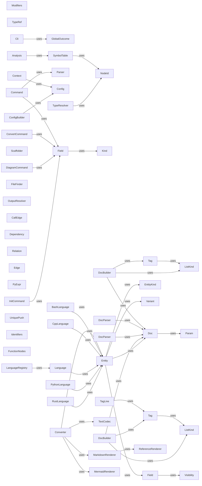
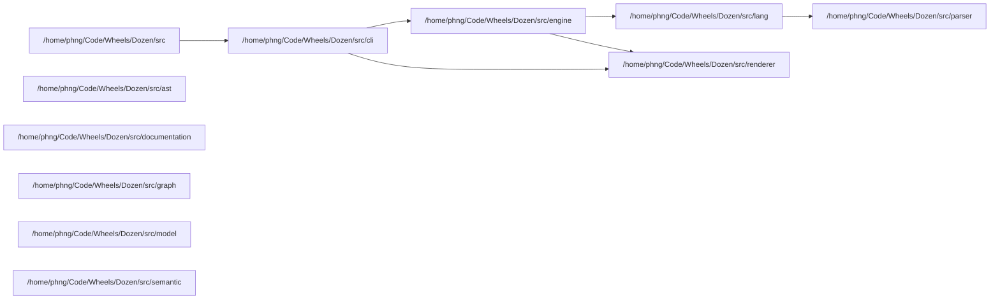

# Contract Graph

## Class Diagram

```mermaid
classDiagram
  class Visibility {
    <<enumeration>>
    +as_str()
    +marker()
    +from_keyword()
    Public
    Protected
    Private
    Package
  }
  class Modifiers {
    +bool r#static
    +bool r#abstract
  }
  class NodeId {
    +new()
    +index()
    +from()
  }
  class TypeRef {
    -String raw
    -String base
    -Vec~String~ tokens
    +parse()
    +raw()
    +base()
    +tokens()
    +display()
  }
  class Context {
    -Option~PathBuf~ global_config
    +new()
    +load_config()
    +input_spec()
    +output_path()
    +prepare_output()
  }
  class Command {
    <<interface>>
    +name()
    +usage()
    +help()
    +fields()
    +run()
    +parse()
    +error_program()
    +print_help()
  }
  class ConvertCommand {
    +name()
    +usage()
    +help()
    +fields()
    +run()
  }
  class DiagramCommand {
    +name()
    +usage()
    +help()
    +fields()
    +run()
  }
  class InitCommand {
    +name()
    +usage()
    +help()
    +fields()
    +run()
  }
  class Cli {
    -Vec~String~ args
    +from_env()
    +execute()
    +command_index()
    +execute_default()
    +parse_global()
  }
  class GlobalOutcome {
    <<enumeration>>
    Continue
    Stop
  }
  class Kind {
    <<enumeration>>
    Flag
    Opt
    Pos
  }
  class Field {
    +static str long
    +Option~char~ short
    +Kind kind
    +option()
    +flag()
    +short_flag()
    +positional()
    +accepts_long()
    +accepts_short()
  }
  class Parser {
    +Vec~String~ flags
    +HashMap~String, String~ opts
    +Vec~String~ positional
    +flag()
    +opt()
    +str()
    +parse()
    +parse_long()
    +parse_short()
    +push_flag()
  }
  class Scaffolder {
    -PathBuf target
    -bool force
    +new()
    +run()
    +target()
    +config_path()
  }
  class Tag {
    <<enumeration>>
    +from_name()
    +list_kind()
    Brief
    Details
    Param
    Returns
    Throws
    See
    Note
    Warning
    Example
    Unknown
  }
  class ListKind {
    <<enumeration>>
    See
    Note
    Warning
    Example
  }
  class DocBuilder {
    -Doc doc
    -Option~Tag~ active
    -Option~usize~ param
    -Option~usize~ throw
    -Option~(ListKind, usize)~ list
    +new()
    +consume()
    +blank_line()
    +begin_tag()
    +continuation()
    +append_unstructured()
    +push_param()
    +push_throw()
    +push_list()
    +list_mut()
    +finish()
    +paragraphs()
  }
  class DocParser {
    +parse()
  }
  class DocParser_2 {
    +parse()
  }
  class Tag_2 {
    <<enumeration>>
    +from_name()
    +list_kind()
    Brief
    Details
    Param
    Returns
    Throws
    See
    Note
    Warning
    Example
    Unknown
  }
  class ListKind_2 {
    <<enumeration>>
    See
    Note
    Warning
    Example
  }
  class TagLine {
    +Tag tag
    +a str direction
    +a str value
  }
  class DocBuilder_2 {
    -Doc doc
    -Option~Tag~ active
    -Option~usize~ param
    -Option~usize~ throw
    -Option~(ListKind, usize)~ list
    +new()
    +consume()
    +blank_line()
    +begin_tag()
    +continuation()
    +append_unstructured()
    +push_param()
    +push_throw()
    +push_list()
    +list_mut()
    +finish()
    +paragraphs()
    +partition_space()
  }
  class Config {
    +String glob
    +PathBuf output
    +PathBuf diagram
    +String encoding
    +PathBuf base_dir
    +default()
    +defaults()
    +load()
    +parse()
  }
  class ConfigBuilder {
    -Config config
    -Option~String~ section
    +new()
    +apply()
    +set()
    +finish()
  }
  class TextCodec {
    -String encoding
    +new()
    +read()
    +decode()
    +encode()
    +write()
  }
  class Converter {
    -MarkdownRenderer markdown
    -MermaidRenderer mermaid
    -TextCodec codec
    +new()
    +entities()
    +file()
    +project()
    +diagram()
    +files()
    +document()
  }
  class FileFinder {
    -Option~a Path~ base_dir
  }
  class OutputResolver {
    -a Path base_dir
  }
  class CallEdge {
    +String caller
    +String callee
  }
  class Dependency {
    +String owner
    +String dependency
  }
  class Relation {
    +String child
    +String parent
    +bool implementation
  }
  class Edge {
    +T from
    +T to
    +Option~String~ label
  }
  class BashLanguage {
    +extensions()
    +parse()
  }
  class CppLanguage {
    +extensions()
    +parse()
  }
  class Language {
    <<interface>>
    +extensions()
    +parse()
  }
  class PyExpr {
    <<enumeration>>
    Raw
    Name
    Attribute
    Subscript
    Tuple
    List
    BinOp
    String
    Call
  }
  class PythonLanguage {
    +extensions()
    +parse()
  }
  class LanguageRegistry {
    +new()
    +suffix()
    +is_supported()
    +language_for()
  }
  class RustLanguage {
    +extensions()
    +parse()
  }
  class EntityKind {
    <<enumeration>>
    +value()
    +title()
    +is_aggregate()
    +is_enum()
    +is_callable()
    +is_container()
    Module
    Function
    Method
    Class
    Struct
    Enum
    Trait
    Interface
  }
  class Param {
    +String name
    +String r#type
    +String direction
    +String description
    +new()
    +extend_description()
  }
  class Variant {
    +String name
    +String description
  }
  class Field_2 {
    +String name
    +String r#type
    +Visibility visibility
    +bool r#static
    +String description
    +new()
  }
  class Doc {
    +String brief
    +String details
    +Vec~Param~ params
    +String returns
    +Vec~(String, String)~ throws
    +Vec~String~ see
    +Vec~String~ notes
    +Vec~String~ warnings
    +Vec~String~ examples
    +has_contract()
  }
  class Entity {
    +EntityKind kind
    +String name
    +String signature
    +String return_type
    +Doc doc
    +bool r#abstract
    +Vec~Entity~ members
    +Vec~Variant~ variants
    +Vec~Field~ fields
    +Vec~String~ bases
    +Vec~String~ implements
    +String module
    +String path
    +usize line
    +Vec~String~ calls
    +Vec~String~ includes
    +new()
    +stamp()
  }
  class UniquePush {
    <<interface>>
    +push_unique()
  }
  class MarkdownRenderer {
    -ReferenceRenderer reference
    +new()
    +render()
  }
  class MermaidRenderer {
    +title()
    +render()
    +render_all()
    +class_diagram()
    +inheritance_diagram()
    +class_diagram_impl()
    +collaboration_diagram()
    +call_graph()
    +caller_graph()
    +call_diagram()
    +include_graph()
    +directory_graph()
  }
  class Identifiers {
    -HashMap~usize, String~ ids
    -HashMap~String, String~ by_name
    -HashMap~(String, String), String~ by_file
  }
  class FunctionNodes {
    -HashMap~usize, String~ ids
    -HashMap~usize, String~ labels
    -HashMap~String, String~ by_name
    -HashMap~(String, String), String~ by_file
  }
  class ReferenceRenderer {
    +render()
    +entity()
    +module_reference()
    +function()
    +class_reference()
    +enum_reference()
    +relations()
    +member_contracts()
    +member_contract()
    +example_section()
    +members_table()
    +fields_table()
    +params_table()
    +throws_table()
    +quote_blocks()
  }
  class Analysis {
    +SymbolTable symbols
  }
  class SymbolTable {
    -HashMap~String, Vec~NodeId~~ by_name
    +from_entities()
    +add()
    +get()
    +len()
    +is_empty()
  }
  class TypeResolver {
    +resolve()
  }
  Command <|.. ConvertCommand
  Command <|.. DiagramCommand
  Command <|.. InitCommand
  Field ..> Kind
  DocBuilder ..> Doc
  DocBuilder ..> Tag
  DocBuilder ..> ListKind
  TagLine ..> Tag_2
  DocBuilder_2 ..> Doc
  DocBuilder_2 ..> Tag_2
  DocBuilder_2 ..> ListKind_2
  ConfigBuilder ..> Config
  Converter ..> MarkdownRenderer
  Converter ..> MermaidRenderer
  Converter ..> TextCodec
  Language <|.. BashLanguage
  Language <|.. CppLanguage
  Language <|.. PythonLanguage
  Language <|.. RustLanguage
  Field_2 ..> Visibility
  Doc ..> Param
  Entity ..> EntityKind
  Entity ..> Doc
  Entity ..> Variant
  Entity ..> Field_2
  MarkdownRenderer ..> ReferenceRenderer
  Analysis ..> SymbolTable
  SymbolTable ..> NodeId
```



## Inheritance Diagram

```mermaid
classDiagram
  class Modifiers {
  }
  class NodeId {
  }
  class TypeRef {
  }
  class Context {
  }
  class Command {
    <<interface>>
  }
  class ConvertCommand {
  }
  class DiagramCommand {
  }
  class InitCommand {
  }
  class Cli {
  }
  class Field {
  }
  class Parser {
  }
  class Scaffolder {
  }
  class DocBuilder {
  }
  class DocParser {
  }
  class DocParser_2 {
  }
  class TagLine {
  }
  class DocBuilder_2 {
  }
  class Config {
  }
  class ConfigBuilder {
  }
  class TextCodec {
  }
  class Converter {
  }
  class FileFinder {
  }
  class OutputResolver {
  }
  class CallEdge {
  }
  class Dependency {
  }
  class Relation {
  }
  class Edge {
  }
  class BashLanguage {
  }
  class CppLanguage {
  }
  class Language {
    <<interface>>
  }
  class PythonLanguage {
  }
  class LanguageRegistry {
  }
  class RustLanguage {
  }
  class Param {
  }
  class Variant {
  }
  class Field_2 {
  }
  class Doc {
  }
  class Entity {
  }
  class UniquePush {
    <<interface>>
  }
  class MarkdownRenderer {
  }
  class MermaidRenderer {
  }
  class Identifiers {
  }
  class FunctionNodes {
  }
  class ReferenceRenderer {
  }
  class Analysis {
  }
  class SymbolTable {
  }
  class TypeResolver {
  }
  Command <|.. ConvertCommand
  Command <|.. DiagramCommand
  Command <|.. InitCommand
  Language <|.. BashLanguage
  Language <|.. CppLanguage
  Language <|.. PythonLanguage
  Language <|.. RustLanguage
```



## Collaboration Diagram



## Call Graph

```mermaid
flowchart LR
  fn_attribute_Visibility_as_str["attribute.Visibility.as_str"]
  fn_attribute_Visibility_marker["attribute.Visibility.marker"]
  fn_attribute_Visibility_from_keyword["attribute.Visibility.from_keyword"]
  fn_node_NodeId_new["node.NodeId.new"]
  fn_node_NodeId_index["node.NodeId.index"]
  fn_node_NodeId_from["node.NodeId.from"]
  fn_types_TypeRef_parse["types.TypeRef.parse"]
  fn_types_TypeRef_raw["types.TypeRef.raw"]
  fn_types_TypeRef_base["types.TypeRef.base"]
  fn_types_TypeRef_tokens["types.TypeRef.tokens"]
  fn_types_TypeRef_display["types.TypeRef.display"]
  fn_command_Context_new["command.Context.new"]
  fn_command_Context_load_config["command.Context.load_config"]
  fn_command_Context_input_spec["command.Context.input_spec"]
  fn_command_Context_output_path["command.Context.output_path"]
  fn_command_Context_prepare_output["command.Context.prepare_output"]
  fn_command_Command_name["command.Command.name"]
  fn_command_Command_usage["command.Command.usage"]
  fn_command_Command_help["command.Command.help"]
  fn_command_Command_fields["command.Command.fields"]
  fn_command_Command_run["command.Command.run"]
  fn_command_Command_parse["command.Command.parse"]
  fn_command_Command_error_program["command.Command.error_program"]
  fn_command_Command_print_help["command.Command.print_help"]
  fn_command_ConvertCommand_name["command.ConvertCommand.name"]
  fn_command_ConvertCommand_usage["command.ConvertCommand.usage"]
  fn_command_ConvertCommand_help["command.ConvertCommand.help"]
  fn_command_ConvertCommand_fields["command.ConvertCommand.fields"]
  fn_command_ConvertCommand_run["command.ConvertCommand.run"]
  fn_command_DiagramCommand_name["command.DiagramCommand.name"]
  fn_command_DiagramCommand_usage["command.DiagramCommand.usage"]
  fn_command_DiagramCommand_help["command.DiagramCommand.help"]
  fn_command_DiagramCommand_fields["command.DiagramCommand.fields"]
  fn_command_DiagramCommand_run["command.DiagramCommand.run"]
  fn_command_InitCommand_name["command.InitCommand.name"]
  fn_command_InitCommand_usage["command.InitCommand.usage"]
  fn_command_InitCommand_help["command.InitCommand.help"]
  fn_command_InitCommand_fields["command.InitCommand.fields"]
  fn_command_InitCommand_run["command.InitCommand.run"]
  fn_command_all["command.all"]
  fn_command_find["command.find"]
  fn_command_kind_choices["command.kind_choices"]
  fn_command_parse_or_exit["command.parse_or_exit"]
  fn_mod_run["mod.run"]
  fn_mod_Cli_from_env["mod.Cli.from_env"]
  fn_mod_Cli_execute["mod.Cli.execute"]
  fn_mod_Cli_command_index["mod.Cli.command_index"]
  fn_mod_Cli_execute_default["mod.Cli.execute_default"]
  fn_mod_Cli_parse_global["mod.Cli.parse_global"]
  fn_mod_dispatch["mod.dispatch"]
  fn_mod_run_command["mod.run_command"]
  fn_mod_is_help["mod.is_help"]
  fn_mod_print_help["mod.print_help"]
  fn_mod_print_version["mod.print_version"]
  fn_mod_usage_error["mod.usage_error"]
  fn_parser_Field_option["parser.Field.option"]
  fn_parser_Field_flag["parser.Field.flag"]
  fn_parser_Field_short_flag["parser.Field.short_flag"]
  fn_parser_Field_positional["parser.Field.positional"]
  fn_parser_Field_accepts_long["parser.Field.accepts_long"]
  fn_parser_Field_accepts_short["parser.Field.accepts_short"]
  fn_parser_Parser_flag["parser.Parser.flag"]
  fn_parser_Parser_opt["parser.Parser.opt"]
  fn_parser_Parser_str["parser.Parser.str"]
  fn_parser_Parser_parse["parser.Parser.parse"]
  fn_parser_Parser_parse_long["parser.Parser.parse_long"]
  fn_parser_Parser_parse_short["parser.Parser.parse_short"]
  fn_parser_Parser_push_flag["parser.Parser.push_flag"]
  fn_scaffold_Scaffolder_new["scaffold.Scaffolder.new"]
  fn_scaffold_Scaffolder_run["scaffold.Scaffolder.run"]
  fn_scaffold_Scaffolder_target["scaffold.Scaffolder.target"]
  fn_scaffold_Scaffolder_config_path["scaffold.Scaffolder.config_path"]
  fn_scaffold_normalize["scaffold.normalize"]
  fn_mod_Tag_from_name["mod.Tag.from_name"]
  fn_mod_Tag_list_kind["mod.Tag.list_kind"]
  fn_mod_DocBuilder_new["mod.DocBuilder.new"]
  fn_mod_DocBuilder_consume["mod.DocBuilder.consume"]
  fn_mod_DocBuilder_blank_line["mod.DocBuilder.blank_line"]
  fn_mod_DocBuilder_begin_tag["mod.DocBuilder.begin_tag"]
  fn_mod_DocBuilder_continuation["mod.DocBuilder.continuation"]
  fn_mod_DocBuilder_append_unstructured["mod.DocBuilder.append_unstructured"]
  fn_mod_DocBuilder_push_param["mod.DocBuilder.push_param"]
  fn_mod_DocBuilder_push_throw["mod.DocBuilder.push_throw"]
  fn_mod_DocBuilder_push_list["mod.DocBuilder.push_list"]
  fn_mod_DocBuilder_list_mut["mod.DocBuilder.list_mut"]
  fn_mod_DocBuilder_finish["mod.DocBuilder.finish"]
  fn_mod_DocBuilder_paragraphs["mod.DocBuilder.paragraphs"]
  fn_mod_split_lines["mod.split_lines"]
  fn_mod_expand_tabs["mod.expand_tabs"]
  fn_mod_cleandoc["mod.cleandoc"]
  fn_mod_DocParser_parse["mod.DocParser.parse"]
  fn_mod_partition_space["mod.partition_space"]
  fn_parser_DocParser_parse["parser.DocParser.parse"]
  fn_tags_Tag_from_name["tags.Tag.from_name"]
  fn_tags_Tag_list_kind["tags.Tag.list_kind"]
  fn_tags_DocBuilder_new["tags.DocBuilder.new"]
  fn_tags_DocBuilder_consume["tags.DocBuilder.consume"]
  fn_tags_DocBuilder_blank_line["tags.DocBuilder.blank_line"]
  fn_tags_DocBuilder_begin_tag["tags.DocBuilder.begin_tag"]
  fn_tags_DocBuilder_continuation["tags.DocBuilder.continuation"]
  fn_tags_DocBuilder_append_unstructured["tags.DocBuilder.append_unstructured"]
  fn_tags_DocBuilder_push_param["tags.DocBuilder.push_param"]
  fn_tags_DocBuilder_push_throw["tags.DocBuilder.push_throw"]
  fn_tags_DocBuilder_push_list["tags.DocBuilder.push_list"]
  fn_tags_DocBuilder_list_mut["tags.DocBuilder.list_mut"]
  fn_tags_DocBuilder_finish["tags.DocBuilder.finish"]
  fn_tags_DocBuilder_paragraphs["tags.DocBuilder.paragraphs"]
  fn_tags_DocBuilder_partition_space["tags.DocBuilder.partition_space"]
  fn_config_Config_default["config.Config.default"]
  fn_config_Config_defaults["config.Config.defaults"]
  fn_config_Config_load["config.Config.load"]
  fn_config_Config_parse["config.Config.parse"]
  fn_config_ConfigBuilder_new["config.ConfigBuilder.new"]
  fn_config_ConfigBuilder_apply["config.ConfigBuilder.apply"]
  fn_config_ConfigBuilder_set["config.ConfigBuilder.set"]
  fn_config_ConfigBuilder_finish["config.ConfigBuilder.finish"]
  fn_config_python_path["config.python_path"]
  fn_converter_TextCodec_new["converter.TextCodec.new"]
  fn_converter_TextCodec_read["converter.TextCodec.read"]
  fn_converter_TextCodec_decode["converter.TextCodec.decode"]
  fn_converter_TextCodec_encode["converter.TextCodec.encode"]
  fn_converter_TextCodec_write["converter.TextCodec.write"]
  fn_converter_encoding_for["converter.encoding_for"]
  fn_converter_Converter_new["converter.Converter.new"]
  fn_converter_Converter_entities["converter.Converter.entities"]
  fn_converter_Converter_file["converter.Converter.file"]
  fn_converter_Converter_project["converter.Converter.project"]
  fn_converter_Converter_diagram["converter.Converter.diagram"]
  fn_converter_Converter_files["converter.Converter.files"]
  fn_converter_Converter_document["converter.Converter.document"]
  fn_converter_display_name["converter.display_name"]
  fn_files_match_options["files.match_options"]
  fn_call_graph_edges["call_graph.edges"]
  fn_dependency_dependencies["dependency.dependencies"]
  fn_inheritance_relations["inheritance.relations"]
  fn_bash_BashLanguage_extensions["bash.BashLanguage.extensions"]
  fn_bash_BashLanguage_parse["bash.BashLanguage.parse"]
  fn_bash_text_at["bash.text_at"]
  fn_bash_preceding_doc["bash.preceding_doc"]
  fn_bash_walk_functions["bash.walk_functions"]
  fn_bash_includes["bash.includes"]
  fn_bash_collect_includes["bash.collect_includes"]
  fn_bash_calls["bash.calls"]
  fn_bash_walk_calls["bash.walk_calls"]
  fn_cpp_CppLanguage_extensions["cpp.CppLanguage.extensions"]
  fn_cpp_CppLanguage_parse["cpp.CppLanguage.parse"]
  fn_cpp_text_at["cpp.text_at"]
  fn_cpp_clean_comment["cpp.clean_comment"]
  fn_cpp_preceding_doc["cpp.preceding_doc"]
  fn_cpp_doc_for["cpp.doc_for"]
  fn_cpp_walk_top_level["cpp.walk_top_level"]
  fn_cpp_enum_entity["cpp.enum_entity"]
  fn_cpp_class_entity["cpp.class_entity"]
  fn_cpp_field_entity["cpp.field_entity"]
  fn_cpp_node_name["cpp.node_name"]
  fn_cpp_method_declaration["cpp.method_declaration"]
  fn_cpp_declarator_parameter_text["cpp.declarator_parameter_text"]
  fn_cpp_find_parameters["cpp.find_parameters"]
  fn_cpp_parameter_types["cpp.parameter_types"]
  fn_cpp_merge_parameter_types["cpp.merge_parameter_types"]
  fn_cpp_function_entity["cpp.function_entity"]
  fn_cpp_qualified_name["cpp.qualified_name"]
  fn_cpp_merge_impl_methods["cpp.merge_impl_methods"]
  fn_cpp_merge_methods_in_namespace["cpp.merge_methods_in_namespace"]
  fn_cpp_base_names["cpp.base_names"]
  fn_cpp_includes["cpp.includes"]
  fn_cpp_collect_includes["cpp.collect_includes"]
  fn_cpp_calls["cpp.calls"]
  fn_cpp_walk_calls["cpp.walk_calls"]
  fn_mod_Language_extensions["mod.Language.extensions"]
  fn_mod_Language_parse["mod.Language.parse"]
  fn_mod_consume_block["mod.consume_block"]
  fn_mod_read_block_comment["mod.read_block_comment"]
  fn_mod_body_slice["mod.body_slice"]
  fn_python_PythonLanguage_extensions["python.PythonLanguage.extensions"]
  fn_python_PythonLanguage_parse["python.PythonLanguage.parse"]
  fn_python_unwrap_decorated["python.unwrap_decorated"]
  fn_python_text_at["python.text_at"]
  fn_python_module_docstring["python.module_docstring"]
  fn_python_docstring["python.docstring"]
  fn_python_clean_string["python.clean_string"]
  fn_python_line_of["python.line_of"]
  fn_python_function_entity["python.function_entity"]
  fn_python_parameter_annotations["python.parameter_annotations"]
  fn_python_parameter_name["python.parameter_name"]
  fn_python_parameter_annotation["python.parameter_annotation"]
  fn_python_unparse_annotation_text["python.unparse_annotation_text"]
  fn_python_class_entity["python.class_entity"]
  fn_python_find_method["python.find_method"]
  fn_python_is_enum_class["python.is_enum_class"]
  fn_python_is_abstract_class["python.is_abstract_class"]
  fn_python_is_abstract_method["python.is_abstract_method"]
  fn_python_class_bases["python.class_bases"]
  fn_python_enum_variants["python.enum_variants"]
  fn_python_collect_fields["python.collect_fields"]
  fn_python_walk_fields["python.walk_fields"]
  fn_python_self_attribute["python.self_attribute"]
  fn_python_add_field["python.add_field"]
  fn_python_visibility["python.visibility"]
  fn_python_collect_imports["python.collect_imports"]
  fn_python_collect_import_nodes["python.collect_import_nodes"]
  fn_python_import_name["python.import_name"]
  fn_python_collect_calls["python.collect_calls"]
  fn_python_walk_calls["python.walk_calls"]
  fn_python_call_name["python.call_name"]
  fn_python_node_name["python.node_name"]
  fn_python_unparse_text["python.unparse_text"]
  fn_python_parse_expr["python.parse_expr"]
  fn_python_render_expr["python.render_expr"]
  fn_python_unparse_string["python.unparse_string"]
  fn_registry_LanguageRegistry_new["registry.LanguageRegistry.new"]
  fn_registry_LanguageRegistry_suffix["registry.LanguageRegistry.suffix"]
  fn_registry_LanguageRegistry_is_supported["registry.LanguageRegistry.is_supported"]
  fn_registry_LanguageRegistry_language_for["registry.LanguageRegistry.language_for"]
  fn_rust_RustLanguage_extensions["rust.RustLanguage.extensions"]
  fn_rust_RustLanguage_parse["rust.RustLanguage.parse"]
  fn_rust_text_at["rust.text_at"]
  fn_rust_node_name["rust.node_name"]
  fn_rust_preceding_doc["rust.preceding_doc"]
  fn_rust_clean_line_comment["rust.clean_line_comment"]
  fn_rust_clean_block_comment["rust.clean_block_comment"]
  fn_rust_doc_for["rust.doc_for"]
  fn_rust_visibility["rust.visibility"]
  fn_rust_struct_entity["rust.struct_entity"]
  fn_rust_enum_entity["rust.enum_entity"]
  fn_rust_trait_entity["rust.trait_entity"]
  fn_rust_function_entity["rust.function_entity"]
  fn_rust_parameter_text["rust.parameter_text"]
  fn_rust_merge_impl["rust.merge_impl"]
  fn_rust_includes["rust.includes"]
  fn_rust_calls["rust.calls"]
  fn_rust_walk_calls["rust.walk_calls"]
  fn_rust_call_name["rust.call_name"]
  fn_rust_split_args["rust.split_args"]
  fn_main_main["main.main"]
  fn_mod_EntityKind_value["mod.EntityKind.value"]
  fn_mod_EntityKind_title["mod.EntityKind.title"]
  fn_mod_EntityKind_is_aggregate["mod.EntityKind.is_aggregate"]
  fn_mod_EntityKind_is_enum["mod.EntityKind.is_enum"]
  fn_mod_EntityKind_is_callable["mod.EntityKind.is_callable"]
  fn_mod_EntityKind_is_container["mod.EntityKind.is_container"]
  fn_mod_Param_new["mod.Param.new"]
  fn_mod_Param_extend_description["mod.Param.extend_description"]
  fn_mod_Field_new["mod.Field.new"]
  fn_mod_Doc_has_contract["mod.Doc.has_contract"]
  fn_mod_Entity_new["mod.Entity.new"]
  fn_mod_Entity_stamp["mod.Entity.stamp"]
  fn_mod_UniquePush_push_unique["mod.UniquePush.push_unique"]
  fn_mod_dedup_push["mod.dedup_push"]
  fn_tree_sitter_python_parser["tree_sitter.python_parser"]
  fn_tree_sitter_parse_python["tree_sitter.parse_python"]
  fn_tree_sitter_rust_parser["tree_sitter.rust_parser"]
  fn_tree_sitter_parse_rust["tree_sitter.parse_rust"]
  fn_tree_sitter_cpp_parser["tree_sitter.cpp_parser"]
  fn_tree_sitter_parse_cpp["tree_sitter.parse_cpp"]
  fn_tree_sitter_bash_parser["tree_sitter.bash_parser"]
  fn_tree_sitter_parse_bash["tree_sitter.parse_bash"]
  fn_tree_sitter_has_missing["tree_sitter.has_missing"]
  fn_tree_sitter_parse["tree_sitter.parse"]
  fn_markdown_MarkdownRenderer_new["markdown.MarkdownRenderer.new"]
  fn_markdown_MarkdownRenderer_render["markdown.MarkdownRenderer.render"]
  fn_markdown_escape_table_cell["markdown.escape_table_cell"]
  fn_markdown_cell["markdown.cell"]
  fn_markdown_table["markdown.table"]
  fn_markdown_code_list["markdown.code_list"]
  fn_markdown_bullets["markdown.bullets"]
  fn_markdown_heading["markdown.heading"]
  fn_markdown_fenced_code["markdown.fenced_code"]
  fn_mermaid_MermaidRenderer_title["mermaid.MermaidRenderer.title"]
  fn_mermaid_MermaidRenderer_render["mermaid.MermaidRenderer.render"]
  fn_mermaid_MermaidRenderer_render_all["mermaid.MermaidRenderer.render_all"]
  fn_mermaid_MermaidRenderer_class_diagram["mermaid.MermaidRenderer.class_diagram"]
  fn_mermaid_MermaidRenderer_inheritance_diagram["mermaid.MermaidRenderer.inheritance_diagram"]
  fn_mermaid_MermaidRenderer_class_diagram_impl["mermaid.MermaidRenderer.class_diagram_impl"]
  fn_mermaid_MermaidRenderer_collaboration_diagram["mermaid.MermaidRenderer.collaboration_diagram"]
  fn_mermaid_MermaidRenderer_call_graph["mermaid.MermaidRenderer.call_graph"]
  fn_mermaid_MermaidRenderer_caller_graph["mermaid.MermaidRenderer.caller_graph"]
  fn_mermaid_MermaidRenderer_call_diagram["mermaid.MermaidRenderer.call_diagram"]
  fn_mermaid_MermaidRenderer_include_graph["mermaid.MermaidRenderer.include_graph"]
  fn_mermaid_MermaidRenderer_directory_graph["mermaid.MermaidRenderer.directory_graph"]
  fn_mermaid_collect["mermaid.collect"]
  fn_mermaid_identifiers["mermaid.identifiers"]
  fn_mermaid_block["mermaid.block"]
  fn_mermaid_stereotype["mermaid.stereotype"]
  fn_mermaid_display_type["mermaid.display_type"]
  fn_mermaid_class_edges["mermaid.class_edges"]
  fn_mermaid_lookup["mermaid.lookup"]
  fn_mermaid_type_names["mermaid.type_names"]
  fn_mermaid_used_types["mermaid.used_types"]
  fn_mermaid_functions["mermaid.functions"]
  fn_mermaid_function_nodes["mermaid.function_nodes"]
  fn_mermaid_call_target["mermaid.call_target"]
  fn_mermaid_qualified["mermaid.qualified"]
  fn_mermaid_modules["mermaid.modules"]
  fn_mermaid_module_index["mermaid.module_index"]
  fn_mermaid_resolve_module["mermaid.resolve_module"]
  fn_mermaid_include_candidates["mermaid.include_candidates"]
  fn_mermaid_sanitize["mermaid.sanitize"]
  fn_mermaid_label["mermaid.label"]
  fn_mermaid_as_posix["mermaid.as_posix"]
  fn_mermaid_path_file_name["mermaid.path_file_name"]
  fn_mermaid_path_file_stem["mermaid.path_file_stem"]
  fn_mermaid_parent_posix["mermaid.parent_posix"]
  fn_reference_ReferenceRenderer_render["reference.ReferenceRenderer.render"]
  fn_reference_ReferenceRenderer_entity["reference.ReferenceRenderer.entity"]
  fn_reference_ReferenceRenderer_module_reference["reference.ReferenceRenderer.module_reference"]
  fn_reference_ReferenceRenderer_function["reference.ReferenceRenderer.function"]
  fn_reference_ReferenceRenderer_class_reference["reference.ReferenceRenderer.class_reference"]
  fn_reference_ReferenceRenderer_enum_reference["reference.ReferenceRenderer.enum_reference"]
  fn_reference_ReferenceRenderer_relations["reference.ReferenceRenderer.relations"]
  fn_reference_ReferenceRenderer_member_contracts["reference.ReferenceRenderer.member_contracts"]
  fn_reference_ReferenceRenderer_member_contract["reference.ReferenceRenderer.member_contract"]
  fn_reference_ReferenceRenderer_example_section["reference.ReferenceRenderer.example_section"]
  fn_reference_ReferenceRenderer_members_table["reference.ReferenceRenderer.members_table"]
  fn_reference_ReferenceRenderer_fields_table["reference.ReferenceRenderer.fields_table"]
  fn_reference_ReferenceRenderer_params_table["reference.ReferenceRenderer.params_table"]
  fn_reference_ReferenceRenderer_throws_table["reference.ReferenceRenderer.throws_table"]
  fn_reference_ReferenceRenderer_quote_blocks["reference.ReferenceRenderer.quote_blocks"]
  fn_analyzer_analyze["analyzer.analyze"]
  fn_symbol_table_SymbolTable_from_entities["symbol_table.SymbolTable.from_entities"]
  fn_symbol_table_SymbolTable_add["symbol_table.SymbolTable.add"]
  fn_symbol_table_SymbolTable_get["symbol_table.SymbolTable.get"]
  fn_symbol_table_SymbolTable_len["symbol_table.SymbolTable.len"]
  fn_symbol_table_SymbolTable_is_empty["symbol_table.SymbolTable.is_empty"]
  fn_type_resolver_TypeResolver_resolve["type_resolver.TypeResolver.resolve"]
  fn_node_NodeId_from -->|calls| fn_node_NodeId_new
  fn_types_TypeRef_parse -->|calls| fn_mermaid_collect
  fn_types_TypeRef_parse -->|calls| fn_attribute_Visibility_as_str
  fn_command_Context_load_config -->|calls| fn_parser_Parser_opt
  fn_command_Context_load_config -->|calls| fn_config_Config_load
  fn_command_Context_output_path -->|calls| fn_command_Context_new
  fn_command_Context_output_path -->|calls| fn_type_resolver_TypeResolver_resolve
  fn_command_Context_output_path -->|calls| fn_parser_Parser_opt
  fn_command_Context_prepare_output -->|calls| fn_symbol_table_SymbolTable_is_empty
  fn_command_Context_prepare_output -->|calls| fn_command_Context_new
  fn_command_Command_parse -->|calls| fn_command_parse_or_exit
  fn_command_ConvertCommand_run -->|calls| fn_command_Command_parse
  fn_command_ConvertCommand_run -->|calls| fn_command_Context_load_config
  fn_command_ConvertCommand_run -->|calls| fn_command_Context_input_spec
  fn_command_ConvertCommand_run -->|calls| fn_command_Context_new
  fn_command_ConvertCommand_run -->|calls| fn_command_Context_output_path
  fn_command_ConvertCommand_run -->|calls| fn_command_Context_prepare_output
  fn_command_ConvertCommand_run -->|calls| fn_converter_Converter_files
  fn_command_DiagramCommand_run -->|calls| fn_command_Command_parse
  fn_command_DiagramCommand_run -->|calls| fn_command_Context_load_config
  fn_command_DiagramCommand_run -->|calls| fn_parser_Parser_opt
  fn_command_DiagramCommand_run -->|calls| fn_mod_usage_error
  fn_command_DiagramCommand_run -->|calls| fn_command_Command_error_program
  fn_command_DiagramCommand_run -->|calls| fn_command_Context_input_spec
  fn_command_DiagramCommand_run -->|calls| fn_command_Context_new
  fn_command_DiagramCommand_run -->|calls| fn_command_Context_output_path
  fn_command_DiagramCommand_run -->|calls| fn_command_Context_prepare_output
  fn_command_DiagramCommand_run -->|calls| fn_converter_Converter_diagram
  fn_command_InitCommand_run -->|calls| fn_command_Command_parse
  fn_command_InitCommand_run -->|calls| fn_node_NodeId_from
  fn_command_InitCommand_run -->|calls| fn_command_Context_new
  fn_command_parse_or_exit -->|calls| fn_command_Command_parse
  fn_mod_run -->|calls| fn_mod_Cli_execute
  fn_mod_run -->|calls| fn_mod_Cli_from_env
  fn_mod_Cli_from_env -->|calls| fn_mermaid_collect
  fn_mod_Cli_execute -->|calls| fn_symbol_table_SymbolTable_is_empty
  fn_mod_Cli_execute -->|calls| fn_mod_print_help
  fn_mod_Cli_execute -->|calls| fn_mod_Cli_command_index
  fn_mod_Cli_execute -->|calls| fn_mod_Cli_execute_default
  fn_mod_Cli_execute -->|calls| fn_mod_Cli_parse_global
  fn_mod_Cli_execute -->|calls| fn_mod_dispatch
  fn_mod_Cli_execute -->|calls| fn_mod_run_command
  fn_mod_Cli_command_index -->|calls| fn_command_find
  fn_mod_Cli_execute_default -->|calls| fn_mod_is_help
  fn_mod_Cli_execute_default -->|calls| fn_mod_print_help
  fn_mod_Cli_execute_default -->|calls| fn_mod_print_version
  fn_mod_Cli_execute_default -->|calls| fn_mermaid_collect
  fn_mod_Cli_execute_default -->|calls| fn_mod_dispatch
  fn_mod_Cli_execute_default -->|calls| fn_mod_run_command
  fn_mod_Cli_parse_global -->|calls| fn_symbol_table_SymbolTable_len
  fn_mod_Cli_parse_global -->|calls| fn_attribute_Visibility_as_str
  fn_mod_Cli_parse_global -->|calls| fn_mod_print_help
  fn_mod_Cli_parse_global -->|calls| fn_mod_print_version
  fn_mod_Cli_parse_global -->|calls| fn_symbol_table_SymbolTable_get
  fn_mod_Cli_parse_global -->|calls| fn_mod_usage_error
  fn_mod_Cli_parse_global -->|calls| fn_node_NodeId_from
  fn_mod_dispatch -->|calls| fn_command_find
  fn_mod_run_command -->|calls| fn_mod_is_help
  fn_mod_run_command -->|calls| fn_mod_print_help
  fn_mod_run_command -->|calls| fn_mod_run
  fn_mod_usage_error -->|calls| fn_node_NodeId_from
  fn_parser_Parser_opt -->|calls| fn_symbol_table_SymbolTable_get
  fn_parser_Parser_parse -->|calls| fn_config_Config_default
  fn_parser_Parser_parse -->|calls| fn_parser_Parser_parse_long
  fn_parser_Parser_parse -->|calls| fn_parser_Parser_parse_short
  fn_parser_Parser_parse_long -->|calls| fn_command_find
  fn_parser_Parser_parse_long -->|calls| fn_parser_Field_accepts_long
  fn_parser_Parser_parse_long -->|calls| fn_parser_Parser_push_flag
  fn_parser_Parser_parse_short -->|calls| fn_command_find
  fn_parser_Parser_parse_short -->|calls| fn_parser_Field_accepts_short
  fn_parser_Parser_parse_short -->|calls| fn_parser_Parser_push_flag
  fn_parser_Parser_parse_short -->|calls| fn_symbol_table_SymbolTable_is_empty
  fn_scaffold_Scaffolder_run -->|calls| fn_scaffold_Scaffolder_config_path
  fn_scaffold_Scaffolder_run -->|calls| fn_converter_TextCodec_write
  fn_scaffold_Scaffolder_config_path -->|calls| fn_scaffold_normalize
  fn_scaffold_normalize -->|calls| fn_mermaid_collect
  fn_mod_DocBuilder_new -->|calls| fn_mod_DocBuilder_paragraphs
  fn_mod_DocBuilder_new -->|calls| fn_config_Config_default
  fn_mod_DocBuilder_consume -->|calls| fn_symbol_table_SymbolTable_is_empty
  fn_mod_DocBuilder_consume -->|calls| fn_mod_DocBuilder_blank_line
  fn_mod_DocBuilder_consume -->|calls| fn_mod_DocBuilder_begin_tag
  fn_mod_DocBuilder_consume -->|calls| fn_mod_DocBuilder_continuation
  fn_mod_DocBuilder_begin_tag -->|calls| fn_symbol_table_SymbolTable_get
  fn_mod_DocBuilder_begin_tag -->|calls| fn_attribute_Visibility_as_str
  fn_mod_DocBuilder_begin_tag -->|calls| fn_mod_Tag_from_name
  fn_mod_DocBuilder_begin_tag -->|calls| fn_mod_DocBuilder_push_param
  fn_mod_DocBuilder_begin_tag -->|calls| fn_mod_DocBuilder_push_throw
  fn_mod_DocBuilder_begin_tag -->|calls| fn_mod_Tag_list_kind
  fn_mod_DocBuilder_begin_tag -->|calls| fn_mod_DocBuilder_push_list
  fn_mod_DocBuilder_continuation -->|calls| fn_mod_Param_extend_description
  fn_mod_DocBuilder_continuation -->|calls| fn_mod_DocBuilder_append_unstructured
  fn_mod_DocBuilder_append_unstructured -->|calls| fn_mod_DocBuilder_list_mut
  fn_mod_DocBuilder_push_param -->|calls| fn_mod_partition_space
  fn_mod_DocBuilder_push_param -->|calls| fn_mod_DocBuilder_new
  fn_mod_DocBuilder_push_param -->|calls| fn_symbol_table_SymbolTable_len
  fn_mod_DocBuilder_push_throw -->|calls| fn_mod_partition_space
  fn_mod_DocBuilder_push_throw -->|calls| fn_symbol_table_SymbolTable_len
  fn_mod_DocBuilder_push_list -->|calls| fn_mod_DocBuilder_list_mut
  fn_mod_DocBuilder_push_list -->|calls| fn_symbol_table_SymbolTable_len
  fn_mod_DocBuilder_paragraphs -->|calls| fn_mermaid_collect
  fn_mod_DocBuilder_paragraphs -->|calls| fn_mod_DocBuilder_new
  fn_mod_DocBuilder_paragraphs -->|calls| fn_symbol_table_SymbolTable_is_empty
  fn_mod_split_lines -->|calls| fn_mod_DocBuilder_new
  fn_mod_split_lines -->|calls| fn_symbol_table_SymbolTable_len
  fn_mod_expand_tabs -->|calls| fn_symbol_table_SymbolTable_len
  fn_mod_cleandoc -->|calls| fn_mod_expand_tabs
  fn_mod_cleandoc -->|calls| fn_mermaid_collect
  fn_mod_cleandoc -->|calls| fn_symbol_table_SymbolTable_is_empty
  fn_mod_DocParser_parse -->|calls| fn_symbol_table_SymbolTable_is_empty
  fn_mod_DocParser_parse -->|calls| fn_config_Config_default
  fn_mod_DocParser_parse -->|calls| fn_mod_split_lines
  fn_mod_DocParser_parse -->|calls| fn_mod_DocBuilder_new
  fn_mod_DocParser_parse -->|calls| fn_mod_DocBuilder_consume
  fn_mod_DocParser_parse -->|calls| fn_mod_DocBuilder_finish
  fn_mod_partition_space -->|calls| fn_command_find
  fn_parser_DocParser_parse -->|calls| fn_symbol_table_SymbolTable_is_empty
  fn_parser_DocParser_parse -->|calls| fn_config_Config_default
  fn_tags_DocBuilder_new -->|calls| fn_tags_DocBuilder_paragraphs
  fn_tags_DocBuilder_new -->|calls| fn_config_Config_default
  fn_tags_DocBuilder_consume -->|calls| fn_symbol_table_SymbolTable_is_empty
  fn_tags_DocBuilder_consume -->|calls| fn_tags_DocBuilder_blank_line
  fn_tags_DocBuilder_consume -->|calls| fn_tags_DocBuilder_begin_tag
  fn_tags_DocBuilder_consume -->|calls| fn_tags_DocBuilder_continuation
  fn_tags_DocBuilder_begin_tag -->|calls| fn_tags_DocBuilder_push_param
  fn_tags_DocBuilder_begin_tag -->|calls| fn_tags_DocBuilder_push_throw
  fn_tags_DocBuilder_begin_tag -->|calls| fn_tags_Tag_list_kind
  fn_tags_DocBuilder_begin_tag -->|calls| fn_tags_DocBuilder_push_list
  fn_tags_DocBuilder_continuation -->|calls| fn_mod_Param_extend_description
  fn_tags_DocBuilder_continuation -->|calls| fn_tags_DocBuilder_append_unstructured
  fn_tags_DocBuilder_append_unstructured -->|calls| fn_tags_DocBuilder_list_mut
  fn_tags_DocBuilder_push_param -->|calls| fn_tags_DocBuilder_partition_space
  fn_tags_DocBuilder_push_param -->|calls| fn_tags_DocBuilder_new
  fn_tags_DocBuilder_push_param -->|calls| fn_symbol_table_SymbolTable_len
  fn_tags_DocBuilder_push_throw -->|calls| fn_tags_DocBuilder_partition_space
  fn_tags_DocBuilder_push_throw -->|calls| fn_symbol_table_SymbolTable_len
  fn_tags_DocBuilder_push_list -->|calls| fn_tags_DocBuilder_list_mut
  fn_tags_DocBuilder_push_list -->|calls| fn_symbol_table_SymbolTable_len
  fn_tags_DocBuilder_paragraphs -->|calls| fn_mermaid_collect
  fn_tags_DocBuilder_paragraphs -->|calls| fn_tags_DocBuilder_new
  fn_tags_DocBuilder_paragraphs -->|calls| fn_symbol_table_SymbolTable_is_empty
  fn_tags_DocBuilder_partition_space -->|calls| fn_command_find
  fn_config_Config_default -->|calls| fn_node_NodeId_from
  fn_config_Config_defaults -->|calls| fn_config_Config_parse
  fn_config_Config_load -->|calls| fn_config_Config_parse
  fn_config_Config_load -->|calls| fn_node_NodeId_from
  fn_config_Config_load -->|calls| fn_config_Config_defaults
  fn_config_Config_parse -->|calls| fn_config_ConfigBuilder_new
  fn_config_Config_parse -->|calls| fn_mod_split_lines
  fn_config_Config_parse -->|calls| fn_config_ConfigBuilder_apply
  fn_config_Config_parse -->|calls| fn_config_ConfigBuilder_finish
  fn_config_ConfigBuilder_new -->|calls| fn_config_Config_default
  fn_config_ConfigBuilder_apply -->|calls| fn_symbol_table_SymbolTable_is_empty
  fn_config_ConfigBuilder_apply -->|calls| fn_config_ConfigBuilder_set
  fn_config_ConfigBuilder_set -->|calls| fn_config_python_path
  fn_config_ConfigBuilder_set -->|calls| fn_symbol_table_SymbolTable_is_empty
  fn_config_python_path -->|calls| fn_symbol_table_SymbolTable_is_empty
  fn_config_python_path -->|calls| fn_node_NodeId_from
  fn_converter_TextCodec_read -->|calls| fn_converter_TextCodec_decode
  fn_converter_TextCodec_decode -->|calls| fn_converter_encoding_for
  fn_converter_TextCodec_encode -->|calls| fn_converter_encoding_for
  fn_converter_TextCodec_write -->|calls| fn_converter_TextCodec_encode
  fn_converter_Converter_entities -->|calls| fn_registry_LanguageRegistry_language_for
  fn_converter_Converter_entities -->|calls| fn_converter_TextCodec_read
  fn_converter_Converter_entities -->|calls| fn_converter_display_name
  fn_converter_Converter_entities -->|calls| fn_mod_Entity_stamp
  fn_converter_Converter_file -->|calls| fn_converter_Converter_entities
  fn_converter_Converter_project -->|calls| fn_converter_Converter_entities
  fn_converter_Converter_project -->|calls| fn_mermaid_collect
  fn_converter_Converter_diagram -->|calls| fn_mermaid_collect
  fn_converter_Converter_diagram -->|calls| fn_converter_Converter_project
  fn_converter_Converter_diagram -->|calls| fn_converter_TextCodec_write
  fn_converter_Converter_diagram -->|calls| fn_mermaid_MermaidRenderer_render_all
  fn_converter_Converter_files -->|calls| fn_converter_Converter_document
  fn_converter_Converter_files -->|calls| fn_converter_TextCodec_write
  fn_converter_Converter_document -->|calls| fn_converter_Converter_file
  fn_converter_Converter_document -->|calls| fn_symbol_table_SymbolTable_is_empty
  fn_call_graph_edges -->|calls| fn_mod_EntityKind_is_callable
  fn_call_graph_edges -->|calls| fn_symbol_table_SymbolTable_is_empty
  fn_dependency_dependencies -->|calls| fn_types_TypeRef_tokens
  fn_bash_BashLanguage_parse -->|calls| fn_tree_sitter_parse_bash
  fn_bash_BashLanguage_parse -->|calls| fn_bash_includes
  fn_bash_BashLanguage_parse -->|calls| fn_bash_walk_functions
  fn_bash_text_at -->|calls| fn_symbol_table_SymbolTable_get
  fn_bash_preceding_doc -->|calls| fn_bash_text_at
  fn_bash_preceding_doc -->|calls| fn_symbol_table_SymbolTable_is_empty
  fn_bash_walk_functions -->|calls| fn_bash_text_at
  fn_bash_walk_functions -->|calls| fn_bash_BashLanguage_parse
  fn_bash_walk_functions -->|calls| fn_bash_preceding_doc
  fn_bash_walk_functions -->|calls| fn_bash_calls
  fn_bash_includes -->|calls| fn_bash_text_at
  fn_bash_includes -->|calls| fn_mod_dedup_push
  fn_bash_includes -->|calls| fn_bash_collect_includes
  fn_bash_collect_includes -->|calls| fn_bash_text_at
  fn_bash_collect_includes -->|calls| fn_mod_dedup_push
  fn_bash_calls -->|calls| fn_bash_walk_calls
  fn_bash_walk_calls -->|calls| fn_bash_text_at
  fn_bash_walk_calls -->|calls| fn_mod_dedup_push
  fn_cpp_CppLanguage_parse -->|calls| fn_tree_sitter_parse_cpp
  fn_cpp_CppLanguage_parse -->|calls| fn_cpp_includes
  fn_cpp_CppLanguage_parse -->|calls| fn_cpp_walk_top_level
  fn_cpp_CppLanguage_parse -->|calls| fn_cpp_merge_methods_in_namespace
  fn_cpp_text_at -->|calls| fn_symbol_table_SymbolTable_get
  fn_cpp_clean_comment -->|calls| fn_mermaid_collect
  fn_cpp_clean_comment -->|calls| fn_symbol_table_SymbolTable_is_empty
  fn_cpp_preceding_doc -->|calls| fn_cpp_clean_comment
  fn_cpp_preceding_doc -->|calls| fn_cpp_text_at
  fn_cpp_doc_for -->|calls| fn_cpp_CppLanguage_parse
  fn_cpp_doc_for -->|calls| fn_cpp_preceding_doc
  fn_cpp_walk_top_level -->|calls| fn_cpp_enum_entity
  fn_cpp_walk_top_level -->|calls| fn_symbol_table_SymbolTable_len
  fn_cpp_walk_top_level -->|calls| fn_cpp_class_entity
  fn_cpp_walk_top_level -->|calls| fn_command_find
  fn_cpp_walk_top_level -->|calls| fn_cpp_function_entity
  fn_cpp_enum_entity -->|calls| fn_cpp_text_at
  fn_cpp_enum_entity -->|calls| fn_cpp_doc_for
  fn_cpp_enum_entity -->|calls| fn_symbol_table_SymbolTable_is_empty
  fn_cpp_class_entity -->|calls| fn_cpp_text_at
  fn_cpp_class_entity -->|calls| fn_cpp_doc_for
  fn_cpp_class_entity -->|calls| fn_command_find
  fn_cpp_class_entity -->|calls| fn_cpp_base_names
  fn_cpp_class_entity -->|calls| fn_cpp_method_declaration
  fn_cpp_class_entity -->|calls| fn_cpp_field_entity
  fn_cpp_class_entity -->|calls| fn_cpp_function_entity
  fn_cpp_field_entity -->|calls| fn_cpp_node_name
  fn_cpp_field_entity -->|calls| fn_symbol_table_SymbolTable_is_empty
  fn_cpp_field_entity -->|calls| fn_cpp_text_at
  fn_cpp_field_entity -->|calls| fn_cpp_preceding_doc
  fn_cpp_node_name -->|calls| fn_cpp_text_at
  fn_cpp_method_declaration -->|calls| fn_cpp_node_name
  fn_cpp_method_declaration -->|calls| fn_symbol_table_SymbolTable_is_empty
  fn_cpp_method_declaration -->|calls| fn_cpp_text_at
  fn_cpp_method_declaration -->|calls| fn_cpp_declarator_parameter_text
  fn_cpp_method_declaration -->|calls| fn_cpp_doc_for
  fn_cpp_declarator_parameter_text -->|calls| fn_cpp_find_parameters
  fn_cpp_declarator_parameter_text -->|calls| fn_cpp_text_at
  fn_cpp_declarator_parameter_text -->|calls| fn_symbol_table_SymbolTable_is_empty
  fn_cpp_parameter_types -->|calls| fn_cpp_node_name
  fn_cpp_parameter_types -->|calls| fn_cpp_text_at
  fn_cpp_parameter_types -->|calls| fn_symbol_table_SymbolTable_is_empty
  fn_cpp_merge_parameter_types -->|calls| fn_symbol_table_SymbolTable_is_empty
  fn_cpp_merge_parameter_types -->|calls| fn_symbol_table_SymbolTable_get
  fn_cpp_function_entity -->|calls| fn_cpp_node_name
  fn_cpp_function_entity -->|calls| fn_cpp_text_at
  fn_cpp_function_entity -->|calls| fn_cpp_declarator_parameter_text
  fn_cpp_function_entity -->|calls| fn_cpp_qualified_name
  fn_cpp_function_entity -->|calls| fn_cpp_doc_for
  fn_cpp_function_entity -->|calls| fn_cpp_calls
  fn_cpp_function_entity -->|calls| fn_cpp_find_parameters
  fn_cpp_function_entity -->|calls| fn_cpp_merge_parameter_types
  fn_cpp_function_entity -->|calls| fn_cpp_parameter_types
  fn_cpp_qualified_name -->|calls| fn_cpp_text_at
  fn_cpp_merge_impl_methods -->|calls| fn_cpp_qualified_name
  fn_cpp_merge_impl_methods -->|calls| fn_symbol_table_SymbolTable_get
  fn_cpp_merge_impl_methods -->|calls| fn_cpp_function_entity
  fn_cpp_merge_methods_in_namespace -->|calls| fn_cpp_merge_impl_methods
  fn_cpp_base_names -->|calls| fn_mod_dedup_push
  fn_cpp_includes -->|calls| fn_cpp_text_at
  fn_cpp_includes -->|calls| fn_mod_dedup_push
  fn_cpp_includes -->|calls| fn_cpp_collect_includes
  fn_cpp_collect_includes -->|calls| fn_cpp_text_at
  fn_cpp_collect_includes -->|calls| fn_mod_dedup_push
  fn_cpp_calls -->|calls| fn_cpp_walk_calls
  fn_cpp_walk_calls -->|calls| fn_cpp_qualified_name
  fn_cpp_walk_calls -->|calls| fn_symbol_table_SymbolTable_is_empty
  fn_cpp_walk_calls -->|calls| fn_attribute_Visibility_as_str
  fn_cpp_walk_calls -->|calls| fn_mod_dedup_push
  fn_mod_consume_block -->|calls| fn_symbol_table_SymbolTable_len
  fn_mod_read_block_comment -->|calls| fn_symbol_table_SymbolTable_len
  fn_mod_read_block_comment -->|calls| fn_command_find
  fn_mod_read_block_comment -->|calls| fn_symbol_table_SymbolTable_is_empty
  fn_mod_body_slice -->|calls| fn_symbol_table_SymbolTable_len
  fn_python_PythonLanguage_parse -->|calls| fn_tree_sitter_parse_python
  fn_python_PythonLanguage_parse -->|calls| fn_python_module_docstring
  fn_python_PythonLanguage_parse -->|calls| fn_python_collect_imports
  fn_python_PythonLanguage_parse -->|calls| fn_python_unwrap_decorated
  fn_python_PythonLanguage_parse -->|calls| fn_python_function_entity
  fn_python_PythonLanguage_parse -->|calls| fn_python_is_enum_class
  fn_python_PythonLanguage_parse -->|calls| fn_python_class_entity
  fn_python_text_at -->|calls| fn_symbol_table_SymbolTable_get
  fn_python_module_docstring -->|calls| fn_mod_cleandoc
  fn_python_module_docstring -->|calls| fn_python_clean_string
  fn_python_module_docstring -->|calls| fn_python_text_at
  fn_python_docstring -->|calls| fn_mod_cleandoc
  fn_python_docstring -->|calls| fn_python_clean_string
  fn_python_docstring -->|calls| fn_python_text_at
  fn_python_clean_string -->|calls| fn_symbol_table_SymbolTable_len
  fn_python_function_entity -->|calls| fn_python_text_at
  fn_python_function_entity -->|calls| fn_python_docstring
  fn_python_function_entity -->|calls| fn_python_PythonLanguage_parse
  fn_python_function_entity -->|calls| fn_python_parameter_annotations
  fn_python_function_entity -->|calls| fn_symbol_table_SymbolTable_is_empty
  fn_python_function_entity -->|calls| fn_symbol_table_SymbolTable_get
  fn_python_function_entity -->|calls| fn_python_parameter_name
  fn_python_function_entity -->|calls| fn_python_parameter_annotation
  fn_python_function_entity -->|calls| fn_python_unparse_text
  fn_python_function_entity -->|calls| fn_python_line_of
  fn_python_function_entity -->|calls| fn_python_collect_calls
  fn_python_parameter_annotations -->|calls| fn_python_parameter_name
  fn_python_parameter_annotations -->|calls| fn_python_parameter_annotation
  fn_python_parameter_name -->|calls| fn_python_text_at
  fn_python_parameter_annotation -->|calls| fn_python_unparse_text
  fn_python_parameter_annotation -->|calls| fn_python_text_at
  fn_python_parameter_annotation -->|calls| fn_symbol_table_SymbolTable_is_empty
  fn_python_parameter_annotation -->|calls| fn_python_unparse_annotation_text
  fn_python_unparse_annotation_text -->|calls| fn_symbol_table_SymbolTable_len
  fn_python_class_entity -->|calls| fn_python_text_at
  fn_python_class_entity -->|calls| fn_python_docstring
  fn_python_class_entity -->|calls| fn_python_PythonLanguage_parse
  fn_python_class_entity -->|calls| fn_python_line_of
  fn_python_class_entity -->|calls| fn_python_is_abstract_class
  fn_python_class_entity -->|calls| fn_python_enum_variants
  fn_python_class_entity -->|calls| fn_python_class_bases
  fn_python_class_entity -->|calls| fn_python_find_method
  fn_python_class_entity -->|calls| fn_python_collect_fields
  fn_python_class_entity -->|calls| fn_python_unwrap_decorated
  fn_python_class_entity -->|calls| fn_python_function_entity
  fn_python_class_entity -->|calls| fn_python_is_abstract_method
  fn_python_find_method -->|calls| fn_python_unwrap_decorated
  fn_python_find_method -->|calls| fn_python_text_at
  fn_python_is_enum_class -->|calls| fn_python_class_bases
  fn_python_is_enum_class -->|calls| fn_attribute_Visibility_as_str
  fn_python_is_enum_class -->|calls| fn_python_text_at
  fn_python_is_abstract_class -->|calls| fn_python_class_bases
  fn_python_is_abstract_class -->|calls| fn_attribute_Visibility_as_str
  fn_python_is_abstract_class -->|calls| fn_python_unwrap_decorated
  fn_python_is_abstract_class -->|calls| fn_python_is_abstract_method
  fn_python_is_abstract_method -->|calls| fn_python_node_name
  fn_python_is_abstract_method -->|calls| fn_attribute_Visibility_as_str
  fn_python_class_bases -->|calls| fn_command_find
  fn_python_class_bases -->|calls| fn_python_node_name
  fn_python_class_bases -->|calls| fn_symbol_table_SymbolTable_is_empty
  fn_python_class_bases -->|calls| fn_attribute_Visibility_as_str
  fn_python_class_bases -->|calls| fn_mod_dedup_push
  fn_python_enum_variants -->|calls| fn_python_text_at
  fn_python_enum_variants -->|calls| fn_symbol_table_SymbolTable_is_empty
  fn_python_collect_fields -->|calls| fn_python_parameter_name
  fn_python_collect_fields -->|calls| fn_python_parameter_annotation
  fn_python_collect_fields -->|calls| fn_python_text_at
  fn_python_collect_fields -->|calls| fn_python_unparse_text
  fn_python_collect_fields -->|calls| fn_python_add_field
  fn_python_collect_fields -->|calls| fn_symbol_table_SymbolTable_is_empty
  fn_python_collect_fields -->|calls| fn_python_unparse_annotation_text
  fn_python_collect_fields -->|calls| fn_python_walk_fields
  fn_python_collect_fields -->|calls| fn_python_docstring
  fn_python_collect_fields -->|calls| fn_mermaid_collect
  fn_python_collect_fields -->|calls| fn_python_PythonLanguage_parse
  fn_python_collect_fields -->|calls| fn_symbol_table_SymbolTable_get
  fn_python_walk_fields -->|calls| fn_python_self_attribute
  fn_python_walk_fields -->|calls| fn_symbol_table_SymbolTable_get
  fn_python_walk_fields -->|calls| fn_python_text_at
  fn_python_walk_fields -->|calls| fn_python_add_field
  fn_python_walk_fields -->|calls| fn_python_visibility
  fn_python_walk_fields -->|calls| fn_python_unparse_text
  fn_python_self_attribute -->|calls| fn_python_text_at
  fn_python_add_field -->|calls| fn_symbol_table_SymbolTable_get
  fn_python_add_field -->|calls| fn_symbol_table_SymbolTable_is_empty
  fn_python_add_field -->|calls| fn_attribute_Visibility_from_keyword
  fn_python_add_field -->|calls| fn_symbol_table_SymbolTable_len
  fn_python_collect_imports -->|calls| fn_python_collect_import_nodes
  fn_python_collect_import_nodes -->|calls| fn_python_text_at
  fn_python_collect_import_nodes -->|calls| fn_symbol_table_SymbolTable_is_empty
  fn_python_collect_import_nodes -->|calls| fn_mod_dedup_push
  fn_python_collect_import_nodes -->|calls| fn_python_import_name
  fn_python_import_name -->|calls| fn_python_text_at
  fn_python_collect_calls -->|calls| fn_python_walk_calls
  fn_python_walk_calls -->|calls| fn_python_call_name
  fn_python_walk_calls -->|calls| fn_symbol_table_SymbolTable_is_empty
  fn_python_walk_calls -->|calls| fn_mod_dedup_push
  fn_python_call_name -->|calls| fn_python_text_at
  fn_python_call_name -->|calls| fn_symbol_table_SymbolTable_is_empty
  fn_python_node_name -->|calls| fn_python_text_at
  fn_python_unparse_text -->|calls| fn_python_render_expr
  fn_python_unparse_text -->|calls| fn_python_parse_expr
  fn_python_parse_expr -->|calls| fn_python_text_at
  fn_python_parse_expr -->|calls| fn_mermaid_collect
  fn_python_parse_expr -->|calls| fn_symbol_table_SymbolTable_len
  fn_python_parse_expr -->|calls| fn_command_find
  fn_python_parse_expr -->|calls| fn_python_render_expr
  fn_python_render_expr -->|calls| fn_symbol_table_SymbolTable_len
  fn_python_render_expr -->|calls| fn_python_unparse_string
  fn_python_unparse_string -->|calls| fn_symbol_table_SymbolTable_len
  fn_registry_LanguageRegistry_is_supported -->|calls| fn_attribute_Visibility_as_str
  fn_registry_LanguageRegistry_is_supported -->|calls| fn_registry_LanguageRegistry_suffix
  fn_registry_LanguageRegistry_language_for -->|calls| fn_attribute_Visibility_as_str
  fn_registry_LanguageRegistry_language_for -->|calls| fn_registry_LanguageRegistry_suffix
  fn_registry_LanguageRegistry_language_for -->|calls| fn_registry_LanguageRegistry_new
  fn_rust_RustLanguage_parse -->|calls| fn_tree_sitter_parse_rust
  fn_rust_RustLanguage_parse -->|calls| fn_rust_includes
  fn_rust_RustLanguage_parse -->|calls| fn_rust_enum_entity
  fn_rust_RustLanguage_parse -->|calls| fn_symbol_table_SymbolTable_len
  fn_rust_RustLanguage_parse -->|calls| fn_rust_struct_entity
  fn_rust_RustLanguage_parse -->|calls| fn_rust_trait_entity
  fn_rust_RustLanguage_parse -->|calls| fn_rust_merge_impl
  fn_rust_RustLanguage_parse -->|calls| fn_rust_function_entity
  fn_rust_text_at -->|calls| fn_symbol_table_SymbolTable_get
  fn_rust_node_name -->|calls| fn_rust_text_at
  fn_rust_preceding_doc -->|calls| fn_rust_text_at
  fn_rust_preceding_doc -->|calls| fn_rust_clean_block_comment
  fn_rust_preceding_doc -->|calls| fn_rust_clean_line_comment
  fn_rust_clean_block_comment -->|calls| fn_mermaid_collect
  fn_rust_clean_block_comment -->|calls| fn_symbol_table_SymbolTable_is_empty
  fn_rust_doc_for -->|calls| fn_rust_RustLanguage_parse
  fn_rust_doc_for -->|calls| fn_rust_preceding_doc
  fn_rust_struct_entity -->|calls| fn_rust_node_name
  fn_rust_struct_entity -->|calls| fn_rust_doc_for
  fn_rust_struct_entity -->|calls| fn_rust_text_at
  fn_rust_struct_entity -->|calls| fn_rust_visibility
  fn_rust_struct_entity -->|calls| fn_rust_preceding_doc
  fn_rust_enum_entity -->|calls| fn_rust_node_name
  fn_rust_enum_entity -->|calls| fn_rust_doc_for
  fn_rust_enum_entity -->|calls| fn_rust_text_at
  fn_rust_enum_entity -->|calls| fn_rust_preceding_doc
  fn_rust_trait_entity -->|calls| fn_rust_node_name
  fn_rust_trait_entity -->|calls| fn_rust_doc_for
  fn_rust_trait_entity -->|calls| fn_rust_text_at
  fn_rust_trait_entity -->|calls| fn_mermaid_collect
  fn_rust_trait_entity -->|calls| fn_symbol_table_SymbolTable_is_empty
  fn_rust_trait_entity -->|calls| fn_rust_function_entity
  fn_rust_function_entity -->|calls| fn_rust_node_name
  fn_rust_function_entity -->|calls| fn_rust_parameter_text
  fn_rust_function_entity -->|calls| fn_rust_text_at
  fn_rust_function_entity -->|calls| fn_symbol_table_SymbolTable_is_empty
  fn_rust_function_entity -->|calls| fn_rust_doc_for
  fn_rust_function_entity -->|calls| fn_rust_calls
  fn_rust_parameter_text -->|calls| fn_rust_text_at
  fn_rust_parameter_text -->|calls| fn_symbol_table_SymbolTable_is_empty
  fn_rust_merge_impl -->|calls| fn_rust_text_at
  fn_rust_merge_impl -->|calls| fn_symbol_table_SymbolTable_get
  fn_rust_merge_impl -->|calls| fn_rust_function_entity
  fn_rust_merge_impl -->|calls| fn_mod_dedup_push
  fn_rust_includes -->|calls| fn_rust_text_at
  fn_rust_includes -->|calls| fn_mod_dedup_push
  fn_rust_calls -->|calls| fn_rust_walk_calls
  fn_rust_walk_calls -->|calls| fn_rust_call_name
  fn_rust_walk_calls -->|calls| fn_symbol_table_SymbolTable_is_empty
  fn_rust_walk_calls -->|calls| fn_attribute_Visibility_as_str
  fn_rust_walk_calls -->|calls| fn_mod_dedup_push
  fn_rust_call_name -->|calls| fn_rust_text_at
  fn_rust_split_args -->|calls| fn_symbol_table_SymbolTable_is_empty
  fn_mod_Doc_has_contract -->|calls| fn_symbol_table_SymbolTable_is_empty
  fn_mod_Entity_new -->|calls| fn_config_Config_default
  fn_mod_dedup_push -->|calls| fn_mod_UniquePush_push_unique
  fn_tree_sitter_parse_python -->|calls| fn_tree_sitter_python_parser
  fn_tree_sitter_parse_python -->|calls| fn_tree_sitter_parse
  fn_tree_sitter_parse_python -->|calls| fn_tree_sitter_has_missing
  fn_tree_sitter_parse_rust -->|calls| fn_tree_sitter_rust_parser
  fn_tree_sitter_parse_rust -->|calls| fn_tree_sitter_parse
  fn_tree_sitter_parse_rust -->|calls| fn_tree_sitter_has_missing
  fn_tree_sitter_parse_cpp -->|calls| fn_tree_sitter_cpp_parser
  fn_tree_sitter_parse_cpp -->|calls| fn_tree_sitter_parse
  fn_tree_sitter_parse_cpp -->|calls| fn_tree_sitter_has_missing
  fn_tree_sitter_parse_bash -->|calls| fn_tree_sitter_bash_parser
  fn_tree_sitter_parse_bash -->|calls| fn_tree_sitter_parse
  fn_tree_sitter_parse_bash -->|calls| fn_tree_sitter_has_missing
  fn_markdown_MarkdownRenderer_new -->|calls| fn_config_Config_default
  fn_markdown_cell -->|calls| fn_markdown_escape_table_cell
  fn_mermaid_MermaidRenderer_render -->|calls| fn_mermaid_MermaidRenderer_class_diagram
  fn_mermaid_MermaidRenderer_render -->|calls| fn_mermaid_MermaidRenderer_inheritance_diagram
  fn_mermaid_MermaidRenderer_render -->|calls| fn_mermaid_MermaidRenderer_collaboration_diagram
  fn_mermaid_MermaidRenderer_render -->|calls| fn_mermaid_MermaidRenderer_call_graph
  fn_mermaid_MermaidRenderer_render -->|calls| fn_mermaid_MermaidRenderer_caller_graph
  fn_mermaid_MermaidRenderer_render -->|calls| fn_mermaid_MermaidRenderer_include_graph
  fn_mermaid_MermaidRenderer_render -->|calls| fn_mermaid_MermaidRenderer_directory_graph
  fn_mermaid_MermaidRenderer_render_all -->|calls| fn_mermaid_collect
  fn_mermaid_MermaidRenderer_render_all -->|calls| fn_mermaid_MermaidRenderer_title
  fn_mermaid_MermaidRenderer_render_all -->|calls| fn_mermaid_MermaidRenderer_render
  fn_mermaid_MermaidRenderer_class_diagram -->|calls| fn_mermaid_MermaidRenderer_class_diagram_impl
  fn_mermaid_MermaidRenderer_inheritance_diagram -->|calls| fn_mermaid_MermaidRenderer_class_diagram_impl
  fn_mermaid_MermaidRenderer_class_diagram_impl -->|calls| fn_mermaid_collect
  fn_mermaid_MermaidRenderer_class_diagram_impl -->|calls| fn_mermaid_identifiers
  fn_mermaid_MermaidRenderer_class_diagram_impl -->|calls| fn_mermaid_block
  fn_mermaid_MermaidRenderer_class_diagram_impl -->|calls| fn_mermaid_class_edges
  fn_mermaid_MermaidRenderer_collaboration_diagram -->|calls| fn_mermaid_collect
  fn_mermaid_MermaidRenderer_collaboration_diagram -->|calls| fn_mermaid_identifiers
  fn_mermaid_MermaidRenderer_collaboration_diagram -->|calls| fn_mermaid_used_types
  fn_mermaid_MermaidRenderer_collaboration_diagram -->|calls| fn_mermaid_lookup
  fn_mermaid_MermaidRenderer_call_graph -->|calls| fn_mermaid_MermaidRenderer_call_diagram
  fn_mermaid_MermaidRenderer_caller_graph -->|calls| fn_mermaid_MermaidRenderer_call_diagram
  fn_mermaid_MermaidRenderer_call_diagram -->|calls| fn_mermaid_functions
  fn_mermaid_MermaidRenderer_call_diagram -->|calls| fn_mermaid_function_nodes
  fn_mermaid_MermaidRenderer_call_diagram -->|calls| fn_mermaid_call_target
  fn_mermaid_MermaidRenderer_call_diagram -->|calls| fn_mermaid_lookup
  fn_mermaid_MermaidRenderer_include_graph -->|calls| fn_mermaid_modules
  fn_mermaid_MermaidRenderer_include_graph -->|calls| fn_mermaid_module_index
  fn_mermaid_MermaidRenderer_include_graph -->|calls| fn_mermaid_path_file_name
  fn_mermaid_MermaidRenderer_include_graph -->|calls| fn_symbol_table_SymbolTable_is_empty
  fn_mermaid_MermaidRenderer_include_graph -->|calls| fn_mermaid_resolve_module
  fn_mermaid_MermaidRenderer_directory_graph -->|calls| fn_mermaid_modules
  fn_mermaid_MermaidRenderer_directory_graph -->|calls| fn_mermaid_module_index
  fn_mermaid_MermaidRenderer_directory_graph -->|calls| fn_mermaid_collect
  fn_mermaid_MermaidRenderer_directory_graph -->|calls| fn_mermaid_parent_posix
  fn_mermaid_MermaidRenderer_directory_graph -->|calls| fn_symbol_table_SymbolTable_is_empty
  fn_mermaid_MermaidRenderer_directory_graph -->|calls| fn_attribute_Visibility_as_str
  fn_mermaid_MermaidRenderer_directory_graph -->|calls| fn_mermaid_resolve_module
  fn_mermaid_MermaidRenderer_directory_graph -->|calls| fn_symbol_table_SymbolTable_get
  fn_mermaid_collect -->|calls| fn_mod_EntityKind_is_enum
  fn_mermaid_identifiers -->|calls| fn_mermaid_sanitize
  fn_mermaid_identifiers -->|calls| fn_symbol_table_SymbolTable_is_empty
  fn_mermaid_block -->|calls| fn_mermaid_stereotype
  fn_mermaid_block -->|calls| fn_symbol_table_SymbolTable_is_empty
  fn_mermaid_block -->|calls| fn_attribute_Visibility_as_str
  fn_mermaid_block -->|calls| fn_mermaid_display_type
  fn_mermaid_class_edges -->|calls| fn_mermaid_lookup
  fn_mermaid_class_edges -->|calls| fn_mermaid_type_names
  fn_mermaid_lookup -->|calls| fn_symbol_table_SymbolTable_get
  fn_mermaid_type_names -->|calls| fn_mermaid_collect
  fn_mermaid_type_names -->|calls| fn_attribute_Visibility_as_str
  fn_mermaid_used_types -->|calls| fn_mermaid_type_names
  fn_mermaid_functions -->|calls| fn_mermaid_collect
  fn_mermaid_functions -->|calls| fn_mod_EntityKind_is_callable
  fn_mermaid_function_nodes -->|calls| fn_mermaid_qualified
  fn_mermaid_function_nodes -->|calls| fn_mermaid_sanitize
  fn_mermaid_function_nodes -->|calls| fn_symbol_table_SymbolTable_is_empty
  fn_mermaid_function_nodes -->|calls| fn_symbol_table_SymbolTable_get
  fn_mermaid_call_target -->|calls| fn_symbol_table_SymbolTable_is_empty
  fn_mermaid_qualified -->|calls| fn_symbol_table_SymbolTable_is_empty
  fn_mermaid_modules -->|calls| fn_mermaid_collect
  fn_mermaid_module_index -->|calls| fn_mermaid_as_posix
  fn_mermaid_module_index -->|calls| fn_mermaid_sanitize
  fn_mermaid_module_index -->|calls| fn_symbol_table_SymbolTable_is_empty
  fn_mermaid_module_index -->|calls| fn_mermaid_path_file_name
  fn_mermaid_module_index -->|calls| fn_mermaid_path_file_stem
  fn_mermaid_resolve_module -->|calls| fn_mermaid_include_candidates
  fn_mermaid_resolve_module -->|calls| fn_symbol_table_SymbolTable_get
  fn_mermaid_include_candidates -->|calls| fn_mermaid_path_file_name
  fn_mermaid_include_candidates -->|calls| fn_mermaid_path_file_stem
  fn_mermaid_include_candidates -->|calls| fn_mermaid_collect
  fn_mermaid_include_candidates -->|calls| fn_symbol_table_SymbolTable_is_empty
  fn_mermaid_include_candidates -->|calls| fn_symbol_table_SymbolTable_len
  fn_mermaid_as_posix -->|calls| fn_symbol_table_SymbolTable_is_empty
  fn_mermaid_parent_posix -->|calls| fn_symbol_table_SymbolTable_is_empty
  fn_reference_ReferenceRenderer_render -->|calls| fn_reference_ReferenceRenderer_entity
  fn_reference_ReferenceRenderer_render -->|calls| fn_symbol_table_SymbolTable_is_empty
  fn_reference_ReferenceRenderer_entity -->|calls| fn_reference_ReferenceRenderer_enum_reference
  fn_reference_ReferenceRenderer_entity -->|calls| fn_mod_EntityKind_is_aggregate
  fn_reference_ReferenceRenderer_entity -->|calls| fn_reference_ReferenceRenderer_class_reference
  fn_reference_ReferenceRenderer_entity -->|calls| fn_reference_ReferenceRenderer_module_reference
  fn_reference_ReferenceRenderer_entity -->|calls| fn_reference_ReferenceRenderer_function
  fn_reference_ReferenceRenderer_module_reference -->|calls| fn_symbol_table_SymbolTable_is_empty
  fn_reference_ReferenceRenderer_module_reference -->|calls| fn_reference_ReferenceRenderer_example_section
  fn_reference_ReferenceRenderer_function -->|calls| fn_symbol_table_SymbolTable_is_empty
  fn_reference_ReferenceRenderer_function -->|calls| fn_reference_ReferenceRenderer_example_section
  fn_reference_ReferenceRenderer_class_reference -->|calls| fn_symbol_table_SymbolTable_is_empty
  fn_reference_ReferenceRenderer_class_reference -->|calls| fn_reference_ReferenceRenderer_relations
  fn_reference_ReferenceRenderer_class_reference -->|calls| fn_reference_ReferenceRenderer_example_section
  fn_reference_ReferenceRenderer_class_reference -->|calls| fn_reference_ReferenceRenderer_member_contracts
  fn_reference_ReferenceRenderer_enum_reference -->|calls| fn_symbol_table_SymbolTable_is_empty
  fn_reference_ReferenceRenderer_relations -->|calls| fn_symbol_table_SymbolTable_is_empty
  fn_reference_ReferenceRenderer_member_contracts -->|calls| fn_mermaid_collect
  fn_reference_ReferenceRenderer_member_contracts -->|calls| fn_mod_Doc_has_contract
  fn_reference_ReferenceRenderer_member_contracts -->|calls| fn_reference_ReferenceRenderer_member_contract
  fn_reference_ReferenceRenderer_member_contracts -->|calls| fn_symbol_table_SymbolTable_is_empty
  fn_reference_ReferenceRenderer_member_contract -->|calls| fn_symbol_table_SymbolTable_is_empty
  fn_reference_ReferenceRenderer_member_contract -->|calls| fn_reference_ReferenceRenderer_example_section
  fn_reference_ReferenceRenderer_example_section -->|calls| fn_symbol_table_SymbolTable_is_empty
  fn_reference_ReferenceRenderer_members_table -->|calls| fn_symbol_table_SymbolTable_is_empty
  fn_reference_ReferenceRenderer_members_table -->|calls| fn_markdown_table
  fn_reference_ReferenceRenderer_fields_table -->|calls| fn_markdown_table
  fn_reference_ReferenceRenderer_params_table -->|calls| fn_markdown_table
  fn_reference_ReferenceRenderer_throws_table -->|calls| fn_markdown_table
  fn_analyzer_analyze -->|calls| fn_symbol_table_SymbolTable_from_entities
  fn_symbol_table_SymbolTable_from_entities -->|calls| fn_config_Config_default
  fn_symbol_table_SymbolTable_from_entities -->|calls| fn_symbol_table_SymbolTable_add
  fn_symbol_table_SymbolTable_is_empty -->|calls| fn_symbol_table_SymbolTable_len
  fn_type_resolver_TypeResolver_resolve -->|calls| fn_symbol_table_SymbolTable_get
  fn_type_resolver_TypeResolver_resolve -->|calls| fn_types_TypeRef_base
```

## Caller Graph

```mermaid
flowchart LR
  fn_attribute_Visibility_as_str["attribute.Visibility.as_str"]
  fn_attribute_Visibility_marker["attribute.Visibility.marker"]
  fn_attribute_Visibility_from_keyword["attribute.Visibility.from_keyword"]
  fn_node_NodeId_new["node.NodeId.new"]
  fn_node_NodeId_index["node.NodeId.index"]
  fn_node_NodeId_from["node.NodeId.from"]
  fn_types_TypeRef_parse["types.TypeRef.parse"]
  fn_types_TypeRef_raw["types.TypeRef.raw"]
  fn_types_TypeRef_base["types.TypeRef.base"]
  fn_types_TypeRef_tokens["types.TypeRef.tokens"]
  fn_types_TypeRef_display["types.TypeRef.display"]
  fn_command_Context_new["command.Context.new"]
  fn_command_Context_load_config["command.Context.load_config"]
  fn_command_Context_input_spec["command.Context.input_spec"]
  fn_command_Context_output_path["command.Context.output_path"]
  fn_command_Context_prepare_output["command.Context.prepare_output"]
  fn_command_Command_name["command.Command.name"]
  fn_command_Command_usage["command.Command.usage"]
  fn_command_Command_help["command.Command.help"]
  fn_command_Command_fields["command.Command.fields"]
  fn_command_Command_run["command.Command.run"]
  fn_command_Command_parse["command.Command.parse"]
  fn_command_Command_error_program["command.Command.error_program"]
  fn_command_Command_print_help["command.Command.print_help"]
  fn_command_ConvertCommand_name["command.ConvertCommand.name"]
  fn_command_ConvertCommand_usage["command.ConvertCommand.usage"]
  fn_command_ConvertCommand_help["command.ConvertCommand.help"]
  fn_command_ConvertCommand_fields["command.ConvertCommand.fields"]
  fn_command_ConvertCommand_run["command.ConvertCommand.run"]
  fn_command_DiagramCommand_name["command.DiagramCommand.name"]
  fn_command_DiagramCommand_usage["command.DiagramCommand.usage"]
  fn_command_DiagramCommand_help["command.DiagramCommand.help"]
  fn_command_DiagramCommand_fields["command.DiagramCommand.fields"]
  fn_command_DiagramCommand_run["command.DiagramCommand.run"]
  fn_command_InitCommand_name["command.InitCommand.name"]
  fn_command_InitCommand_usage["command.InitCommand.usage"]
  fn_command_InitCommand_help["command.InitCommand.help"]
  fn_command_InitCommand_fields["command.InitCommand.fields"]
  fn_command_InitCommand_run["command.InitCommand.run"]
  fn_command_all["command.all"]
  fn_command_find["command.find"]
  fn_command_kind_choices["command.kind_choices"]
  fn_command_parse_or_exit["command.parse_or_exit"]
  fn_mod_run["mod.run"]
  fn_mod_Cli_from_env["mod.Cli.from_env"]
  fn_mod_Cli_execute["mod.Cli.execute"]
  fn_mod_Cli_command_index["mod.Cli.command_index"]
  fn_mod_Cli_execute_default["mod.Cli.execute_default"]
  fn_mod_Cli_parse_global["mod.Cli.parse_global"]
  fn_mod_dispatch["mod.dispatch"]
  fn_mod_run_command["mod.run_command"]
  fn_mod_is_help["mod.is_help"]
  fn_mod_print_help["mod.print_help"]
  fn_mod_print_version["mod.print_version"]
  fn_mod_usage_error["mod.usage_error"]
  fn_parser_Field_option["parser.Field.option"]
  fn_parser_Field_flag["parser.Field.flag"]
  fn_parser_Field_short_flag["parser.Field.short_flag"]
  fn_parser_Field_positional["parser.Field.positional"]
  fn_parser_Field_accepts_long["parser.Field.accepts_long"]
  fn_parser_Field_accepts_short["parser.Field.accepts_short"]
  fn_parser_Parser_flag["parser.Parser.flag"]
  fn_parser_Parser_opt["parser.Parser.opt"]
  fn_parser_Parser_str["parser.Parser.str"]
  fn_parser_Parser_parse["parser.Parser.parse"]
  fn_parser_Parser_parse_long["parser.Parser.parse_long"]
  fn_parser_Parser_parse_short["parser.Parser.parse_short"]
  fn_parser_Parser_push_flag["parser.Parser.push_flag"]
  fn_scaffold_Scaffolder_new["scaffold.Scaffolder.new"]
  fn_scaffold_Scaffolder_run["scaffold.Scaffolder.run"]
  fn_scaffold_Scaffolder_target["scaffold.Scaffolder.target"]
  fn_scaffold_Scaffolder_config_path["scaffold.Scaffolder.config_path"]
  fn_scaffold_normalize["scaffold.normalize"]
  fn_mod_Tag_from_name["mod.Tag.from_name"]
  fn_mod_Tag_list_kind["mod.Tag.list_kind"]
  fn_mod_DocBuilder_new["mod.DocBuilder.new"]
  fn_mod_DocBuilder_consume["mod.DocBuilder.consume"]
  fn_mod_DocBuilder_blank_line["mod.DocBuilder.blank_line"]
  fn_mod_DocBuilder_begin_tag["mod.DocBuilder.begin_tag"]
  fn_mod_DocBuilder_continuation["mod.DocBuilder.continuation"]
  fn_mod_DocBuilder_append_unstructured["mod.DocBuilder.append_unstructured"]
  fn_mod_DocBuilder_push_param["mod.DocBuilder.push_param"]
  fn_mod_DocBuilder_push_throw["mod.DocBuilder.push_throw"]
  fn_mod_DocBuilder_push_list["mod.DocBuilder.push_list"]
  fn_mod_DocBuilder_list_mut["mod.DocBuilder.list_mut"]
  fn_mod_DocBuilder_finish["mod.DocBuilder.finish"]
  fn_mod_DocBuilder_paragraphs["mod.DocBuilder.paragraphs"]
  fn_mod_split_lines["mod.split_lines"]
  fn_mod_expand_tabs["mod.expand_tabs"]
  fn_mod_cleandoc["mod.cleandoc"]
  fn_mod_DocParser_parse["mod.DocParser.parse"]
  fn_mod_partition_space["mod.partition_space"]
  fn_parser_DocParser_parse["parser.DocParser.parse"]
  fn_tags_Tag_from_name["tags.Tag.from_name"]
  fn_tags_Tag_list_kind["tags.Tag.list_kind"]
  fn_tags_DocBuilder_new["tags.DocBuilder.new"]
  fn_tags_DocBuilder_consume["tags.DocBuilder.consume"]
  fn_tags_DocBuilder_blank_line["tags.DocBuilder.blank_line"]
  fn_tags_DocBuilder_begin_tag["tags.DocBuilder.begin_tag"]
  fn_tags_DocBuilder_continuation["tags.DocBuilder.continuation"]
  fn_tags_DocBuilder_append_unstructured["tags.DocBuilder.append_unstructured"]
  fn_tags_DocBuilder_push_param["tags.DocBuilder.push_param"]
  fn_tags_DocBuilder_push_throw["tags.DocBuilder.push_throw"]
  fn_tags_DocBuilder_push_list["tags.DocBuilder.push_list"]
  fn_tags_DocBuilder_list_mut["tags.DocBuilder.list_mut"]
  fn_tags_DocBuilder_finish["tags.DocBuilder.finish"]
  fn_tags_DocBuilder_paragraphs["tags.DocBuilder.paragraphs"]
  fn_tags_DocBuilder_partition_space["tags.DocBuilder.partition_space"]
  fn_config_Config_default["config.Config.default"]
  fn_config_Config_defaults["config.Config.defaults"]
  fn_config_Config_load["config.Config.load"]
  fn_config_Config_parse["config.Config.parse"]
  fn_config_ConfigBuilder_new["config.ConfigBuilder.new"]
  fn_config_ConfigBuilder_apply["config.ConfigBuilder.apply"]
  fn_config_ConfigBuilder_set["config.ConfigBuilder.set"]
  fn_config_ConfigBuilder_finish["config.ConfigBuilder.finish"]
  fn_config_python_path["config.python_path"]
  fn_converter_TextCodec_new["converter.TextCodec.new"]
  fn_converter_TextCodec_read["converter.TextCodec.read"]
  fn_converter_TextCodec_decode["converter.TextCodec.decode"]
  fn_converter_TextCodec_encode["converter.TextCodec.encode"]
  fn_converter_TextCodec_write["converter.TextCodec.write"]
  fn_converter_encoding_for["converter.encoding_for"]
  fn_converter_Converter_new["converter.Converter.new"]
  fn_converter_Converter_entities["converter.Converter.entities"]
  fn_converter_Converter_file["converter.Converter.file"]
  fn_converter_Converter_project["converter.Converter.project"]
  fn_converter_Converter_diagram["converter.Converter.diagram"]
  fn_converter_Converter_files["converter.Converter.files"]
  fn_converter_Converter_document["converter.Converter.document"]
  fn_converter_display_name["converter.display_name"]
  fn_files_match_options["files.match_options"]
  fn_call_graph_edges["call_graph.edges"]
  fn_dependency_dependencies["dependency.dependencies"]
  fn_inheritance_relations["inheritance.relations"]
  fn_bash_BashLanguage_extensions["bash.BashLanguage.extensions"]
  fn_bash_BashLanguage_parse["bash.BashLanguage.parse"]
  fn_bash_text_at["bash.text_at"]
  fn_bash_preceding_doc["bash.preceding_doc"]
  fn_bash_walk_functions["bash.walk_functions"]
  fn_bash_includes["bash.includes"]
  fn_bash_collect_includes["bash.collect_includes"]
  fn_bash_calls["bash.calls"]
  fn_bash_walk_calls["bash.walk_calls"]
  fn_cpp_CppLanguage_extensions["cpp.CppLanguage.extensions"]
  fn_cpp_CppLanguage_parse["cpp.CppLanguage.parse"]
  fn_cpp_text_at["cpp.text_at"]
  fn_cpp_clean_comment["cpp.clean_comment"]
  fn_cpp_preceding_doc["cpp.preceding_doc"]
  fn_cpp_doc_for["cpp.doc_for"]
  fn_cpp_walk_top_level["cpp.walk_top_level"]
  fn_cpp_enum_entity["cpp.enum_entity"]
  fn_cpp_class_entity["cpp.class_entity"]
  fn_cpp_field_entity["cpp.field_entity"]
  fn_cpp_node_name["cpp.node_name"]
  fn_cpp_method_declaration["cpp.method_declaration"]
  fn_cpp_declarator_parameter_text["cpp.declarator_parameter_text"]
  fn_cpp_find_parameters["cpp.find_parameters"]
  fn_cpp_parameter_types["cpp.parameter_types"]
  fn_cpp_merge_parameter_types["cpp.merge_parameter_types"]
  fn_cpp_function_entity["cpp.function_entity"]
  fn_cpp_qualified_name["cpp.qualified_name"]
  fn_cpp_merge_impl_methods["cpp.merge_impl_methods"]
  fn_cpp_merge_methods_in_namespace["cpp.merge_methods_in_namespace"]
  fn_cpp_base_names["cpp.base_names"]
  fn_cpp_includes["cpp.includes"]
  fn_cpp_collect_includes["cpp.collect_includes"]
  fn_cpp_calls["cpp.calls"]
  fn_cpp_walk_calls["cpp.walk_calls"]
  fn_mod_Language_extensions["mod.Language.extensions"]
  fn_mod_Language_parse["mod.Language.parse"]
  fn_mod_consume_block["mod.consume_block"]
  fn_mod_read_block_comment["mod.read_block_comment"]
  fn_mod_body_slice["mod.body_slice"]
  fn_python_PythonLanguage_extensions["python.PythonLanguage.extensions"]
  fn_python_PythonLanguage_parse["python.PythonLanguage.parse"]
  fn_python_unwrap_decorated["python.unwrap_decorated"]
  fn_python_text_at["python.text_at"]
  fn_python_module_docstring["python.module_docstring"]
  fn_python_docstring["python.docstring"]
  fn_python_clean_string["python.clean_string"]
  fn_python_line_of["python.line_of"]
  fn_python_function_entity["python.function_entity"]
  fn_python_parameter_annotations["python.parameter_annotations"]
  fn_python_parameter_name["python.parameter_name"]
  fn_python_parameter_annotation["python.parameter_annotation"]
  fn_python_unparse_annotation_text["python.unparse_annotation_text"]
  fn_python_class_entity["python.class_entity"]
  fn_python_find_method["python.find_method"]
  fn_python_is_enum_class["python.is_enum_class"]
  fn_python_is_abstract_class["python.is_abstract_class"]
  fn_python_is_abstract_method["python.is_abstract_method"]
  fn_python_class_bases["python.class_bases"]
  fn_python_enum_variants["python.enum_variants"]
  fn_python_collect_fields["python.collect_fields"]
  fn_python_walk_fields["python.walk_fields"]
  fn_python_self_attribute["python.self_attribute"]
  fn_python_add_field["python.add_field"]
  fn_python_visibility["python.visibility"]
  fn_python_collect_imports["python.collect_imports"]
  fn_python_collect_import_nodes["python.collect_import_nodes"]
  fn_python_import_name["python.import_name"]
  fn_python_collect_calls["python.collect_calls"]
  fn_python_walk_calls["python.walk_calls"]
  fn_python_call_name["python.call_name"]
  fn_python_node_name["python.node_name"]
  fn_python_unparse_text["python.unparse_text"]
  fn_python_parse_expr["python.parse_expr"]
  fn_python_render_expr["python.render_expr"]
  fn_python_unparse_string["python.unparse_string"]
  fn_registry_LanguageRegistry_new["registry.LanguageRegistry.new"]
  fn_registry_LanguageRegistry_suffix["registry.LanguageRegistry.suffix"]
  fn_registry_LanguageRegistry_is_supported["registry.LanguageRegistry.is_supported"]
  fn_registry_LanguageRegistry_language_for["registry.LanguageRegistry.language_for"]
  fn_rust_RustLanguage_extensions["rust.RustLanguage.extensions"]
  fn_rust_RustLanguage_parse["rust.RustLanguage.parse"]
  fn_rust_text_at["rust.text_at"]
  fn_rust_node_name["rust.node_name"]
  fn_rust_preceding_doc["rust.preceding_doc"]
  fn_rust_clean_line_comment["rust.clean_line_comment"]
  fn_rust_clean_block_comment["rust.clean_block_comment"]
  fn_rust_doc_for["rust.doc_for"]
  fn_rust_visibility["rust.visibility"]
  fn_rust_struct_entity["rust.struct_entity"]
  fn_rust_enum_entity["rust.enum_entity"]
  fn_rust_trait_entity["rust.trait_entity"]
  fn_rust_function_entity["rust.function_entity"]
  fn_rust_parameter_text["rust.parameter_text"]
  fn_rust_merge_impl["rust.merge_impl"]
  fn_rust_includes["rust.includes"]
  fn_rust_calls["rust.calls"]
  fn_rust_walk_calls["rust.walk_calls"]
  fn_rust_call_name["rust.call_name"]
  fn_rust_split_args["rust.split_args"]
  fn_main_main["main.main"]
  fn_mod_EntityKind_value["mod.EntityKind.value"]
  fn_mod_EntityKind_title["mod.EntityKind.title"]
  fn_mod_EntityKind_is_aggregate["mod.EntityKind.is_aggregate"]
  fn_mod_EntityKind_is_enum["mod.EntityKind.is_enum"]
  fn_mod_EntityKind_is_callable["mod.EntityKind.is_callable"]
  fn_mod_EntityKind_is_container["mod.EntityKind.is_container"]
  fn_mod_Param_new["mod.Param.new"]
  fn_mod_Param_extend_description["mod.Param.extend_description"]
  fn_mod_Field_new["mod.Field.new"]
  fn_mod_Doc_has_contract["mod.Doc.has_contract"]
  fn_mod_Entity_new["mod.Entity.new"]
  fn_mod_Entity_stamp["mod.Entity.stamp"]
  fn_mod_UniquePush_push_unique["mod.UniquePush.push_unique"]
  fn_mod_dedup_push["mod.dedup_push"]
  fn_tree_sitter_python_parser["tree_sitter.python_parser"]
  fn_tree_sitter_parse_python["tree_sitter.parse_python"]
  fn_tree_sitter_rust_parser["tree_sitter.rust_parser"]
  fn_tree_sitter_parse_rust["tree_sitter.parse_rust"]
  fn_tree_sitter_cpp_parser["tree_sitter.cpp_parser"]
  fn_tree_sitter_parse_cpp["tree_sitter.parse_cpp"]
  fn_tree_sitter_bash_parser["tree_sitter.bash_parser"]
  fn_tree_sitter_parse_bash["tree_sitter.parse_bash"]
  fn_tree_sitter_has_missing["tree_sitter.has_missing"]
  fn_tree_sitter_parse["tree_sitter.parse"]
  fn_markdown_MarkdownRenderer_new["markdown.MarkdownRenderer.new"]
  fn_markdown_MarkdownRenderer_render["markdown.MarkdownRenderer.render"]
  fn_markdown_escape_table_cell["markdown.escape_table_cell"]
  fn_markdown_cell["markdown.cell"]
  fn_markdown_table["markdown.table"]
  fn_markdown_code_list["markdown.code_list"]
  fn_markdown_bullets["markdown.bullets"]
  fn_markdown_heading["markdown.heading"]
  fn_markdown_fenced_code["markdown.fenced_code"]
  fn_mermaid_MermaidRenderer_title["mermaid.MermaidRenderer.title"]
  fn_mermaid_MermaidRenderer_render["mermaid.MermaidRenderer.render"]
  fn_mermaid_MermaidRenderer_render_all["mermaid.MermaidRenderer.render_all"]
  fn_mermaid_MermaidRenderer_class_diagram["mermaid.MermaidRenderer.class_diagram"]
  fn_mermaid_MermaidRenderer_inheritance_diagram["mermaid.MermaidRenderer.inheritance_diagram"]
  fn_mermaid_MermaidRenderer_class_diagram_impl["mermaid.MermaidRenderer.class_diagram_impl"]
  fn_mermaid_MermaidRenderer_collaboration_diagram["mermaid.MermaidRenderer.collaboration_diagram"]
  fn_mermaid_MermaidRenderer_call_graph["mermaid.MermaidRenderer.call_graph"]
  fn_mermaid_MermaidRenderer_caller_graph["mermaid.MermaidRenderer.caller_graph"]
  fn_mermaid_MermaidRenderer_call_diagram["mermaid.MermaidRenderer.call_diagram"]
  fn_mermaid_MermaidRenderer_include_graph["mermaid.MermaidRenderer.include_graph"]
  fn_mermaid_MermaidRenderer_directory_graph["mermaid.MermaidRenderer.directory_graph"]
  fn_mermaid_collect["mermaid.collect"]
  fn_mermaid_identifiers["mermaid.identifiers"]
  fn_mermaid_block["mermaid.block"]
  fn_mermaid_stereotype["mermaid.stereotype"]
  fn_mermaid_display_type["mermaid.display_type"]
  fn_mermaid_class_edges["mermaid.class_edges"]
  fn_mermaid_lookup["mermaid.lookup"]
  fn_mermaid_type_names["mermaid.type_names"]
  fn_mermaid_used_types["mermaid.used_types"]
  fn_mermaid_functions["mermaid.functions"]
  fn_mermaid_function_nodes["mermaid.function_nodes"]
  fn_mermaid_call_target["mermaid.call_target"]
  fn_mermaid_qualified["mermaid.qualified"]
  fn_mermaid_modules["mermaid.modules"]
  fn_mermaid_module_index["mermaid.module_index"]
  fn_mermaid_resolve_module["mermaid.resolve_module"]
  fn_mermaid_include_candidates["mermaid.include_candidates"]
  fn_mermaid_sanitize["mermaid.sanitize"]
  fn_mermaid_label["mermaid.label"]
  fn_mermaid_as_posix["mermaid.as_posix"]
  fn_mermaid_path_file_name["mermaid.path_file_name"]
  fn_mermaid_path_file_stem["mermaid.path_file_stem"]
  fn_mermaid_parent_posix["mermaid.parent_posix"]
  fn_reference_ReferenceRenderer_render["reference.ReferenceRenderer.render"]
  fn_reference_ReferenceRenderer_entity["reference.ReferenceRenderer.entity"]
  fn_reference_ReferenceRenderer_module_reference["reference.ReferenceRenderer.module_reference"]
  fn_reference_ReferenceRenderer_function["reference.ReferenceRenderer.function"]
  fn_reference_ReferenceRenderer_class_reference["reference.ReferenceRenderer.class_reference"]
  fn_reference_ReferenceRenderer_enum_reference["reference.ReferenceRenderer.enum_reference"]
  fn_reference_ReferenceRenderer_relations["reference.ReferenceRenderer.relations"]
  fn_reference_ReferenceRenderer_member_contracts["reference.ReferenceRenderer.member_contracts"]
  fn_reference_ReferenceRenderer_member_contract["reference.ReferenceRenderer.member_contract"]
  fn_reference_ReferenceRenderer_example_section["reference.ReferenceRenderer.example_section"]
  fn_reference_ReferenceRenderer_members_table["reference.ReferenceRenderer.members_table"]
  fn_reference_ReferenceRenderer_fields_table["reference.ReferenceRenderer.fields_table"]
  fn_reference_ReferenceRenderer_params_table["reference.ReferenceRenderer.params_table"]
  fn_reference_ReferenceRenderer_throws_table["reference.ReferenceRenderer.throws_table"]
  fn_reference_ReferenceRenderer_quote_blocks["reference.ReferenceRenderer.quote_blocks"]
  fn_analyzer_analyze["analyzer.analyze"]
  fn_symbol_table_SymbolTable_from_entities["symbol_table.SymbolTable.from_entities"]
  fn_symbol_table_SymbolTable_add["symbol_table.SymbolTable.add"]
  fn_symbol_table_SymbolTable_get["symbol_table.SymbolTable.get"]
  fn_symbol_table_SymbolTable_len["symbol_table.SymbolTable.len"]
  fn_symbol_table_SymbolTable_is_empty["symbol_table.SymbolTable.is_empty"]
  fn_type_resolver_TypeResolver_resolve["type_resolver.TypeResolver.resolve"]
  fn_node_NodeId_new -->|called by| fn_node_NodeId_from
  fn_mermaid_collect -->|called by| fn_types_TypeRef_parse
  fn_attribute_Visibility_as_str -->|called by| fn_types_TypeRef_parse
  fn_parser_Parser_opt -->|called by| fn_command_Context_load_config
  fn_config_Config_load -->|called by| fn_command_Context_load_config
  fn_command_Context_new -->|called by| fn_command_Context_output_path
  fn_type_resolver_TypeResolver_resolve -->|called by| fn_command_Context_output_path
  fn_parser_Parser_opt -->|called by| fn_command_Context_output_path
  fn_symbol_table_SymbolTable_is_empty -->|called by| fn_command_Context_prepare_output
  fn_command_Context_new -->|called by| fn_command_Context_prepare_output
  fn_command_parse_or_exit -->|called by| fn_command_Command_parse
  fn_command_Command_parse -->|called by| fn_command_ConvertCommand_run
  fn_command_Context_load_config -->|called by| fn_command_ConvertCommand_run
  fn_command_Context_input_spec -->|called by| fn_command_ConvertCommand_run
  fn_command_Context_new -->|called by| fn_command_ConvertCommand_run
  fn_command_Context_output_path -->|called by| fn_command_ConvertCommand_run
  fn_command_Context_prepare_output -->|called by| fn_command_ConvertCommand_run
  fn_converter_Converter_files -->|called by| fn_command_ConvertCommand_run
  fn_command_Command_parse -->|called by| fn_command_DiagramCommand_run
  fn_command_Context_load_config -->|called by| fn_command_DiagramCommand_run
  fn_parser_Parser_opt -->|called by| fn_command_DiagramCommand_run
  fn_mod_usage_error -->|called by| fn_command_DiagramCommand_run
  fn_command_Command_error_program -->|called by| fn_command_DiagramCommand_run
  fn_command_Context_input_spec -->|called by| fn_command_DiagramCommand_run
  fn_command_Context_new -->|called by| fn_command_DiagramCommand_run
  fn_command_Context_output_path -->|called by| fn_command_DiagramCommand_run
  fn_command_Context_prepare_output -->|called by| fn_command_DiagramCommand_run
  fn_converter_Converter_diagram -->|called by| fn_command_DiagramCommand_run
  fn_command_Command_parse -->|called by| fn_command_InitCommand_run
  fn_node_NodeId_from -->|called by| fn_command_InitCommand_run
  fn_command_Context_new -->|called by| fn_command_InitCommand_run
  fn_command_Command_parse -->|called by| fn_command_parse_or_exit
  fn_mod_Cli_execute -->|called by| fn_mod_run
  fn_mod_Cli_from_env -->|called by| fn_mod_run
  fn_mermaid_collect -->|called by| fn_mod_Cli_from_env
  fn_symbol_table_SymbolTable_is_empty -->|called by| fn_mod_Cli_execute
  fn_mod_print_help -->|called by| fn_mod_Cli_execute
  fn_mod_Cli_command_index -->|called by| fn_mod_Cli_execute
  fn_mod_Cli_execute_default -->|called by| fn_mod_Cli_execute
  fn_mod_Cli_parse_global -->|called by| fn_mod_Cli_execute
  fn_mod_dispatch -->|called by| fn_mod_Cli_execute
  fn_mod_run_command -->|called by| fn_mod_Cli_execute
  fn_command_find -->|called by| fn_mod_Cli_command_index
  fn_mod_is_help -->|called by| fn_mod_Cli_execute_default
  fn_mod_print_help -->|called by| fn_mod_Cli_execute_default
  fn_mod_print_version -->|called by| fn_mod_Cli_execute_default
  fn_mermaid_collect -->|called by| fn_mod_Cli_execute_default
  fn_mod_dispatch -->|called by| fn_mod_Cli_execute_default
  fn_mod_run_command -->|called by| fn_mod_Cli_execute_default
  fn_symbol_table_SymbolTable_len -->|called by| fn_mod_Cli_parse_global
  fn_attribute_Visibility_as_str -->|called by| fn_mod_Cli_parse_global
  fn_mod_print_help -->|called by| fn_mod_Cli_parse_global
  fn_mod_print_version -->|called by| fn_mod_Cli_parse_global
  fn_symbol_table_SymbolTable_get -->|called by| fn_mod_Cli_parse_global
  fn_mod_usage_error -->|called by| fn_mod_Cli_parse_global
  fn_node_NodeId_from -->|called by| fn_mod_Cli_parse_global
  fn_command_find -->|called by| fn_mod_dispatch
  fn_mod_is_help -->|called by| fn_mod_run_command
  fn_mod_print_help -->|called by| fn_mod_run_command
  fn_mod_run -->|called by| fn_mod_run_command
  fn_node_NodeId_from -->|called by| fn_mod_usage_error
  fn_symbol_table_SymbolTable_get -->|called by| fn_parser_Parser_opt
  fn_config_Config_default -->|called by| fn_parser_Parser_parse
  fn_parser_Parser_parse_long -->|called by| fn_parser_Parser_parse
  fn_parser_Parser_parse_short -->|called by| fn_parser_Parser_parse
  fn_command_find -->|called by| fn_parser_Parser_parse_long
  fn_parser_Field_accepts_long -->|called by| fn_parser_Parser_parse_long
  fn_parser_Parser_push_flag -->|called by| fn_parser_Parser_parse_long
  fn_command_find -->|called by| fn_parser_Parser_parse_short
  fn_parser_Field_accepts_short -->|called by| fn_parser_Parser_parse_short
  fn_parser_Parser_push_flag -->|called by| fn_parser_Parser_parse_short
  fn_symbol_table_SymbolTable_is_empty -->|called by| fn_parser_Parser_parse_short
  fn_scaffold_Scaffolder_config_path -->|called by| fn_scaffold_Scaffolder_run
  fn_converter_TextCodec_write -->|called by| fn_scaffold_Scaffolder_run
  fn_scaffold_normalize -->|called by| fn_scaffold_Scaffolder_config_path
  fn_mermaid_collect -->|called by| fn_scaffold_normalize
  fn_mod_DocBuilder_paragraphs -->|called by| fn_mod_DocBuilder_new
  fn_config_Config_default -->|called by| fn_mod_DocBuilder_new
  fn_symbol_table_SymbolTable_is_empty -->|called by| fn_mod_DocBuilder_consume
  fn_mod_DocBuilder_blank_line -->|called by| fn_mod_DocBuilder_consume
  fn_mod_DocBuilder_begin_tag -->|called by| fn_mod_DocBuilder_consume
  fn_mod_DocBuilder_continuation -->|called by| fn_mod_DocBuilder_consume
  fn_symbol_table_SymbolTable_get -->|called by| fn_mod_DocBuilder_begin_tag
  fn_attribute_Visibility_as_str -->|called by| fn_mod_DocBuilder_begin_tag
  fn_mod_Tag_from_name -->|called by| fn_mod_DocBuilder_begin_tag
  fn_mod_DocBuilder_push_param -->|called by| fn_mod_DocBuilder_begin_tag
  fn_mod_DocBuilder_push_throw -->|called by| fn_mod_DocBuilder_begin_tag
  fn_mod_Tag_list_kind -->|called by| fn_mod_DocBuilder_begin_tag
  fn_mod_DocBuilder_push_list -->|called by| fn_mod_DocBuilder_begin_tag
  fn_mod_Param_extend_description -->|called by| fn_mod_DocBuilder_continuation
  fn_mod_DocBuilder_append_unstructured -->|called by| fn_mod_DocBuilder_continuation
  fn_mod_DocBuilder_list_mut -->|called by| fn_mod_DocBuilder_append_unstructured
  fn_mod_partition_space -->|called by| fn_mod_DocBuilder_push_param
  fn_mod_DocBuilder_new -->|called by| fn_mod_DocBuilder_push_param
  fn_symbol_table_SymbolTable_len -->|called by| fn_mod_DocBuilder_push_param
  fn_mod_partition_space -->|called by| fn_mod_DocBuilder_push_throw
  fn_symbol_table_SymbolTable_len -->|called by| fn_mod_DocBuilder_push_throw
  fn_mod_DocBuilder_list_mut -->|called by| fn_mod_DocBuilder_push_list
  fn_symbol_table_SymbolTable_len -->|called by| fn_mod_DocBuilder_push_list
  fn_mermaid_collect -->|called by| fn_mod_DocBuilder_paragraphs
  fn_mod_DocBuilder_new -->|called by| fn_mod_DocBuilder_paragraphs
  fn_symbol_table_SymbolTable_is_empty -->|called by| fn_mod_DocBuilder_paragraphs
  fn_mod_DocBuilder_new -->|called by| fn_mod_split_lines
  fn_symbol_table_SymbolTable_len -->|called by| fn_mod_split_lines
  fn_symbol_table_SymbolTable_len -->|called by| fn_mod_expand_tabs
  fn_mod_expand_tabs -->|called by| fn_mod_cleandoc
  fn_mermaid_collect -->|called by| fn_mod_cleandoc
  fn_symbol_table_SymbolTable_is_empty -->|called by| fn_mod_cleandoc
  fn_symbol_table_SymbolTable_is_empty -->|called by| fn_mod_DocParser_parse
  fn_config_Config_default -->|called by| fn_mod_DocParser_parse
  fn_mod_split_lines -->|called by| fn_mod_DocParser_parse
  fn_mod_DocBuilder_new -->|called by| fn_mod_DocParser_parse
  fn_mod_DocBuilder_consume -->|called by| fn_mod_DocParser_parse
  fn_mod_DocBuilder_finish -->|called by| fn_mod_DocParser_parse
  fn_command_find -->|called by| fn_mod_partition_space
  fn_symbol_table_SymbolTable_is_empty -->|called by| fn_parser_DocParser_parse
  fn_config_Config_default -->|called by| fn_parser_DocParser_parse
  fn_tags_DocBuilder_paragraphs -->|called by| fn_tags_DocBuilder_new
  fn_config_Config_default -->|called by| fn_tags_DocBuilder_new
  fn_symbol_table_SymbolTable_is_empty -->|called by| fn_tags_DocBuilder_consume
  fn_tags_DocBuilder_blank_line -->|called by| fn_tags_DocBuilder_consume
  fn_tags_DocBuilder_begin_tag -->|called by| fn_tags_DocBuilder_consume
  fn_tags_DocBuilder_continuation -->|called by| fn_tags_DocBuilder_consume
  fn_tags_DocBuilder_push_param -->|called by| fn_tags_DocBuilder_begin_tag
  fn_tags_DocBuilder_push_throw -->|called by| fn_tags_DocBuilder_begin_tag
  fn_tags_Tag_list_kind -->|called by| fn_tags_DocBuilder_begin_tag
  fn_tags_DocBuilder_push_list -->|called by| fn_tags_DocBuilder_begin_tag
  fn_mod_Param_extend_description -->|called by| fn_tags_DocBuilder_continuation
  fn_tags_DocBuilder_append_unstructured -->|called by| fn_tags_DocBuilder_continuation
  fn_tags_DocBuilder_list_mut -->|called by| fn_tags_DocBuilder_append_unstructured
  fn_tags_DocBuilder_partition_space -->|called by| fn_tags_DocBuilder_push_param
  fn_tags_DocBuilder_new -->|called by| fn_tags_DocBuilder_push_param
  fn_symbol_table_SymbolTable_len -->|called by| fn_tags_DocBuilder_push_param
  fn_tags_DocBuilder_partition_space -->|called by| fn_tags_DocBuilder_push_throw
  fn_symbol_table_SymbolTable_len -->|called by| fn_tags_DocBuilder_push_throw
  fn_tags_DocBuilder_list_mut -->|called by| fn_tags_DocBuilder_push_list
  fn_symbol_table_SymbolTable_len -->|called by| fn_tags_DocBuilder_push_list
  fn_mermaid_collect -->|called by| fn_tags_DocBuilder_paragraphs
  fn_tags_DocBuilder_new -->|called by| fn_tags_DocBuilder_paragraphs
  fn_symbol_table_SymbolTable_is_empty -->|called by| fn_tags_DocBuilder_paragraphs
  fn_command_find -->|called by| fn_tags_DocBuilder_partition_space
  fn_node_NodeId_from -->|called by| fn_config_Config_default
  fn_config_Config_parse -->|called by| fn_config_Config_defaults
  fn_config_Config_parse -->|called by| fn_config_Config_load
  fn_node_NodeId_from -->|called by| fn_config_Config_load
  fn_config_Config_defaults -->|called by| fn_config_Config_load
  fn_config_ConfigBuilder_new -->|called by| fn_config_Config_parse
  fn_mod_split_lines -->|called by| fn_config_Config_parse
  fn_config_ConfigBuilder_apply -->|called by| fn_config_Config_parse
  fn_config_ConfigBuilder_finish -->|called by| fn_config_Config_parse
  fn_config_Config_default -->|called by| fn_config_ConfigBuilder_new
  fn_symbol_table_SymbolTable_is_empty -->|called by| fn_config_ConfigBuilder_apply
  fn_config_ConfigBuilder_set -->|called by| fn_config_ConfigBuilder_apply
  fn_config_python_path -->|called by| fn_config_ConfigBuilder_set
  fn_symbol_table_SymbolTable_is_empty -->|called by| fn_config_ConfigBuilder_set
  fn_symbol_table_SymbolTable_is_empty -->|called by| fn_config_python_path
  fn_node_NodeId_from -->|called by| fn_config_python_path
  fn_converter_TextCodec_decode -->|called by| fn_converter_TextCodec_read
  fn_converter_encoding_for -->|called by| fn_converter_TextCodec_decode
  fn_converter_encoding_for -->|called by| fn_converter_TextCodec_encode
  fn_converter_TextCodec_encode -->|called by| fn_converter_TextCodec_write
  fn_registry_LanguageRegistry_language_for -->|called by| fn_converter_Converter_entities
  fn_converter_TextCodec_read -->|called by| fn_converter_Converter_entities
  fn_converter_display_name -->|called by| fn_converter_Converter_entities
  fn_mod_Entity_stamp -->|called by| fn_converter_Converter_entities
  fn_converter_Converter_entities -->|called by| fn_converter_Converter_file
  fn_converter_Converter_entities -->|called by| fn_converter_Converter_project
  fn_mermaid_collect -->|called by| fn_converter_Converter_project
  fn_mermaid_collect -->|called by| fn_converter_Converter_diagram
  fn_converter_Converter_project -->|called by| fn_converter_Converter_diagram
  fn_converter_TextCodec_write -->|called by| fn_converter_Converter_diagram
  fn_mermaid_MermaidRenderer_render_all -->|called by| fn_converter_Converter_diagram
  fn_converter_Converter_document -->|called by| fn_converter_Converter_files
  fn_converter_TextCodec_write -->|called by| fn_converter_Converter_files
  fn_converter_Converter_file -->|called by| fn_converter_Converter_document
  fn_symbol_table_SymbolTable_is_empty -->|called by| fn_converter_Converter_document
  fn_mod_EntityKind_is_callable -->|called by| fn_call_graph_edges
  fn_symbol_table_SymbolTable_is_empty -->|called by| fn_call_graph_edges
  fn_types_TypeRef_tokens -->|called by| fn_dependency_dependencies
  fn_tree_sitter_parse_bash -->|called by| fn_bash_BashLanguage_parse
  fn_bash_includes -->|called by| fn_bash_BashLanguage_parse
  fn_bash_walk_functions -->|called by| fn_bash_BashLanguage_parse
  fn_symbol_table_SymbolTable_get -->|called by| fn_bash_text_at
  fn_bash_text_at -->|called by| fn_bash_preceding_doc
  fn_symbol_table_SymbolTable_is_empty -->|called by| fn_bash_preceding_doc
  fn_bash_text_at -->|called by| fn_bash_walk_functions
  fn_bash_BashLanguage_parse -->|called by| fn_bash_walk_functions
  fn_bash_preceding_doc -->|called by| fn_bash_walk_functions
  fn_bash_calls -->|called by| fn_bash_walk_functions
  fn_bash_text_at -->|called by| fn_bash_includes
  fn_mod_dedup_push -->|called by| fn_bash_includes
  fn_bash_collect_includes -->|called by| fn_bash_includes
  fn_bash_text_at -->|called by| fn_bash_collect_includes
  fn_mod_dedup_push -->|called by| fn_bash_collect_includes
  fn_bash_walk_calls -->|called by| fn_bash_calls
  fn_bash_text_at -->|called by| fn_bash_walk_calls
  fn_mod_dedup_push -->|called by| fn_bash_walk_calls
  fn_tree_sitter_parse_cpp -->|called by| fn_cpp_CppLanguage_parse
  fn_cpp_includes -->|called by| fn_cpp_CppLanguage_parse
  fn_cpp_walk_top_level -->|called by| fn_cpp_CppLanguage_parse
  fn_cpp_merge_methods_in_namespace -->|called by| fn_cpp_CppLanguage_parse
  fn_symbol_table_SymbolTable_get -->|called by| fn_cpp_text_at
  fn_mermaid_collect -->|called by| fn_cpp_clean_comment
  fn_symbol_table_SymbolTable_is_empty -->|called by| fn_cpp_clean_comment
  fn_cpp_clean_comment -->|called by| fn_cpp_preceding_doc
  fn_cpp_text_at -->|called by| fn_cpp_preceding_doc
  fn_cpp_CppLanguage_parse -->|called by| fn_cpp_doc_for
  fn_cpp_preceding_doc -->|called by| fn_cpp_doc_for
  fn_cpp_enum_entity -->|called by| fn_cpp_walk_top_level
  fn_symbol_table_SymbolTable_len -->|called by| fn_cpp_walk_top_level
  fn_cpp_class_entity -->|called by| fn_cpp_walk_top_level
  fn_command_find -->|called by| fn_cpp_walk_top_level
  fn_cpp_function_entity -->|called by| fn_cpp_walk_top_level
  fn_cpp_text_at -->|called by| fn_cpp_enum_entity
  fn_cpp_doc_for -->|called by| fn_cpp_enum_entity
  fn_symbol_table_SymbolTable_is_empty -->|called by| fn_cpp_enum_entity
  fn_cpp_text_at -->|called by| fn_cpp_class_entity
  fn_cpp_doc_for -->|called by| fn_cpp_class_entity
  fn_command_find -->|called by| fn_cpp_class_entity
  fn_cpp_base_names -->|called by| fn_cpp_class_entity
  fn_cpp_method_declaration -->|called by| fn_cpp_class_entity
  fn_cpp_field_entity -->|called by| fn_cpp_class_entity
  fn_cpp_function_entity -->|called by| fn_cpp_class_entity
  fn_cpp_node_name -->|called by| fn_cpp_field_entity
  fn_symbol_table_SymbolTable_is_empty -->|called by| fn_cpp_field_entity
  fn_cpp_text_at -->|called by| fn_cpp_field_entity
  fn_cpp_preceding_doc -->|called by| fn_cpp_field_entity
  fn_cpp_text_at -->|called by| fn_cpp_node_name
  fn_cpp_node_name -->|called by| fn_cpp_method_declaration
  fn_symbol_table_SymbolTable_is_empty -->|called by| fn_cpp_method_declaration
  fn_cpp_text_at -->|called by| fn_cpp_method_declaration
  fn_cpp_declarator_parameter_text -->|called by| fn_cpp_method_declaration
  fn_cpp_doc_for -->|called by| fn_cpp_method_declaration
  fn_cpp_find_parameters -->|called by| fn_cpp_declarator_parameter_text
  fn_cpp_text_at -->|called by| fn_cpp_declarator_parameter_text
  fn_symbol_table_SymbolTable_is_empty -->|called by| fn_cpp_declarator_parameter_text
  fn_cpp_node_name -->|called by| fn_cpp_parameter_types
  fn_cpp_text_at -->|called by| fn_cpp_parameter_types
  fn_symbol_table_SymbolTable_is_empty -->|called by| fn_cpp_parameter_types
  fn_symbol_table_SymbolTable_is_empty -->|called by| fn_cpp_merge_parameter_types
  fn_symbol_table_SymbolTable_get -->|called by| fn_cpp_merge_parameter_types
  fn_cpp_node_name -->|called by| fn_cpp_function_entity
  fn_cpp_text_at -->|called by| fn_cpp_function_entity
  fn_cpp_declarator_parameter_text -->|called by| fn_cpp_function_entity
  fn_cpp_qualified_name -->|called by| fn_cpp_function_entity
  fn_cpp_doc_for -->|called by| fn_cpp_function_entity
  fn_cpp_calls -->|called by| fn_cpp_function_entity
  fn_cpp_find_parameters -->|called by| fn_cpp_function_entity
  fn_cpp_merge_parameter_types -->|called by| fn_cpp_function_entity
  fn_cpp_parameter_types -->|called by| fn_cpp_function_entity
  fn_cpp_text_at -->|called by| fn_cpp_qualified_name
  fn_cpp_qualified_name -->|called by| fn_cpp_merge_impl_methods
  fn_symbol_table_SymbolTable_get -->|called by| fn_cpp_merge_impl_methods
  fn_cpp_function_entity -->|called by| fn_cpp_merge_impl_methods
  fn_cpp_merge_impl_methods -->|called by| fn_cpp_merge_methods_in_namespace
  fn_mod_dedup_push -->|called by| fn_cpp_base_names
  fn_cpp_text_at -->|called by| fn_cpp_includes
  fn_mod_dedup_push -->|called by| fn_cpp_includes
  fn_cpp_collect_includes -->|called by| fn_cpp_includes
  fn_cpp_text_at -->|called by| fn_cpp_collect_includes
  fn_mod_dedup_push -->|called by| fn_cpp_collect_includes
  fn_cpp_walk_calls -->|called by| fn_cpp_calls
  fn_cpp_qualified_name -->|called by| fn_cpp_walk_calls
  fn_symbol_table_SymbolTable_is_empty -->|called by| fn_cpp_walk_calls
  fn_attribute_Visibility_as_str -->|called by| fn_cpp_walk_calls
  fn_mod_dedup_push -->|called by| fn_cpp_walk_calls
  fn_symbol_table_SymbolTable_len -->|called by| fn_mod_consume_block
  fn_symbol_table_SymbolTable_len -->|called by| fn_mod_read_block_comment
  fn_command_find -->|called by| fn_mod_read_block_comment
  fn_symbol_table_SymbolTable_is_empty -->|called by| fn_mod_read_block_comment
  fn_symbol_table_SymbolTable_len -->|called by| fn_mod_body_slice
  fn_tree_sitter_parse_python -->|called by| fn_python_PythonLanguage_parse
  fn_python_module_docstring -->|called by| fn_python_PythonLanguage_parse
  fn_python_collect_imports -->|called by| fn_python_PythonLanguage_parse
  fn_python_unwrap_decorated -->|called by| fn_python_PythonLanguage_parse
  fn_python_function_entity -->|called by| fn_python_PythonLanguage_parse
  fn_python_is_enum_class -->|called by| fn_python_PythonLanguage_parse
  fn_python_class_entity -->|called by| fn_python_PythonLanguage_parse
  fn_symbol_table_SymbolTable_get -->|called by| fn_python_text_at
  fn_mod_cleandoc -->|called by| fn_python_module_docstring
  fn_python_clean_string -->|called by| fn_python_module_docstring
  fn_python_text_at -->|called by| fn_python_module_docstring
  fn_mod_cleandoc -->|called by| fn_python_docstring
  fn_python_clean_string -->|called by| fn_python_docstring
  fn_python_text_at -->|called by| fn_python_docstring
  fn_symbol_table_SymbolTable_len -->|called by| fn_python_clean_string
  fn_python_text_at -->|called by| fn_python_function_entity
  fn_python_docstring -->|called by| fn_python_function_entity
  fn_python_PythonLanguage_parse -->|called by| fn_python_function_entity
  fn_python_parameter_annotations -->|called by| fn_python_function_entity
  fn_symbol_table_SymbolTable_is_empty -->|called by| fn_python_function_entity
  fn_symbol_table_SymbolTable_get -->|called by| fn_python_function_entity
  fn_python_parameter_name -->|called by| fn_python_function_entity
  fn_python_parameter_annotation -->|called by| fn_python_function_entity
  fn_python_unparse_text -->|called by| fn_python_function_entity
  fn_python_line_of -->|called by| fn_python_function_entity
  fn_python_collect_calls -->|called by| fn_python_function_entity
  fn_python_parameter_name -->|called by| fn_python_parameter_annotations
  fn_python_parameter_annotation -->|called by| fn_python_parameter_annotations
  fn_python_text_at -->|called by| fn_python_parameter_name
  fn_python_unparse_text -->|called by| fn_python_parameter_annotation
  fn_python_text_at -->|called by| fn_python_parameter_annotation
  fn_symbol_table_SymbolTable_is_empty -->|called by| fn_python_parameter_annotation
  fn_python_unparse_annotation_text -->|called by| fn_python_parameter_annotation
  fn_symbol_table_SymbolTable_len -->|called by| fn_python_unparse_annotation_text
  fn_python_text_at -->|called by| fn_python_class_entity
  fn_python_docstring -->|called by| fn_python_class_entity
  fn_python_PythonLanguage_parse -->|called by| fn_python_class_entity
  fn_python_line_of -->|called by| fn_python_class_entity
  fn_python_is_abstract_class -->|called by| fn_python_class_entity
  fn_python_enum_variants -->|called by| fn_python_class_entity
  fn_python_class_bases -->|called by| fn_python_class_entity
  fn_python_find_method -->|called by| fn_python_class_entity
  fn_python_collect_fields -->|called by| fn_python_class_entity
  fn_python_unwrap_decorated -->|called by| fn_python_class_entity
  fn_python_function_entity -->|called by| fn_python_class_entity
  fn_python_is_abstract_method -->|called by| fn_python_class_entity
  fn_python_unwrap_decorated -->|called by| fn_python_find_method
  fn_python_text_at -->|called by| fn_python_find_method
  fn_python_class_bases -->|called by| fn_python_is_enum_class
  fn_attribute_Visibility_as_str -->|called by| fn_python_is_enum_class
  fn_python_text_at -->|called by| fn_python_is_enum_class
  fn_python_class_bases -->|called by| fn_python_is_abstract_class
  fn_attribute_Visibility_as_str -->|called by| fn_python_is_abstract_class
  fn_python_unwrap_decorated -->|called by| fn_python_is_abstract_class
  fn_python_is_abstract_method -->|called by| fn_python_is_abstract_class
  fn_python_node_name -->|called by| fn_python_is_abstract_method
  fn_attribute_Visibility_as_str -->|called by| fn_python_is_abstract_method
  fn_command_find -->|called by| fn_python_class_bases
  fn_python_node_name -->|called by| fn_python_class_bases
  fn_symbol_table_SymbolTable_is_empty -->|called by| fn_python_class_bases
  fn_attribute_Visibility_as_str -->|called by| fn_python_class_bases
  fn_mod_dedup_push -->|called by| fn_python_class_bases
  fn_python_text_at -->|called by| fn_python_enum_variants
  fn_symbol_table_SymbolTable_is_empty -->|called by| fn_python_enum_variants
  fn_python_parameter_name -->|called by| fn_python_collect_fields
  fn_python_parameter_annotation -->|called by| fn_python_collect_fields
  fn_python_text_at -->|called by| fn_python_collect_fields
  fn_python_unparse_text -->|called by| fn_python_collect_fields
  fn_python_add_field -->|called by| fn_python_collect_fields
  fn_symbol_table_SymbolTable_is_empty -->|called by| fn_python_collect_fields
  fn_python_unparse_annotation_text -->|called by| fn_python_collect_fields
  fn_python_walk_fields -->|called by| fn_python_collect_fields
  fn_python_docstring -->|called by| fn_python_collect_fields
  fn_mermaid_collect -->|called by| fn_python_collect_fields
  fn_python_PythonLanguage_parse -->|called by| fn_python_collect_fields
  fn_symbol_table_SymbolTable_get -->|called by| fn_python_collect_fields
  fn_python_self_attribute -->|called by| fn_python_walk_fields
  fn_symbol_table_SymbolTable_get -->|called by| fn_python_walk_fields
  fn_python_text_at -->|called by| fn_python_walk_fields
  fn_python_add_field -->|called by| fn_python_walk_fields
  fn_python_visibility -->|called by| fn_python_walk_fields
  fn_python_unparse_text -->|called by| fn_python_walk_fields
  fn_python_text_at -->|called by| fn_python_self_attribute
  fn_symbol_table_SymbolTable_get -->|called by| fn_python_add_field
  fn_symbol_table_SymbolTable_is_empty -->|called by| fn_python_add_field
  fn_attribute_Visibility_from_keyword -->|called by| fn_python_add_field
  fn_symbol_table_SymbolTable_len -->|called by| fn_python_add_field
  fn_python_collect_import_nodes -->|called by| fn_python_collect_imports
  fn_python_text_at -->|called by| fn_python_collect_import_nodes
  fn_symbol_table_SymbolTable_is_empty -->|called by| fn_python_collect_import_nodes
  fn_mod_dedup_push -->|called by| fn_python_collect_import_nodes
  fn_python_import_name -->|called by| fn_python_collect_import_nodes
  fn_python_text_at -->|called by| fn_python_import_name
  fn_python_walk_calls -->|called by| fn_python_collect_calls
  fn_python_call_name -->|called by| fn_python_walk_calls
  fn_symbol_table_SymbolTable_is_empty -->|called by| fn_python_walk_calls
  fn_mod_dedup_push -->|called by| fn_python_walk_calls
  fn_python_text_at -->|called by| fn_python_call_name
  fn_symbol_table_SymbolTable_is_empty -->|called by| fn_python_call_name
  fn_python_text_at -->|called by| fn_python_node_name
  fn_python_render_expr -->|called by| fn_python_unparse_text
  fn_python_parse_expr -->|called by| fn_python_unparse_text
  fn_python_text_at -->|called by| fn_python_parse_expr
  fn_mermaid_collect -->|called by| fn_python_parse_expr
  fn_symbol_table_SymbolTable_len -->|called by| fn_python_parse_expr
  fn_command_find -->|called by| fn_python_parse_expr
  fn_python_render_expr -->|called by| fn_python_parse_expr
  fn_symbol_table_SymbolTable_len -->|called by| fn_python_render_expr
  fn_python_unparse_string -->|called by| fn_python_render_expr
  fn_symbol_table_SymbolTable_len -->|called by| fn_python_unparse_string
  fn_attribute_Visibility_as_str -->|called by| fn_registry_LanguageRegistry_is_supported
  fn_registry_LanguageRegistry_suffix -->|called by| fn_registry_LanguageRegistry_is_supported
  fn_attribute_Visibility_as_str -->|called by| fn_registry_LanguageRegistry_language_for
  fn_registry_LanguageRegistry_suffix -->|called by| fn_registry_LanguageRegistry_language_for
  fn_registry_LanguageRegistry_new -->|called by| fn_registry_LanguageRegistry_language_for
  fn_tree_sitter_parse_rust -->|called by| fn_rust_RustLanguage_parse
  fn_rust_includes -->|called by| fn_rust_RustLanguage_parse
  fn_rust_enum_entity -->|called by| fn_rust_RustLanguage_parse
  fn_symbol_table_SymbolTable_len -->|called by| fn_rust_RustLanguage_parse
  fn_rust_struct_entity -->|called by| fn_rust_RustLanguage_parse
  fn_rust_trait_entity -->|called by| fn_rust_RustLanguage_parse
  fn_rust_merge_impl -->|called by| fn_rust_RustLanguage_parse
  fn_rust_function_entity -->|called by| fn_rust_RustLanguage_parse
  fn_symbol_table_SymbolTable_get -->|called by| fn_rust_text_at
  fn_rust_text_at -->|called by| fn_rust_node_name
  fn_rust_text_at -->|called by| fn_rust_preceding_doc
  fn_rust_clean_block_comment -->|called by| fn_rust_preceding_doc
  fn_rust_clean_line_comment -->|called by| fn_rust_preceding_doc
  fn_mermaid_collect -->|called by| fn_rust_clean_block_comment
  fn_symbol_table_SymbolTable_is_empty -->|called by| fn_rust_clean_block_comment
  fn_rust_RustLanguage_parse -->|called by| fn_rust_doc_for
  fn_rust_preceding_doc -->|called by| fn_rust_doc_for
  fn_rust_node_name -->|called by| fn_rust_struct_entity
  fn_rust_doc_for -->|called by| fn_rust_struct_entity
  fn_rust_text_at -->|called by| fn_rust_struct_entity
  fn_rust_visibility -->|called by| fn_rust_struct_entity
  fn_rust_preceding_doc -->|called by| fn_rust_struct_entity
  fn_rust_node_name -->|called by| fn_rust_enum_entity
  fn_rust_doc_for -->|called by| fn_rust_enum_entity
  fn_rust_text_at -->|called by| fn_rust_enum_entity
  fn_rust_preceding_doc -->|called by| fn_rust_enum_entity
  fn_rust_node_name -->|called by| fn_rust_trait_entity
  fn_rust_doc_for -->|called by| fn_rust_trait_entity
  fn_rust_text_at -->|called by| fn_rust_trait_entity
  fn_mermaid_collect -->|called by| fn_rust_trait_entity
  fn_symbol_table_SymbolTable_is_empty -->|called by| fn_rust_trait_entity
  fn_rust_function_entity -->|called by| fn_rust_trait_entity
  fn_rust_node_name -->|called by| fn_rust_function_entity
  fn_rust_parameter_text -->|called by| fn_rust_function_entity
  fn_rust_text_at -->|called by| fn_rust_function_entity
  fn_symbol_table_SymbolTable_is_empty -->|called by| fn_rust_function_entity
  fn_rust_doc_for -->|called by| fn_rust_function_entity
  fn_rust_calls -->|called by| fn_rust_function_entity
  fn_rust_text_at -->|called by| fn_rust_parameter_text
  fn_symbol_table_SymbolTable_is_empty -->|called by| fn_rust_parameter_text
  fn_rust_text_at -->|called by| fn_rust_merge_impl
  fn_symbol_table_SymbolTable_get -->|called by| fn_rust_merge_impl
  fn_rust_function_entity -->|called by| fn_rust_merge_impl
  fn_mod_dedup_push -->|called by| fn_rust_merge_impl
  fn_rust_text_at -->|called by| fn_rust_includes
  fn_mod_dedup_push -->|called by| fn_rust_includes
  fn_rust_walk_calls -->|called by| fn_rust_calls
  fn_rust_call_name -->|called by| fn_rust_walk_calls
  fn_symbol_table_SymbolTable_is_empty -->|called by| fn_rust_walk_calls
  fn_attribute_Visibility_as_str -->|called by| fn_rust_walk_calls
  fn_mod_dedup_push -->|called by| fn_rust_walk_calls
  fn_rust_text_at -->|called by| fn_rust_call_name
  fn_symbol_table_SymbolTable_is_empty -->|called by| fn_rust_split_args
  fn_symbol_table_SymbolTable_is_empty -->|called by| fn_mod_Doc_has_contract
  fn_config_Config_default -->|called by| fn_mod_Entity_new
  fn_mod_UniquePush_push_unique -->|called by| fn_mod_dedup_push
  fn_tree_sitter_python_parser -->|called by| fn_tree_sitter_parse_python
  fn_tree_sitter_parse -->|called by| fn_tree_sitter_parse_python
  fn_tree_sitter_has_missing -->|called by| fn_tree_sitter_parse_python
  fn_tree_sitter_rust_parser -->|called by| fn_tree_sitter_parse_rust
  fn_tree_sitter_parse -->|called by| fn_tree_sitter_parse_rust
  fn_tree_sitter_has_missing -->|called by| fn_tree_sitter_parse_rust
  fn_tree_sitter_cpp_parser -->|called by| fn_tree_sitter_parse_cpp
  fn_tree_sitter_parse -->|called by| fn_tree_sitter_parse_cpp
  fn_tree_sitter_has_missing -->|called by| fn_tree_sitter_parse_cpp
  fn_tree_sitter_bash_parser -->|called by| fn_tree_sitter_parse_bash
  fn_tree_sitter_parse -->|called by| fn_tree_sitter_parse_bash
  fn_tree_sitter_has_missing -->|called by| fn_tree_sitter_parse_bash
  fn_config_Config_default -->|called by| fn_markdown_MarkdownRenderer_new
  fn_markdown_escape_table_cell -->|called by| fn_markdown_cell
  fn_mermaid_MermaidRenderer_class_diagram -->|called by| fn_mermaid_MermaidRenderer_render
  fn_mermaid_MermaidRenderer_inheritance_diagram -->|called by| fn_mermaid_MermaidRenderer_render
  fn_mermaid_MermaidRenderer_collaboration_diagram -->|called by| fn_mermaid_MermaidRenderer_render
  fn_mermaid_MermaidRenderer_call_graph -->|called by| fn_mermaid_MermaidRenderer_render
  fn_mermaid_MermaidRenderer_caller_graph -->|called by| fn_mermaid_MermaidRenderer_render
  fn_mermaid_MermaidRenderer_include_graph -->|called by| fn_mermaid_MermaidRenderer_render
  fn_mermaid_MermaidRenderer_directory_graph -->|called by| fn_mermaid_MermaidRenderer_render
  fn_mermaid_collect -->|called by| fn_mermaid_MermaidRenderer_render_all
  fn_mermaid_MermaidRenderer_title -->|called by| fn_mermaid_MermaidRenderer_render_all
  fn_mermaid_MermaidRenderer_render -->|called by| fn_mermaid_MermaidRenderer_render_all
  fn_mermaid_MermaidRenderer_class_diagram_impl -->|called by| fn_mermaid_MermaidRenderer_class_diagram
  fn_mermaid_MermaidRenderer_class_diagram_impl -->|called by| fn_mermaid_MermaidRenderer_inheritance_diagram
  fn_mermaid_collect -->|called by| fn_mermaid_MermaidRenderer_class_diagram_impl
  fn_mermaid_identifiers -->|called by| fn_mermaid_MermaidRenderer_class_diagram_impl
  fn_mermaid_block -->|called by| fn_mermaid_MermaidRenderer_class_diagram_impl
  fn_mermaid_class_edges -->|called by| fn_mermaid_MermaidRenderer_class_diagram_impl
  fn_mermaid_collect -->|called by| fn_mermaid_MermaidRenderer_collaboration_diagram
  fn_mermaid_identifiers -->|called by| fn_mermaid_MermaidRenderer_collaboration_diagram
  fn_mermaid_used_types -->|called by| fn_mermaid_MermaidRenderer_collaboration_diagram
  fn_mermaid_lookup -->|called by| fn_mermaid_MermaidRenderer_collaboration_diagram
  fn_mermaid_MermaidRenderer_call_diagram -->|called by| fn_mermaid_MermaidRenderer_call_graph
  fn_mermaid_MermaidRenderer_call_diagram -->|called by| fn_mermaid_MermaidRenderer_caller_graph
  fn_mermaid_functions -->|called by| fn_mermaid_MermaidRenderer_call_diagram
  fn_mermaid_function_nodes -->|called by| fn_mermaid_MermaidRenderer_call_diagram
  fn_mermaid_call_target -->|called by| fn_mermaid_MermaidRenderer_call_diagram
  fn_mermaid_lookup -->|called by| fn_mermaid_MermaidRenderer_call_diagram
  fn_mermaid_modules -->|called by| fn_mermaid_MermaidRenderer_include_graph
  fn_mermaid_module_index -->|called by| fn_mermaid_MermaidRenderer_include_graph
  fn_mermaid_path_file_name -->|called by| fn_mermaid_MermaidRenderer_include_graph
  fn_symbol_table_SymbolTable_is_empty -->|called by| fn_mermaid_MermaidRenderer_include_graph
  fn_mermaid_resolve_module -->|called by| fn_mermaid_MermaidRenderer_include_graph
  fn_mermaid_modules -->|called by| fn_mermaid_MermaidRenderer_directory_graph
  fn_mermaid_module_index -->|called by| fn_mermaid_MermaidRenderer_directory_graph
  fn_mermaid_collect -->|called by| fn_mermaid_MermaidRenderer_directory_graph
  fn_mermaid_parent_posix -->|called by| fn_mermaid_MermaidRenderer_directory_graph
  fn_symbol_table_SymbolTable_is_empty -->|called by| fn_mermaid_MermaidRenderer_directory_graph
  fn_attribute_Visibility_as_str -->|called by| fn_mermaid_MermaidRenderer_directory_graph
  fn_mermaid_resolve_module -->|called by| fn_mermaid_MermaidRenderer_directory_graph
  fn_symbol_table_SymbolTable_get -->|called by| fn_mermaid_MermaidRenderer_directory_graph
  fn_mod_EntityKind_is_enum -->|called by| fn_mermaid_collect
  fn_mermaid_sanitize -->|called by| fn_mermaid_identifiers
  fn_symbol_table_SymbolTable_is_empty -->|called by| fn_mermaid_identifiers
  fn_mermaid_stereotype -->|called by| fn_mermaid_block
  fn_symbol_table_SymbolTable_is_empty -->|called by| fn_mermaid_block
  fn_attribute_Visibility_as_str -->|called by| fn_mermaid_block
  fn_mermaid_display_type -->|called by| fn_mermaid_block
  fn_mermaid_lookup -->|called by| fn_mermaid_class_edges
  fn_mermaid_type_names -->|called by| fn_mermaid_class_edges
  fn_symbol_table_SymbolTable_get -->|called by| fn_mermaid_lookup
  fn_mermaid_collect -->|called by| fn_mermaid_type_names
  fn_attribute_Visibility_as_str -->|called by| fn_mermaid_type_names
  fn_mermaid_type_names -->|called by| fn_mermaid_used_types
  fn_mermaid_collect -->|called by| fn_mermaid_functions
  fn_mod_EntityKind_is_callable -->|called by| fn_mermaid_functions
  fn_mermaid_qualified -->|called by| fn_mermaid_function_nodes
  fn_mermaid_sanitize -->|called by| fn_mermaid_function_nodes
  fn_symbol_table_SymbolTable_is_empty -->|called by| fn_mermaid_function_nodes
  fn_symbol_table_SymbolTable_get -->|called by| fn_mermaid_function_nodes
  fn_symbol_table_SymbolTable_is_empty -->|called by| fn_mermaid_call_target
  fn_symbol_table_SymbolTable_is_empty -->|called by| fn_mermaid_qualified
  fn_mermaid_collect -->|called by| fn_mermaid_modules
  fn_mermaid_as_posix -->|called by| fn_mermaid_module_index
  fn_mermaid_sanitize -->|called by| fn_mermaid_module_index
  fn_symbol_table_SymbolTable_is_empty -->|called by| fn_mermaid_module_index
  fn_mermaid_path_file_name -->|called by| fn_mermaid_module_index
  fn_mermaid_path_file_stem -->|called by| fn_mermaid_module_index
  fn_mermaid_include_candidates -->|called by| fn_mermaid_resolve_module
  fn_symbol_table_SymbolTable_get -->|called by| fn_mermaid_resolve_module
  fn_mermaid_path_file_name -->|called by| fn_mermaid_include_candidates
  fn_mermaid_path_file_stem -->|called by| fn_mermaid_include_candidates
  fn_mermaid_collect -->|called by| fn_mermaid_include_candidates
  fn_symbol_table_SymbolTable_is_empty -->|called by| fn_mermaid_include_candidates
  fn_symbol_table_SymbolTable_len -->|called by| fn_mermaid_include_candidates
  fn_symbol_table_SymbolTable_is_empty -->|called by| fn_mermaid_as_posix
  fn_symbol_table_SymbolTable_is_empty -->|called by| fn_mermaid_parent_posix
  fn_reference_ReferenceRenderer_entity -->|called by| fn_reference_ReferenceRenderer_render
  fn_symbol_table_SymbolTable_is_empty -->|called by| fn_reference_ReferenceRenderer_render
  fn_reference_ReferenceRenderer_enum_reference -->|called by| fn_reference_ReferenceRenderer_entity
  fn_mod_EntityKind_is_aggregate -->|called by| fn_reference_ReferenceRenderer_entity
  fn_reference_ReferenceRenderer_class_reference -->|called by| fn_reference_ReferenceRenderer_entity
  fn_reference_ReferenceRenderer_module_reference -->|called by| fn_reference_ReferenceRenderer_entity
  fn_reference_ReferenceRenderer_function -->|called by| fn_reference_ReferenceRenderer_entity
  fn_symbol_table_SymbolTable_is_empty -->|called by| fn_reference_ReferenceRenderer_module_reference
  fn_reference_ReferenceRenderer_example_section -->|called by| fn_reference_ReferenceRenderer_module_reference
  fn_symbol_table_SymbolTable_is_empty -->|called by| fn_reference_ReferenceRenderer_function
  fn_reference_ReferenceRenderer_example_section -->|called by| fn_reference_ReferenceRenderer_function
  fn_symbol_table_SymbolTable_is_empty -->|called by| fn_reference_ReferenceRenderer_class_reference
  fn_reference_ReferenceRenderer_relations -->|called by| fn_reference_ReferenceRenderer_class_reference
  fn_reference_ReferenceRenderer_example_section -->|called by| fn_reference_ReferenceRenderer_class_reference
  fn_reference_ReferenceRenderer_member_contracts -->|called by| fn_reference_ReferenceRenderer_class_reference
  fn_symbol_table_SymbolTable_is_empty -->|called by| fn_reference_ReferenceRenderer_enum_reference
  fn_symbol_table_SymbolTable_is_empty -->|called by| fn_reference_ReferenceRenderer_relations
  fn_mermaid_collect -->|called by| fn_reference_ReferenceRenderer_member_contracts
  fn_mod_Doc_has_contract -->|called by| fn_reference_ReferenceRenderer_member_contracts
  fn_reference_ReferenceRenderer_member_contract -->|called by| fn_reference_ReferenceRenderer_member_contracts
  fn_symbol_table_SymbolTable_is_empty -->|called by| fn_reference_ReferenceRenderer_member_contracts
  fn_symbol_table_SymbolTable_is_empty -->|called by| fn_reference_ReferenceRenderer_member_contract
  fn_reference_ReferenceRenderer_example_section -->|called by| fn_reference_ReferenceRenderer_member_contract
  fn_symbol_table_SymbolTable_is_empty -->|called by| fn_reference_ReferenceRenderer_example_section
  fn_symbol_table_SymbolTable_is_empty -->|called by| fn_reference_ReferenceRenderer_members_table
  fn_markdown_table -->|called by| fn_reference_ReferenceRenderer_members_table
  fn_markdown_table -->|called by| fn_reference_ReferenceRenderer_fields_table
  fn_markdown_table -->|called by| fn_reference_ReferenceRenderer_params_table
  fn_markdown_table -->|called by| fn_reference_ReferenceRenderer_throws_table
  fn_symbol_table_SymbolTable_from_entities -->|called by| fn_analyzer_analyze
  fn_config_Config_default -->|called by| fn_symbol_table_SymbolTable_from_entities
  fn_symbol_table_SymbolTable_add -->|called by| fn_symbol_table_SymbolTable_from_entities
  fn_symbol_table_SymbolTable_len -->|called by| fn_symbol_table_SymbolTable_is_empty
  fn_symbol_table_SymbolTable_get -->|called by| fn_type_resolver_TypeResolver_resolve
  fn_types_TypeRef_base -->|called by| fn_type_resolver_TypeResolver_resolve
```

## Include Graph

```mermaid
flowchart LR
  file__home_phng_Code_Wheels_Dozen_src_ast_attribute_rs["attribute.rs"]
  file__home_phng_Code_Wheels_Dozen_src_ast_mod_rs["mod.rs"]
  file__home_phng_Code_Wheels_Dozen_src_ast_node_rs["node.rs"]
  file__home_phng_Code_Wheels_Dozen_src_ast_types_rs["types.rs"]
  file__home_phng_Code_Wheels_Dozen_src_cli_command_rs["command.rs"]
  file__home_phng_Code_Wheels_Dozen_src_cli_mod_rs["mod.rs"]
  file__home_phng_Code_Wheels_Dozen_src_cli_parser_rs["parser.rs"]
  file__home_phng_Code_Wheels_Dozen_src_cli_scaffold_rs["scaffold.rs"]
  file__home_phng_Code_Wheels_Dozen_src_documentation_mod_rs["mod.rs"]
  file__home_phng_Code_Wheels_Dozen_src_documentation_parser_rs["parser.rs"]
  file__home_phng_Code_Wheels_Dozen_src_documentation_tags_rs["tags.rs"]
  file__home_phng_Code_Wheels_Dozen_src_engine_config_rs["config.rs"]
  file__home_phng_Code_Wheels_Dozen_src_engine_converter_rs["converter.rs"]
  file__home_phng_Code_Wheels_Dozen_src_engine_files_rs["files.rs"]
  file__home_phng_Code_Wheels_Dozen_src_engine_mod_rs["mod.rs"]
  file__home_phng_Code_Wheels_Dozen_src_graph_call_graph_rs["call_graph.rs"]
  file__home_phng_Code_Wheels_Dozen_src_graph_dependency_rs["dependency.rs"]
  file__home_phng_Code_Wheels_Dozen_src_graph_inheritance_rs["inheritance.rs"]
  file__home_phng_Code_Wheels_Dozen_src_graph_mod_rs["mod.rs"]
  file__home_phng_Code_Wheels_Dozen_src_lang_bash_rs["bash.rs"]
  file__home_phng_Code_Wheels_Dozen_src_lang_cpp_rs["cpp.rs"]
  file__home_phng_Code_Wheels_Dozen_src_lang_mod_rs["mod.rs"]
  file__home_phng_Code_Wheels_Dozen_src_lang_python_rs["python.rs"]
  file__home_phng_Code_Wheels_Dozen_src_lang_registry_rs["registry.rs"]
  file__home_phng_Code_Wheels_Dozen_src_lang_rust_rs["rust.rs"]
  file__home_phng_Code_Wheels_Dozen_src_lib_rs["lib.rs"]
  file__home_phng_Code_Wheels_Dozen_src_main_rs["main.rs"]
  file__home_phng_Code_Wheels_Dozen_src_model_mod_rs["mod.rs"]
  file__home_phng_Code_Wheels_Dozen_src_parser_mod_rs["mod.rs"]
  file__home_phng_Code_Wheels_Dozen_src_parser_tree_sitter_rs["tree_sitter.rs"]
  file__home_phng_Code_Wheels_Dozen_src_renderer_markdown_rs["markdown.rs"]
  file__home_phng_Code_Wheels_Dozen_src_renderer_mermaid_rs["mermaid.rs"]
  file__home_phng_Code_Wheels_Dozen_src_renderer_mod_rs["mod.rs"]
  file__home_phng_Code_Wheels_Dozen_src_renderer_reference_rs["reference.rs"]
  file__home_phng_Code_Wheels_Dozen_src_semantic_analyzer_rs["analyzer.rs"]
  file__home_phng_Code_Wheels_Dozen_src_semantic_mod_rs["mod.rs"]
  file__home_phng_Code_Wheels_Dozen_src_semantic_symbol_table_rs["symbol_table.rs"]
  file__home_phng_Code_Wheels_Dozen_src_semantic_type_resolver_rs["type_resolver.rs"]
  ext_0["tests"]
  ext_1["pub use attribute::"]
  ext_2["pub use node::NodeId"]
  ext_3["pub use types::TypeRef"]
  ext_4["std::sync::LazyLock"]
  ext_5["regex::Regex"]
  ext_6["std::path::"]
  ext_7["std::process::ExitCode"]
  ext_8["anyhow::Result"]
  ext_9["super::"]
  ext_10["std::path::PathBuf"]
  ext_11["anyhow::"]
  ext_12["std::collections::HashMap"]
  ext_13["crate::model::"]
  ext_14["crate::documentation::DocText"]
  ext_15["crate::model::Doc"]
  ext_16["crate::documentation::split_lines"]
  ext_17["encoding_rs::Encoding"]
  ext_18["crate::model::Entity"]
  ext_19["std::collections::HashSet"]
  ext_20["glob::"]
  ext_21["crate::ast::TypeRef"]
  ext_22["crate::documentation::DOC_PARSER"]
  ext_23["crate::lang::Language"]
  ext_24["crate::ast::Visibility"]
  ext_25["crate::documentation::"]
  ext_26["std::path::Path"]
  ext_27["crate::lang::"]
  ext_28["ast"]
  ext_29["cli"]
  ext_30["documentation"]
  ext_31["engine"]
  ext_32["graph"]
  ext_33["lang"]
  ext_34["model"]
  ext_35["renderer"]
  ext_36["semantic"]
  ext_37["pub use crate::lang::"]
  ext_38["std::collections::"]
  ext_39["anyhow::bail"]
  ext_40["crate::semantic::SymbolTable"]
  ext_41["pub use symbol_table::SymbolTable"]
  ext_42["pub use type_resolver::TypeResolver"]
  ext_43["crate::ast::NodeId"]
  ext_44["crate::ast::"]
  file__home_phng_Code_Wheels_Dozen_src_ast_attribute_rs --> ext_0
  file__home_phng_Code_Wheels_Dozen_src_ast_mod_rs --> file__home_phng_Code_Wheels_Dozen_src_ast_attribute_rs
  file__home_phng_Code_Wheels_Dozen_src_ast_mod_rs --> file__home_phng_Code_Wheels_Dozen_src_ast_node_rs
  file__home_phng_Code_Wheels_Dozen_src_ast_mod_rs --> file__home_phng_Code_Wheels_Dozen_src_ast_types_rs
  file__home_phng_Code_Wheels_Dozen_src_ast_mod_rs --> ext_1
  file__home_phng_Code_Wheels_Dozen_src_ast_mod_rs --> ext_2
  file__home_phng_Code_Wheels_Dozen_src_ast_mod_rs --> ext_3
  file__home_phng_Code_Wheels_Dozen_src_ast_types_rs --> ext_4
  file__home_phng_Code_Wheels_Dozen_src_ast_types_rs --> ext_5
  file__home_phng_Code_Wheels_Dozen_src_ast_types_rs --> ext_0
  file__home_phng_Code_Wheels_Dozen_src_cli_command_rs --> ext_6
  file__home_phng_Code_Wheels_Dozen_src_cli_command_rs --> ext_7
  file__home_phng_Code_Wheels_Dozen_src_cli_command_rs --> ext_8
  file__home_phng_Code_Wheels_Dozen_src_cli_command_rs --> file__home_phng_Code_Wheels_Dozen_src_cli_parser_rs
  file__home_phng_Code_Wheels_Dozen_src_cli_command_rs --> file__home_phng_Code_Wheels_Dozen_src_cli_scaffold_rs
  file__home_phng_Code_Wheels_Dozen_src_cli_command_rs --> file__home_phng_Code_Wheels_Dozen_src_engine_config_rs
  file__home_phng_Code_Wheels_Dozen_src_cli_command_rs --> file__home_phng_Code_Wheels_Dozen_src_engine_converter_rs
  file__home_phng_Code_Wheels_Dozen_src_cli_command_rs --> file__home_phng_Code_Wheels_Dozen_src_engine_files_rs
  file__home_phng_Code_Wheels_Dozen_src_cli_command_rs --> file__home_phng_Code_Wheels_Dozen_src_renderer_mermaid_rs
  file__home_phng_Code_Wheels_Dozen_src_cli_command_rs --> ext_9
  file__home_phng_Code_Wheels_Dozen_src_cli_mod_rs --> file__home_phng_Code_Wheels_Dozen_src_cli_command_rs
  file__home_phng_Code_Wheels_Dozen_src_cli_mod_rs --> file__home_phng_Code_Wheels_Dozen_src_cli_parser_rs
  file__home_phng_Code_Wheels_Dozen_src_cli_mod_rs --> file__home_phng_Code_Wheels_Dozen_src_cli_scaffold_rs
  file__home_phng_Code_Wheels_Dozen_src_cli_mod_rs --> ext_10
  file__home_phng_Code_Wheels_Dozen_src_cli_mod_rs --> ext_7
  file__home_phng_Code_Wheels_Dozen_src_cli_mod_rs --> ext_11
  file__home_phng_Code_Wheels_Dozen_src_cli_parser_rs --> ext_12
  file__home_phng_Code_Wheels_Dozen_src_cli_parser_rs --> ext_0
  file__home_phng_Code_Wheels_Dozen_src_cli_scaffold_rs --> ext_6
  file__home_phng_Code_Wheels_Dozen_src_cli_scaffold_rs --> ext_11
  file__home_phng_Code_Wheels_Dozen_src_cli_scaffold_rs --> file__home_phng_Code_Wheels_Dozen_src_engine_config_rs
  file__home_phng_Code_Wheels_Dozen_src_documentation_mod_rs --> ext_4
  file__home_phng_Code_Wheels_Dozen_src_documentation_mod_rs --> ext_5
  file__home_phng_Code_Wheels_Dozen_src_documentation_mod_rs --> ext_13
  file__home_phng_Code_Wheels_Dozen_src_documentation_mod_rs --> ext_0
  file__home_phng_Code_Wheels_Dozen_src_documentation_parser_rs --> ext_14
  file__home_phng_Code_Wheels_Dozen_src_documentation_parser_rs --> file__home_phng_Code_Wheels_Dozen_src_documentation_tags_rs
  file__home_phng_Code_Wheels_Dozen_src_documentation_parser_rs --> ext_15
  file__home_phng_Code_Wheels_Dozen_src_documentation_parser_rs --> ext_0
  file__home_phng_Code_Wheels_Dozen_src_documentation_tags_rs --> ext_4
  file__home_phng_Code_Wheels_Dozen_src_documentation_tags_rs --> ext_5
  file__home_phng_Code_Wheels_Dozen_src_documentation_tags_rs --> ext_13
  file__home_phng_Code_Wheels_Dozen_src_engine_config_rs --> ext_6
  file__home_phng_Code_Wheels_Dozen_src_engine_config_rs --> ext_4
  file__home_phng_Code_Wheels_Dozen_src_engine_config_rs --> ext_11
  file__home_phng_Code_Wheels_Dozen_src_engine_config_rs --> ext_5
  file__home_phng_Code_Wheels_Dozen_src_engine_config_rs --> ext_16
  file__home_phng_Code_Wheels_Dozen_src_engine_config_rs --> ext_0
  file__home_phng_Code_Wheels_Dozen_src_engine_converter_rs --> ext_6
  file__home_phng_Code_Wheels_Dozen_src_engine_converter_rs --> ext_11
  file__home_phng_Code_Wheels_Dozen_src_engine_converter_rs --> ext_17
  file__home_phng_Code_Wheels_Dozen_src_engine_converter_rs --> file__home_phng_Code_Wheels_Dozen_src_engine_config_rs
  file__home_phng_Code_Wheels_Dozen_src_engine_converter_rs --> file__home_phng_Code_Wheels_Dozen_src_lang_registry_rs
  file__home_phng_Code_Wheels_Dozen_src_engine_converter_rs --> ext_18
  file__home_phng_Code_Wheels_Dozen_src_engine_converter_rs --> file__home_phng_Code_Wheels_Dozen_src_renderer_markdown_rs
  file__home_phng_Code_Wheels_Dozen_src_engine_converter_rs --> file__home_phng_Code_Wheels_Dozen_src_renderer_mermaid_rs
  file__home_phng_Code_Wheels_Dozen_src_engine_files_rs --> ext_19
  file__home_phng_Code_Wheels_Dozen_src_engine_files_rs --> ext_6
  file__home_phng_Code_Wheels_Dozen_src_engine_files_rs --> ext_20
  file__home_phng_Code_Wheels_Dozen_src_engine_files_rs --> file__home_phng_Code_Wheels_Dozen_src_lang_registry_rs
  file__home_phng_Code_Wheels_Dozen_src_engine_files_rs --> ext_0
  file__home_phng_Code_Wheels_Dozen_src_engine_mod_rs --> file__home_phng_Code_Wheels_Dozen_src_engine_config_rs
  file__home_phng_Code_Wheels_Dozen_src_engine_mod_rs --> file__home_phng_Code_Wheels_Dozen_src_engine_converter_rs
  file__home_phng_Code_Wheels_Dozen_src_engine_mod_rs --> file__home_phng_Code_Wheels_Dozen_src_engine_files_rs
  file__home_phng_Code_Wheels_Dozen_src_graph_call_graph_rs --> ext_18
  file__home_phng_Code_Wheels_Dozen_src_graph_dependency_rs --> ext_21
  file__home_phng_Code_Wheels_Dozen_src_graph_dependency_rs --> ext_18
  file__home_phng_Code_Wheels_Dozen_src_graph_inheritance_rs --> ext_18
  file__home_phng_Code_Wheels_Dozen_src_graph_mod_rs --> file__home_phng_Code_Wheels_Dozen_src_graph_call_graph_rs
  file__home_phng_Code_Wheels_Dozen_src_graph_mod_rs --> file__home_phng_Code_Wheels_Dozen_src_graph_dependency_rs
  file__home_phng_Code_Wheels_Dozen_src_graph_mod_rs --> file__home_phng_Code_Wheels_Dozen_src_graph_inheritance_rs
  file__home_phng_Code_Wheels_Dozen_src_lang_bash_rs --> file__home_phng_Code_Wheels_Dozen_src_parser_tree_sitter_rs
  file__home_phng_Code_Wheels_Dozen_src_lang_bash_rs --> ext_22
  file__home_phng_Code_Wheels_Dozen_src_lang_bash_rs --> ext_23
  file__home_phng_Code_Wheels_Dozen_src_lang_bash_rs --> ext_13
  file__home_phng_Code_Wheels_Dozen_src_lang_bash_rs --> ext_0
  file__home_phng_Code_Wheels_Dozen_src_lang_cpp_rs --> ext_12
  file__home_phng_Code_Wheels_Dozen_src_lang_cpp_rs --> file__home_phng_Code_Wheels_Dozen_src_parser_tree_sitter_rs
  file__home_phng_Code_Wheels_Dozen_src_lang_cpp_rs --> ext_24
  file__home_phng_Code_Wheels_Dozen_src_lang_cpp_rs --> ext_22
  file__home_phng_Code_Wheels_Dozen_src_lang_cpp_rs --> ext_23
  file__home_phng_Code_Wheels_Dozen_src_lang_cpp_rs --> ext_13
  file__home_phng_Code_Wheels_Dozen_src_lang_cpp_rs --> ext_0
  file__home_phng_Code_Wheels_Dozen_src_lang_mod_rs --> ext_4
  file__home_phng_Code_Wheels_Dozen_src_lang_mod_rs --> ext_5
  file__home_phng_Code_Wheels_Dozen_src_lang_mod_rs --> ext_18
  file__home_phng_Code_Wheels_Dozen_src_lang_mod_rs --> file__home_phng_Code_Wheels_Dozen_src_lang_bash_rs
  file__home_phng_Code_Wheels_Dozen_src_lang_mod_rs --> file__home_phng_Code_Wheels_Dozen_src_lang_cpp_rs
  file__home_phng_Code_Wheels_Dozen_src_lang_mod_rs --> file__home_phng_Code_Wheels_Dozen_src_lang_python_rs
  file__home_phng_Code_Wheels_Dozen_src_lang_mod_rs --> file__home_phng_Code_Wheels_Dozen_src_lang_registry_rs
  file__home_phng_Code_Wheels_Dozen_src_lang_mod_rs --> file__home_phng_Code_Wheels_Dozen_src_lang_rust_rs
  file__home_phng_Code_Wheels_Dozen_src_lang_mod_rs --> ext_0
  file__home_phng_Code_Wheels_Dozen_src_lang_python_rs --> ext_12
  file__home_phng_Code_Wheels_Dozen_src_lang_python_rs --> file__home_phng_Code_Wheels_Dozen_src_parser_tree_sitter_rs
  file__home_phng_Code_Wheels_Dozen_src_lang_python_rs --> ext_24
  file__home_phng_Code_Wheels_Dozen_src_lang_python_rs --> ext_25
  file__home_phng_Code_Wheels_Dozen_src_lang_python_rs --> ext_23
  file__home_phng_Code_Wheels_Dozen_src_lang_python_rs --> ext_13
  file__home_phng_Code_Wheels_Dozen_src_lang_python_rs --> ext_0
  file__home_phng_Code_Wheels_Dozen_src_lang_registry_rs --> ext_26
  file__home_phng_Code_Wheels_Dozen_src_lang_registry_rs --> ext_27
  file__home_phng_Code_Wheels_Dozen_src_lang_rust_rs --> ext_12
  file__home_phng_Code_Wheels_Dozen_src_lang_rust_rs --> file__home_phng_Code_Wheels_Dozen_src_parser_tree_sitter_rs
  file__home_phng_Code_Wheels_Dozen_src_lang_rust_rs --> ext_24
  file__home_phng_Code_Wheels_Dozen_src_lang_rust_rs --> ext_22
  file__home_phng_Code_Wheels_Dozen_src_lang_rust_rs --> ext_23
  file__home_phng_Code_Wheels_Dozen_src_lang_rust_rs --> ext_13
  file__home_phng_Code_Wheels_Dozen_src_lang_rust_rs --> ext_0
  file__home_phng_Code_Wheels_Dozen_src_lib_rs --> ext_28
  file__home_phng_Code_Wheels_Dozen_src_lib_rs --> ext_29
  file__home_phng_Code_Wheels_Dozen_src_lib_rs --> ext_30
  file__home_phng_Code_Wheels_Dozen_src_lib_rs --> ext_31
  file__home_phng_Code_Wheels_Dozen_src_lib_rs --> ext_32
  file__home_phng_Code_Wheels_Dozen_src_lib_rs --> ext_33
  file__home_phng_Code_Wheels_Dozen_src_lib_rs --> ext_34
  file__home_phng_Code_Wheels_Dozen_src_lib_rs --> file__home_phng_Code_Wheels_Dozen_src_cli_parser_rs
  file__home_phng_Code_Wheels_Dozen_src_lib_rs --> ext_35
  file__home_phng_Code_Wheels_Dozen_src_lib_rs --> ext_36
  file__home_phng_Code_Wheels_Dozen_src_main_rs --> ext_7
  file__home_phng_Code_Wheels_Dozen_src_model_mod_rs --> ext_24
  file__home_phng_Code_Wheels_Dozen_src_parser_mod_rs --> file__home_phng_Code_Wheels_Dozen_src_parser_tree_sitter_rs
  file__home_phng_Code_Wheels_Dozen_src_parser_mod_rs --> ext_37
  file__home_phng_Code_Wheels_Dozen_src_parser_tree_sitter_rs --> ext_23
  file__home_phng_Code_Wheels_Dozen_src_parser_tree_sitter_rs --> ext_18
  file__home_phng_Code_Wheels_Dozen_src_renderer_markdown_rs --> ext_18
  file__home_phng_Code_Wheels_Dozen_src_renderer_markdown_rs --> file__home_phng_Code_Wheels_Dozen_src_renderer_reference_rs
  file__home_phng_Code_Wheels_Dozen_src_renderer_markdown_rs --> ext_0
  file__home_phng_Code_Wheels_Dozen_src_renderer_mermaid_rs --> ext_38
  file__home_phng_Code_Wheels_Dozen_src_renderer_mermaid_rs --> ext_26
  file__home_phng_Code_Wheels_Dozen_src_renderer_mermaid_rs --> ext_4
  file__home_phng_Code_Wheels_Dozen_src_renderer_mermaid_rs --> ext_39
  file__home_phng_Code_Wheels_Dozen_src_renderer_mermaid_rs --> ext_5
  file__home_phng_Code_Wheels_Dozen_src_renderer_mermaid_rs --> ext_13
  file__home_phng_Code_Wheels_Dozen_src_renderer_mod_rs --> file__home_phng_Code_Wheels_Dozen_src_renderer_markdown_rs
  file__home_phng_Code_Wheels_Dozen_src_renderer_mod_rs --> file__home_phng_Code_Wheels_Dozen_src_renderer_mermaid_rs
  file__home_phng_Code_Wheels_Dozen_src_renderer_mod_rs --> file__home_phng_Code_Wheels_Dozen_src_renderer_reference_rs
  file__home_phng_Code_Wheels_Dozen_src_renderer_reference_rs --> ext_13
  file__home_phng_Code_Wheels_Dozen_src_renderer_reference_rs --> file__home_phng_Code_Wheels_Dozen_src_renderer_markdown_rs
  file__home_phng_Code_Wheels_Dozen_src_semantic_analyzer_rs --> ext_18
  file__home_phng_Code_Wheels_Dozen_src_semantic_analyzer_rs --> ext_40
  file__home_phng_Code_Wheels_Dozen_src_semantic_mod_rs --> file__home_phng_Code_Wheels_Dozen_src_semantic_analyzer_rs
  file__home_phng_Code_Wheels_Dozen_src_semantic_mod_rs --> file__home_phng_Code_Wheels_Dozen_src_semantic_symbol_table_rs
  file__home_phng_Code_Wheels_Dozen_src_semantic_mod_rs --> file__home_phng_Code_Wheels_Dozen_src_semantic_type_resolver_rs
  file__home_phng_Code_Wheels_Dozen_src_semantic_mod_rs --> ext_41
  file__home_phng_Code_Wheels_Dozen_src_semantic_mod_rs --> ext_42
  file__home_phng_Code_Wheels_Dozen_src_semantic_symbol_table_rs --> ext_12
  file__home_phng_Code_Wheels_Dozen_src_semantic_symbol_table_rs --> ext_43
  file__home_phng_Code_Wheels_Dozen_src_semantic_symbol_table_rs --> ext_18
  file__home_phng_Code_Wheels_Dozen_src_semantic_type_resolver_rs --> ext_44
  file__home_phng_Code_Wheels_Dozen_src_semantic_type_resolver_rs --> ext_40
```



## Directory Diagram


