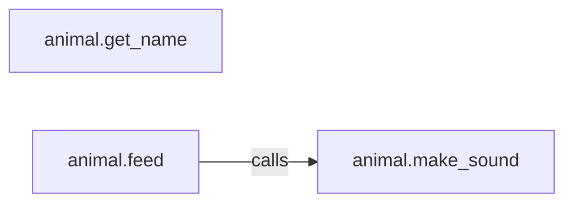
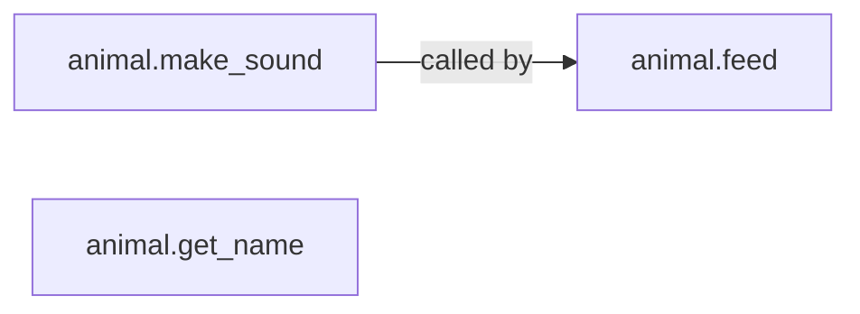
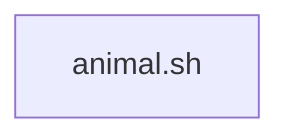
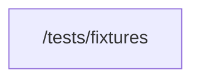

# Contract Graph

## Class Diagram

```mermaid
classDiagram
```

## Inheritance Diagram

```mermaid
classDiagram
```

## Collaboration Diagram

```mermaid
flowchart LR
```

## Call Graph



## Caller Graph



## Include Graph



## Directory Diagram


